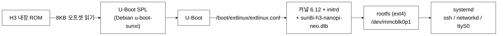

# E3-DP 최신 Debian OS 적용 방법 (PoC)

| 항목 | 내용 |
|---|---|
| 목적 | 하드웨어(NanoPi NEO) 변경 없이 **최신 공식 Debian 32비트(armhf)가 부팅되는지** 확인 |
| 범위 | OS 부팅까지만. **E3-DP 사용자 프로그램은 포함하지 않음** (이후 개발 사항) |
| 대상 OS | Debian 13 "Trixie" armhf, 커널 `6.12.111+deb13-armmp` |
| 작성일 | 2026-10-13 |
| 상태 | **이미지는 생성/정적 검증 완료. 실제 NEO 부팅은 아직 시험하지 않음** |

---

## 0. 배경

| 항목 | 내용 |
|---|---|
| 제품 | N-ELITE E3-DP (KT 납품). 하드웨어는 FriendlyELEC **NanoPi NEO**(Allwinner H3, 32비트 ARMv7, 512MB) |
| 현재 OS | Ubuntu 16.04.2 + 커널 3.4(2017년 빌드). **공식 지원 종료(EOL)** 상태이며 SBOM(소프트웨어 구성 목록) 보안 점검에서 지적 대상 |
| 선택한 방향 | 하드웨어는 유지하고 **공식 지원 중인 Debian 13 Trixie의 32비트(armhf) 버전**으로 전환. Debian 13 armhf는 2030-06까지 지원되고, 공식 커널 패키지에 NEO용 Device Tree가, Debian U-Boot에 NEO 항목이 이미 포함되어 있음 |
| 이 문서의 범위 | 전환 가능성의 첫 관문인 **"최신 Debian이 이 보드에서 부팅되는가"** 만 시험. 사용자 프로그램 동작은 시험 대상이 아니며 이후 개발 사항 |
| 현재 장비 특성(후속 개발 판단용) | 응용은 약 15개 서버 프로세스(C 소스 보유, libc 위주), 자체 커널 모듈 없음, 제조사 전용 라이브러리(`libfahw`)를 쓰는 프로세스(`wan_led`) 1개, USB 이더넷(eth1)과 NAT 사용 |

---

## 1. 결과물

| 파일 | 설명 |
|---|---|
| [poc/e3dp-poc-debian13-armhf.img](../poc/e3dp-poc-debian13-armhf.img) | microSD 기록용 이미지 (2GB) |
| [poc/e3dp-poc-debian13-armhf.img.sha256](../poc/e3dp-poc-debian13-armhf.img.sha256) | 무결성 확인용 해시 |
| [poc/build_poc.sh](../poc/build_poc.sh) | 이미지 재생성 스크립트 (WSL2 Ubuntu / Linux root 실행) |
| `os_old/E3DP_OS_20250901_V030112.img` | 현재 운영 중인 기존 OS 이미지 (**수정하지 않음**) |

**이미지 구성**

| 항목 | 내용 |
|---|---|
| 베이스 | Debian 13 Trixie armhf 최소 구성 + 시험용 점검 도구, 패키지 181개 (현 장비 582개) |
| 커널 | Debian 공식 `linux-image-armmp` 6.12.111, NEO용 `sun8i-h3-nanopi-neo.dtb` 포함 |
| 부트로더 | Debian 공식 `u-boot-sunxi`(nanopi_neo)의 `u-boot-sunxi-with-spl.bin`, microSD 8KB 위치 |
| 서비스 | OpenSSH(root 비밀번호 로그인 허용), systemd-networkd **DHCP 자동**(랜선 연결 시 IP 자동 획득), 시리얼 콘솔 ttyS0 115200(**비밀번호 없이 root 자동 로그인**) |
| 카드 용량 | **첫 부팅 때 루트 파티션을 카드 전체 크기로 자동 확장**(로그: `/var/log/expand-rootfs.log`) |
| 패키지 관리 | `apt`, `apt upgrade` 사용 가능(인터넷 필요). 저장소는 trixie, trixie-updates, trixie-security |
| 시험용 도구 | `gpiod`(gpioset 등), `i2c-tools`, `usbutils`, `ethtool`, `net-tools`, `tcpdump`, `strace`, `curl` |
| 호스트명 | `E3-DP-POC` |
| 계정 | root / `poc-e3dp` (**PoC 전용. 시험 후 변경하거나 이미지를 폐기**) |
| 시간대 | Asia/Seoul |

---

## 2. 부팅 구조

H3는 전원이 켜지면 내장 ROM이 microSD 8KB 위치의 U-Boot(SPL)를 읽습니다. 따라서 **U-Boot, 커널, 루트 파일시스템이 모두 microSD 한 장에 들어가며**, 카드를 바꿔 꽂으면 기존 OS로 즉시 되돌릴 수 있습니다.



**microSD 레이아웃**

| 위치 | 내용 |
|---|---|
| 0 ~ 8KB | 파티션 테이블(MBR) 영역 |
| 8KB ~ 1MB | U-Boot (SPL 포함) |
| 파티션 1 (1MiB ~ 끝, ext4) | `/boot`(커널, initrd, extlinux), 루트 파일시스템 |

---

## 3. 정적 검증 결과 (PC에서 확인)

| 항목 | 결과 |
|---|---|
| 파티션 테이블 | 정상 (dos, 파티션 1 부팅 플래그) |
| 8KB 위치 | `eGON.BT0` / `SPL` 헤더 확인 (H3 ROM이 읽는 형식) |
| ext4 파일시스템 | `e2fsck` 정상 |
| extlinux 설정 | 커널/initrd/dtb 경로가 실제 파일과 일치 |
| **NEO 실장비 부팅** | **미확인** |

---

## 4. 시험 절차

### 4.1 준비물

| 준비물 | 용도 | 비고 |
|---|---|---|
| **개발용 NanoPi NEO** | 시험 대상 | **양산 장비의 NEO를 쓰지 말 것** |
| microSD 카드 (4GB 이상) | OS 이미지 | 기존 카드와 분리 |
| **USB-TTL 케이블 (3.3V)** | 부팅 로그 확인 | 부팅 실패 원인 분석에 사실상 필수. NEO UART0(GND/TX/RX)에 연결, 핀 위치는 [NEO 위키](https://wiki.friendlyelec.com/wiki/index.php/NanoPi_NEO) 확인 |
| 5V/2A 전원 + micro-USB | 전원 | PC USB 전원은 전류 부족 가능 |
| 이더넷 + DHCP 공유기 | SSH 접속 | 시리얼이 없을 때 필요 |

> micro-USB 포트는 전원 입력과 OTG용이며 **콘솔이 나오지 않습니다.** 포트를 떼어내거나 개조하지 마십시오.

### 4.2 microSD에 기록

1. 해시를 확인합니다.
   ```powershell
   Get-FileHash .\poc\e3dp-poc-debian13-armhf.img -Algorithm SHA256
   ```
   `.sha256` 파일 값과 같아야 합니다.
2. balenaEtcher 또는 Win32DiskImager로 `e3dp-poc-debian13-armhf.img`를 microSD에 기록합니다.
   **대상 드라이브를 잘못 선택하면 다른 디스크의 데이터가 지워지므로 반드시 카드 리더 드라이브인지 확인하십시오.**

### 4.3 부팅과 확인

1. 시리얼 케이블을 연결하고 터미널(115200, 8N1)을 엽니다.
2. 이더넷을 연결하고 microSD를 NEO에 꽂은 뒤 전원을 켭니다.
3. 시리얼 로그에서 U-Boot → 커널 → 로그인 프롬프트까지 진행되는지 확인합니다.
4. 로그인(root / `poc-e3dp`) 후 다음을 확인합니다.
   ```
   cat /etc/os-release       # Debian GNU/Linux 13 (trixie)
   uname -r                  # 6.12.111+deb13-armmp
   uname -m                  # armv7l
   free -m
   ip -br addr               # DHCP IP 확인
   ```
5. 시리얼이 없으면 공유기의 DHCP 목록에서 `E3-DP-POC`를 찾아 `ssh root@<IP>`로 접속합니다.

### 4.4 판정 기준

| 단계 | 성공 기준 |
|---|---|
| 1. U-Boot | 시리얼에 U-Boot 배너가 출력됨 |
| 2. 커널 | 커널 부팅 로그 출력, Device Tree 인식 |
| 3. 루트 마운트 | `/dev/mmcblk0p1` 마운트, systemd 기동 |
| 4. 네트워크 | DHCP로 IP 획득, SSH 접속 |
| **최종** | `os-release`가 Debian 13이고 `uname -m`이 `armv7l` |

---

## 5. 부팅이 안 될 때

메인라인 커널은 버전에 따라 H3 보드에서 부팅 중 멈춘 사례가 있습니다(예: [Armbian 포럼 사례](https://forum.armbian.com/topic/28593-nanopi-neo-hangs-on-boot-bookworm-2351/)). **시리얼 로그가 있어야 원인을 좁힐 수 있습니다.**

| 멈춘 위치 | 의심 원인 | 조치 |
|---|---|---|
| 아무 출력 없음 | 카드 기록 실패, U-Boot 오프셋, 전원 부족 | 카드 재기록, 전원 교체, 다른 카드로 시험 |
| U-Boot에서 정지 | extlinux 인식 실패 | `ls mmc 0:1 /boot/extlinux`로 확인 후 설정 수정 |
| 커널 시작 직후 정지 | 커널/dtb 문제 | 다른 커널 버전 또는 `-lpae` 변형 시험 |
| 루트 마운트 실패 | initrd/루트 장치명 | `root=` 인자 확인 |
| 부팅은 되나 네트워크 불가 | 인터페이스 이름/DHCP | `ip -br link`로 이름 확인, `20-wired.network` 매칭 조정 |

실패 시 **시리얼 로그 전체**를 전달하면 원인 분석과 이미지 수정을 이어갈 수 있습니다.

---

## 6. 이미지 재생성 방법

### 6.1 자동 (권장)

WSL2 Ubuntu 또는 Linux에서 root로 실행합니다. 인터넷(Debian 미러 접속)이 필요합니다.

```bash
sudo bash poc/build_poc.sh
# 환경변수: OUT(출력 폴더), IMG_SIZE_MB(기본 2048), ROOT_PW(기본 poc-e3dp)
```

내부 단계는 다음과 같습니다.

1. `debootstrap --arch=armhf --foreign trixie` (qemu-user-static으로 armhf 실행)
2. chroot에서 `linux-image-armmp`, `u-boot-sunxi`, `openssh-server`, `systemd-resolved` 등 설치
3. 네트워크(DHCP), SSH, 비밀번호, `extlinux.conf` 설정
4. 빈 이미지 파일에 파티션 생성, `mkfs.ext4 -d`로 rootfs 채움
5. `u-boot-sunxi-with-spl.bin`을 8KB 위치에 `dd`

### 6.2 수동 (핵심 명령)

```bash
sudo apt install debootstrap qemu-user-static binfmt-support
sudo debootstrap --arch=armhf --foreign --variant=minbase trixie ./rootfs http://deb.debian.org/debian
sudo cp /usr/bin/qemu-arm-static ./rootfs/usr/bin/
sudo chroot ./rootfs /debootstrap/debootstrap --second-stage
# chroot 안에서: apt install linux-image-armmp u-boot-sunxi initramfs-tools openssh-server ...
# U-Boot 기록 (카드 /dev/sdX 가정):
sudo dd if=./rootfs/usr/lib/u-boot/nanopi_neo/u-boot-sunxi-with-spl.bin of=/dev/sdX bs=1k seek=8
```

---

## 7. 부팅 성공 이후 작업 (개발 사항)

PoC에서 OS 부팅이 확인되면 아래가 후속 개발입니다. 전체 개발기간은 개발자 1명 기준 약 2~3개월(최선 8주, 불확실 요소 반영 시 4개월 이내)로 **추정**합니다(PoC와 시험 단계 포함).

| 순서 | 작업 | 비고 |
|---|---|---|
| 1 | 루트 파티션 확장 | 이미지는 2GB로 만들어졌고, 첫 부팅 때 카드 전체 크기로 자동 확장됨(`df -h /`로 확인) |
| 2 | 기존 `/opt/e3dp/bin` 바이너리 실행 시험 | libc 위주라 그대로 실행될 가능성. 확인 필요 |
| 3 | 소스 재빌드 | `/home/e3dp/e3dp.2.1/src` (Makefile 보유) |
| 4 | `wan_led` / `libfahw` 대체 | libgpiod 등으로 GPIO 제어 재작성 |
| 5 | USB 이더넷(eth1) 활성화 | NEO USB 호스트 포트 Device Tree 확인, `asix` 드라이버는 표준 |
| 6 | 네트워크/NAT 이전 | 192.168.123.0/24 → eth0 MASQUERADE, `ip_forward` 설정 |
| 7 | 시리얼/I2C/SPI/RTC/워치독 대응 | 앱의 실제 사용 범위 확인 후 dtb 설정 |
| 8 | 보안 정리 | telnet/FTP 제거, SSH 키 인증, 불필요 서비스 제거 |
| 9 | SBOM/VEX 생성 | syft 등으로 SBOM, 필요 시 VEX |
| 10 | 장기 가동 시험, 롤백 절차 | microSD 교체 방식 |

**후속 확인을 위해 현재 장비에서 수집할 명령**

```bash
# 프로세스별 열린 장치 파일
for p in $(pgrep -f /opt/e3dp/bin); do echo "== $p $(readlink /proc/$p/exe)"; ls -l /proc/$p/fd | grep -E "/dev/|/sys/"; done
# 소스에서 HW 접근 부분
grep -rnE "/dev/|/sys/class|ioctl|fahw|gpio" /home/e3dp/e3dp.2.1/src --include=*.c | head -100
# GPIO 상태, 시리얼, 인터럽트
for g in 1 2 3 6 198 199 200 201; do echo gpio$g $(cat /sys/class/gpio/gpio$g/direction) $(cat /sys/class/gpio/gpio$g/value); done
cat /proc/tty/driver/serial; cat /proc/interrupts
```

---

## 8. 주의 사항

- 이 이미지는 **PoC 전용**입니다. root 비밀번호가 문서에 적혀 있고 SSH root 로그인이 허용되어 있으므로 **운영망에 연결하지 마십시오.**
- **양산 장비의 NEO와 기존 microSD는 건드리지 마십시오.** 기존 카드는 보관하고 새 카드로만 시험합니다.
- 두 보드의 전원을 동시에 연결하거나, 베이스보드에 꽂힌 상태에서 별도 전원을 연결하지 않는다(전원 역류 위험).
- 가능 여부 판단은 PoC 결과에 따릅니다. **현재까지는 "공식 구성 요소가 모두 존재함"을 확인한 단계**이며, 부팅 성공은 시험 후 확정됩니다.
