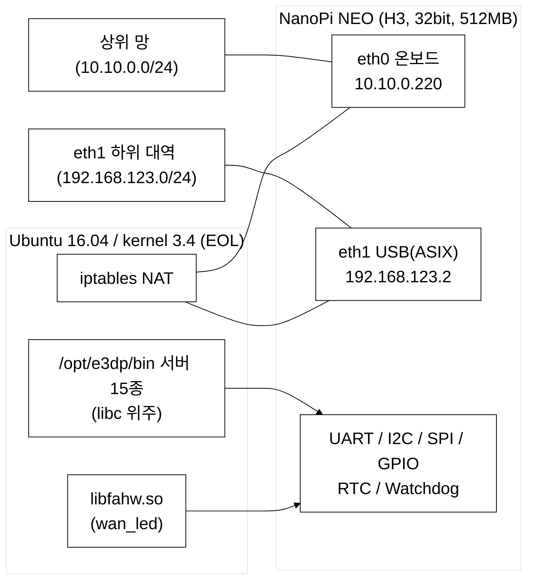
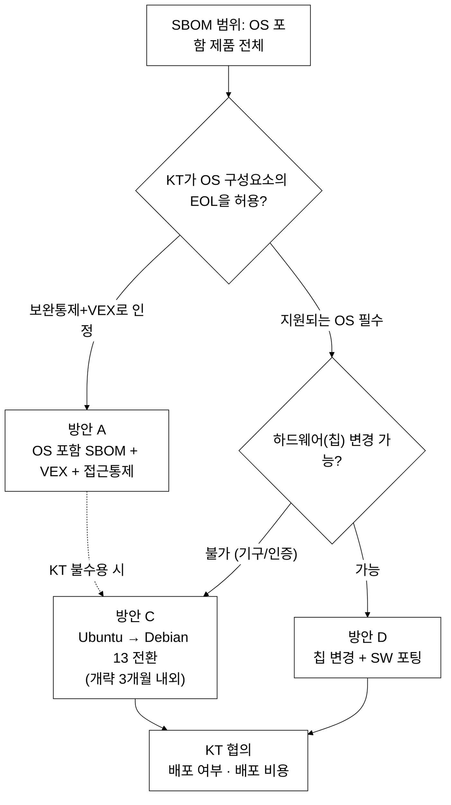

# E3-DP OS SBOM 검토 보고서

| 항목 | 내용 |
|---|---|
| 대상 | N-ELITE E3-DP (Version 03.01.14, 2025-12-05 갱신) |
| 작성일 | 2026-10-13 |
| 작성자 | 김명환 |
| 조사 방법 | ① **E3-DP 장비**(당사 제품)에 SSH로 접속해 OS·하드웨어·프로세스·패키지 정보를 명령어로 수집(2026-10-13, 이하 "장비 조사") ② 보드 제조사(FriendlyELEC)·배포판 공식 문서 조사 |
| 표기 | **[확인]** 장비 조사나 공식 문서로 확인한 사실 / **[추정]** 근거에 기반한 판단 / **[미확인]** 추가 확인 필요 |

### 용어

| 용어 | 설명 |
|---|---|
| SBOM | Software Bill of Materials. 제품에 들어 있는 소프트웨어 구성요소(패키지, 버전)의 목록. SPDX, CycloneDX 형식을 주로 사용 |
| EOL / ESM | End of Life(공식 지원 종료) / Expanded Security Maintenance(Ubuntu의 유료 확장 보안 유지보수) |
| VEX | Vulnerability Exploitability eXchange. "이 취약점은 우리 제품 환경에서 악용할 수 없다"는 소명 문서 |
| armhf | 32비트 ARM(ARMv7, hard-float) 아키텍처. 64비트 ARM은 arm64 |
| BSP | Board Support Package. 칩 제조사(Allwinner)가 자사 칩용으로 개조해 배포하는 커널·드라이버 묶음 |
| 메인라인 커널 | kernel.org의 공식 리눅스 커널. 칩 제조사의 개별 개조 커널(BSP)과 구분됨 |
| Canonical | Ubuntu를 개발·배포하는 회사. 이 보고서에서는 "Ubuntu 개발사"로 표기 |

---

## 1. 요약

1. E3-DP는 **Ubuntu 16.04 / 커널 3.4 (NanoPi NEO, 32비트)** 에서 동작하고 있으며, 이 OS는 **공식 지원이 종료**되었습니다. **[확인]**
2. 현재 KT에는 OS를 제외한 자체 개발 소스만을 대상으로 SBOM을 제공했으며 해당 범위에서는 보안 취약점이 없습니다. 그러나 SBOM의 취지상 대상은 OS를 포함한 제품 전체이므로, OS 구성요소의 지원 종료가 과제로 남습니다.
3. 보드 제조사(FriendlyELEC)와 Ubuntu 개발사(Canonical) 어느 쪽에서도 현재 구성에 대한 **공식 보안 패치 경로가 없습니다.** Ubuntu 16.04의 유료 연장(ESM, Legacy add-on, 2031-04까지)은 Ubuntu 개발사의 공식 안내상 **64비트 x86(amd64)이 대상이며 32비트 ARM(armhf)은 포함되지 않습니다.** **[확인]**
4. **현재 하드웨어(32비트 H3)를 유지한다면 Ubuntu를 포기하고 Debian OS로 전환해야 합니다.** Debian 13은 32비트 ARM(armhf) 버전을 공식 배포하고 있으며(보안 업데이트 2030-06까지) **[확인]**, 이 하드웨어와의 호환 가능성이 높습니다. **[추정]** 단 칩셋사의 지원이 아니라 Debian 프로젝트의 배포판입니다.
5. 대응 방향은 두 가지입니다.
   - **(A) KT와 업무 협의**: OS 포함 SBOM 범위와 EOL OS 허용 여부, 보완통제 인정 범위를 협의합니다.
   - **(B) Ubuntu → Debian 13 전환(신규 개발)**: 하드웨어 변경 없이 Debian이 공식 배포하는 OS로 전환합니다. 업무 지시 이후 진행하며, 개략 **3개월 내외** 소요될 것으로 **추정**됩니다. OS 변경 이후에도 현장 장비에 적용하는 **배포 여부와 배포 비용 등은 KT와 협의가 필요**합니다.
6. Debian 전환은 칩셋사(Allwinner)가 제공하는 OS가 아니므로 **실패 가능성이 있습니다.** 다만 포팅 장벽이 낮은 편이어서 기술적 가능성은 높게 판단됩니다. **[추정]** 근거는 응용 소스코드 보유, 응용의 외부 라이브러리 의존이 거의 없음(C 표준 라이브러리 위주), 로드된 커널 모듈이 표준 USB 이더넷 드라이버 하나뿐이라는 점입니다. **[확인]**

---

## 2. 현재 상태

### 2.1 하드웨어

| 항목 | 내용 | 확인 방법 |
|---|---|---|
| 보드 | FriendlyELEC **NanoPi NEO** | 보드 릴리스 파일(`BOARD="NanoPi-NEO"`) |
| SoC | Allwinner **H3 (sun8i)**, Cortex-A7 4코어, 최대 1.2GHz, **ARMv7 32비트** | `lscpu`, `/proc/cpuinfo` |
| 메모리 | 512MB DDR3 (총 494MB 인식, 사용 32MB) | `free -m` |
| 저장장치 | microSD 30GB (사용 2.4GB), `/boot` 40MB | `df -h` |
| 네트워크 | eth0: 온보드 이더넷 (10.10.0.220), **eth1: USB 이더넷(ASIX AX88772B)** (192.168.123.2) | `ip addr`, `lsusb` |
| 주변장치 노드 | UART `ttyS1~3`, I2C `i2c-0/2`, SPI `spidev0.0`, RTC, 워치독 | `/dev` 목록 |
| GPIO | `gpio1, 2, 3, 6, 198~201`이 사용자 영역에 노출됨. 소스상 용도는 이더넷 스위치(IP175)·USB 이더넷(ASIX) 리셋, 상태 LED 등 | `/sys/class/gpio`, `wan_led` 소스 |

### 2.2 소프트웨어

| 항목 | 내용 |
|---|---|
| OS | Ubuntu 16.04.2 LTS (Xenial), FriendlyELEC 빌드 |
| 커널 | **3.4.39-h3** (2017-03 빌드, Allwinner 레거시 BSP) |
| 부팅 방식 | Android식 `boot.img` 방식. 현대 리눅스 표준인 Device Tree(`.dtb`) 파일이 없음 |
| 패키지 | **582개** (GTK, Mir, CUPS, ModemManager, BlueZ, hostapd 등 서비스에 불필요한 항목이 다수) |
| 응용 | `/opt/e3dp/bin`의 서버 프로세스 약 15개 (alarm, db, control, gather, gw, modbus, rt, scan, acon_agent 등) |
| 응용 의존성 | 대부분 **C 표준 라이브러리(libc)만 사용**, `rt_server`는 libpthread 추가, **`wan_led`는 `libfahw.so`(FriendlyELEC 전용 하드웨어 라이브러리)를 사용** |
| 커널 모듈 | 로드된 것은 `asix`, `usbnet`뿐 |
| 소스코드 | `/home/e3dp/e3dp.2.1/src`에 C 소스와 Makefile 보유 |
| 네트워크 구성 | NetworkManager, `rc.local`의 iptables MASQUERADE(192.168.123.0/24 → eth0, NAT 역할) |

---

## 3. 공식 지원 상태

### 3.1 지원 현황

| 대상 | 상태 | 내용 | 출처 |
|---|---|---|---|
| **Ubuntu 16.04** | 표준 ESM **종료** | 2026-04-30에 10년 ESM 종료. 이후 유료 Legacy add-on으로 2031-04까지 연장 가능(단 아래 아키텍처 제한) | [Ubuntu 개발사 공지](https://canonical.com/blog/ubuntu-16-04-lts-has-reached-the-end-of-standard-expanded-security-maintenance-with-ubuntu-pro-here-are-your-options) |
| Ubuntu 16.04 유료 연장의 **지원 아키텍처** | **armhf 제외** | Ubuntu 개발사의 16.04 안내: "ESM for Ubuntu 16.04 LTS includes support for amd64 (AMD/Intel kernels)", "During the Legacy period, Canonical provides security maintenance for binary packages ... for 64-bit x86 AMD/Intel architectures." ESM 안내 페이지에서도 16.04는 amd64, s390x만 표기 | [Ubuntu 16.04 안내](https://ubuntu.com/16-04), [Ubuntu ESM](https://ubuntu.com/security/esm) |
| 커널 3.4 (E3-DP 사용 중) | **종료** | 3.4 계열은 리눅스 공식 배포가 2016-10(3.4.113)을 마지막으로 종료됨. E3-DP는 칩셋사(Allwinner)의 레거시 커널(BSP)을 보드 제조사(FriendlyELEC)가 보드용으로 빌드한 3.4.39-h3(2017-03 빌드)를 사용하며, 이후 갱신이 확인되지 않음 | E3-DP 장비의 커널 버전 확인, [3.4.113 릴리스 태그](https://gitlab.com/Newbyte/linux/-/tags/v3.4.113) |
| Ubuntu 최신 LTS (24.04) | 32비트 ARM 장기 지원은 있으나 **이 보드용 지원은 확인되지 않음** | Ubuntu 개발사는 24.04 LTS부터 32비트 ARM 12년 지원(5년 무료, 이후 Ubuntu Pro 유료 연장)을 제공. 그러나 FriendlyELEC의 NEO 이미지 목록에 24.04가 없고, Ubuntu 24.04 armhf 패키지에는 NEO용 Device Tree가 없음(Debian 13에는 있음) | [Ubuntu 개발사 블로그(2025-01-20)](https://ubuntu.com/blog/lts-cra-arm), [FriendlyELEC Wiki: NanoPi NEO](https://wiki.friendlyelec.com/wiki/index.php/NanoPi_NEO), [Ubuntu 패키지 검색](https://packages.ubuntu.com/search?searchon=contents&keywords=sun8i-h3-nanopi-neo.dtb&mode=exactfilename&suite=noble&arch=armhf) |
| **Debian 13 Trixie (armhf)** | **공식 배포 중** | Debian이 armhf를 공식 아키텍처로 배포. 보안 업데이트는 일반 2028-08-09, LTS 2030-06-30까지(칩셋사 지원이 아닌 Debian 프로젝트 배포판) | [Debian](https://www.debian.org/releases/trixie/) |
| Debian 커널의 NEO 지원 | 포함 | Debian 공식 커널 패키지(6.12)에 NEO용 Device Tree(`sun8i-h3-nanopi-neo.dtb`)가 들어 있음 | [Debian 패키지 검색](https://packages.debian.org/search?searchon=contents&keywords=sun8i-h3-nanopi-neo.dtb&mode=exactfilename&suite=trixie&arch=armhf) |
| Debian U-Boot의 NEO 지원 | 포함 | Debian 위키에 NanoPi NEO의 microSD 부팅이 정상(`cavok`)으로 표기 | [Debian U-boot Status](https://wiki.debian.org/U-boot/Status) |

### 3.2 요약 및 확인사항

- 현재 구성(Ubuntu 16.04 + 커널 3.4)에 대해 **공식 지원을 받을 수 있는 경로는 확인되지 않았습니다.** Ubuntu 유료 연장도 이 장비(32비트 ARM)에는 적용되지 않습니다.
- **현재 하드웨어를 유지한다면 Debian 13 armhf가 대안입니다.** Debian이 공식 배포하는 OS이며 이 하드웨어와 호환될 가능성이 높습니다(칩셋사의 지원은 아님). Trixie에서 퇴출되는 것은 armel(구형 32비트 ARM)이며 armhf는 해당하지 않습니다. ([Trixie 릴리스 노트](https://www.debian.org/releases/trixie/release-notes/issues.en.html))

---

## 4. SBOM을 만족하기 위한 방법

### 4.1 SBOM 제출 현황과 범위

- 현재 KT에는 OS를 제외한 **자체 개발 소스만을 대상으로 한 SBOM**을 제공했으며, 해당 범위에서는 보안 취약점이 없습니다.
- SBOM의 취지상 대상은 **OS를 포함한 제품 전체**입니다. OS(커널과 패키지 582개)까지 포함하면 EOL 구성요소와 알려진 취약점이 그대로 드러납니다.
- 따라서 OS 구성요소에 대해 보안 업데이트를 받을 수 있는 체계를 갖추는 것이 과제입니다.

### 4.2 방안 비교

| 방안 | 내용 | 장점 | 한계 / 확인 필요 |
|---|---|---|---|
| **A. 현 상태 유지 + 보완통제 + VEX** | OS 포함 SBOM 생성, 폐쇄망·접근통제 근거 제시, VEX로 영향 없음 소명 | 개발 없음 | OS 구성요소의 EOL과 취약점이 그대로 남음. 커널·glibc 같은 핵심 구성요소는 "실행 경로에 없음" 소명이 어려움 |
| **B. Ubuntu 개발사의 유료 유지보수 (Ubuntu Pro)** | Ubuntu 개발사의 유료 보안 유지보수 | 해당 없음 | **적용 불가.** 이 장비의 칩셋(32비트 ARM)은 지원 대상이 아님(3.1절 참조) |
| **C. Debian 13 armhf 전환** | 하드웨어 유지, Debian 공식 배포 OS로 전환 | Debian 보안 업데이트 제공(2030-06까지), 패키지 대폭 감소, 커널 6.12 | 개략 3개월 내외 개발, **칩셋사 제공이 아니므로 실패 가능성 존재**, OS 이미지 구성과 호환 대응 책임이 당사로 이동 |
| D. 칩(보드) 변경 | 64비트 SoC 보드(NanoPi NEO3 등)로 변경 | 칩셋사·배포판의 장기 지원을 받는 보드로 전환 가능 | **NEO3는 48×48mm, 26핀 헤더 1개로 기구 호환이 아님**(NEO는 40×40mm, 24핀+12핀 헤더). **SW 재빌드·검증이 그대로 필요.** 하드웨어 설계·시험·인증 추가 |

### 4.3 유지보수 책임 범위

향후 안정적인 공식 지원을 받으려면 칩(보드) 변경이 근본적인 방법이며, 현재 칩을 유지하면 지속적인 개발자 유지보수가 필요합니다.

| 구분 | 칩셋사·배포판이 지원하는 칩 | Debian + 현재 칩(Allwinner H3) |
|---|---|---|
| OS·커널 보안 패치 | 배포판이 제공 | Debian 13 지원 기간(2030-06까지)에는 Debian이 제공 |
| 칩 드라이버·커널 호환 | 칩셋사·배포판이 대응 | 칩셋사 제공이 아님. H3 지원은 오픈소스 커뮤니티(메인라인 커널)가 유지하며, 향후 커널·드라이버 호환성이 떨어지면 **자사가 직접 대응** |
| 자사 응용 SW | 자사 | 자사 |
| OS 이미지 구성·빌드·업데이트 | 표준 절차 | 자사가 구성·유지 |

### 4.4 의사결정 흐름

### 4.5 검토 결과

- Debian 전환은 칩셋사의 지원이 아니므로 **실패 가능성은 있습니다.** 다만 소스 보유, libc 위주 의존, 로드된 커널 모듈이 표준 드라이버 하나뿐이라는 점, Debian 배포 커널·U-Boot에 NEO 지원이 포함되어 있다는 점에서 기술적 가능성이 높게 판단되며, 개발 리소스를 투입해 시도할 가치가 있다고 봅니다. **[추정]**
- OS를 변경한 이후에도 **KT와의 협의는 필요**합니다. 현장 장비에 적용하는 배포 여부와 배포 비용 등이 협의 대상입니다.
- 개발 리소스 투입과 칩 변경 사이의 **비용 비교가 필요**합니다.

| 구분 | Debian 전환 (현재 칩 유지) | 칩 변경 (64비트 보드) |
|---|---|---|
| 필요 비용 | 개발 인력(개략 3개월 내외) | 개발 인력(SW 재빌드·검증) **+ 보드/베이스보드 설계, 시험, 인증, 재고·양산 전환** |
| 하드웨어 변경 | 없음 | 있음 (NEO3는 기구 호환 아님) |
| 장기 지원 | Debian 13 기준 2030-06까지, 이후 재전환 필요 | 더 오래 유지 가능 |
| 비고 | 기존 OS에서 Debian 최신 OS 적용에 따른 포팅 필요 | 비용은 인건비 단가와 하드웨어 설계·인증 비용 산정이 필요 |

---

## 5. Debian 전환 개발 검토 (방안 C)

### 5.1 포팅 난이도 (장비 조사 기반)

| 항목 | 평가 | 근거 |
|---|---|---|
| 소스코드 | 낮음 | 장비에 C 소스와 Makefile 보유 |
| 외부 라이브러리 | 낮음 | 서버 대부분이 libc만 사용 (OpenSSL 등 직접 링크 없음) |
| ABI 호환 | 낮음 | 바이너리가 ARM EABI5 hard-float로 Debian armhf와 동일. 기존 바이너리가 그대로 실행될 가능성 |
| 커널 모듈 | 낮음 | 로드된 모듈은 `asix`, `usbnet`(메인라인 표준 드라이버)뿐 |
| **`wan_led` / `libfahw`** | **중** | 하드웨어 접근은 이 프로세스(`wan_led`)가 FriendlyELEC 전용 라이브러리로 GPIO 7개(스위치·USB 이더넷 리셋, LED 등)를 제어하는 부분. 호출부를 표준 인터페이스(libgpiod 등)로 대체해야 함 |
| GPIO 핀 매핑 | 중 | 소스의 GPIO 번호와 실제 SoC 핀의 대응은 회로도·핀맵 확인 필요. 리셋 신호는 부팅 시 Debian에서도 같은 상태로 설정해야 네트워크가 동작할 수 있음 |
| USB 이더넷 (eth1) | 낮음~중 | 드라이버는 표준. NEO의 USB 호스트 포트를 Device Tree에서 활성화해야 함 |
| UART/I2C/SPI/RTC/워치독 | 낮음 | 실행 중인 프로세스가 장치 파일을 열고 있지 않고, 응용 소스(.c, .h 검색)에도 시리얼·I2C·SPI·RTC·하드웨어 워치독 접근이 없음(`proc_watchdog`는 프로세스 감시용 소프트웨어) |
| 연결 주변기기 | 확인 필요 | 설치 국사별 연결 주변기기는 장비 호환성 검토 필요 |
| 네트워크 / NAT | 낮음 | NetworkManager → systemd-networkd 전환, iptables 규칙 이전 |
| 부팅 | 중 | `boot.img` 방식 → U-Boot + extlinux + Device Tree 방식 |

### 5.2 예상 개발기간

업무 지시 이후 진행하며, 현재까지의 조사를 기반으로 **개략 3개월 내외**가 소요될 것으로 추정합니다. **[추정]** 세부 일정은 착수 후 수립합니다.

---

## 6. KT 업무 협의 항목

현장 접근이 폐쇄망(접근 IP 통제)이고 SSH 로그인만 가능해 패킷 캡처 같은 분석이 불가능한 구조이므로, 다음 항목은 KT와 협의가 필요합니다.

1. **SBOM 범위와 요구 수준**: OS 포함 여부, 형식(SPDX/CycloneDX), 허용 취약점 기준, EOL OS 허용 여부, VEX와 보완통제의 인정 범위
2. **OS 교체 승인**: Debian 13 전환 시 재인증·재시험 범위와 일정
3. **배포 여부와 배포 비용**: OS 변경 후 현장 장비 적용 여부, 대상 수량, 배포 비용의 부담 주체
4. **시험 환경**: 별도 시험 장비와 접속 방법, 로그 확보 방식(패킷 캡처 불가에 따른 대체 수단)
5. **현장 배포 방식**: OS 교체는 원격 업데이트가 불가능하여 microSD 교체가 필요하며, 이에 따른 현장 작업 방식과 롤백 절차
6. **사후 패치 책임**: 전환 후 보안 패치의 주체와 주기

---

## 7. 확인 필요 사항

| 항목 | 방법 |
|---|---|
| KT의 OS 포함 SBOM 요구 범위와 허용 기준 | KT 문서·담당자 확인 |
| 장비 호환성 | DP가 설치된 국사별 연결 주변기기에 대한 호환성 검토 필요 |
| 칩 변경 시 하드웨어 비용 | 보드 설계·시험·인증 비용 산정 |

---

## 참고 자료

- [Ubuntu 16.04 ESM 종료와 옵션 (Ubuntu 개발사)](https://canonical.com/blog/ubuntu-16-04-lts-has-reached-the-end-of-standard-expanded-security-maintenance-with-ubuntu-pro-here-are-your-options)
- [Ubuntu 16.04 LTS 지원 안내 (Ubuntu 개발사)](https://ubuntu.com/16-04)
- [Ubuntu Expanded Security Maintenance (Ubuntu 개발사)](https://ubuntu.com/security/esm)
- [Debian 13 Trixie 릴리스 정보](https://www.debian.org/releases/trixie/)
- [Debian 13 릴리스 노트 (armel/i386)](https://www.debian.org/releases/trixie/release-notes/issues.en.html)
- [Debian U-boot Status (NanoPi NEO)](https://wiki.debian.org/U-boot/Status)
- [Debian 패키지: sun8i-h3-nanopi-neo.dtb](https://packages.debian.org/search?searchon=contents&keywords=sun8i-h3-nanopi-neo.dtb&mode=exactfilename&suite=trixie&arch=armhf)
- [Bringing 12-year LTS to 32-bit Arm processors (Ubuntu 개발사, 2025-01-20)](https://ubuntu.com/blog/lts-cra-arm)
- [FriendlyELEC Wiki: NanoPi NEO](https://wiki.friendlyelec.com/wiki/index.php/NanoPi_NEO) / [NEO3](https://wiki.friendlyelec.com/wiki/index.php/NanoPi_NEO3)
- [Ubuntu 패키지 검색: sun8i-h3-nanopi-neo.dtb (24.04 armhf)](https://packages.ubuntu.com/search?searchon=contents&keywords=sun8i-h3-nanopi-neo.dtb&mode=exactfilename&suite=noble&arch=armhf)
