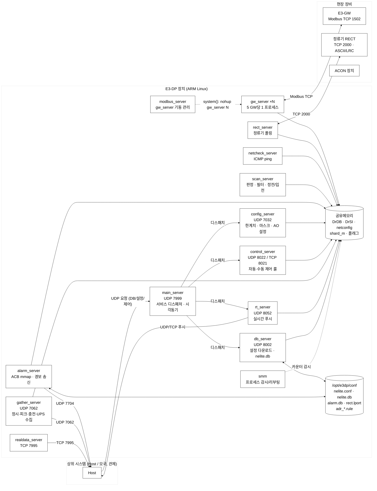
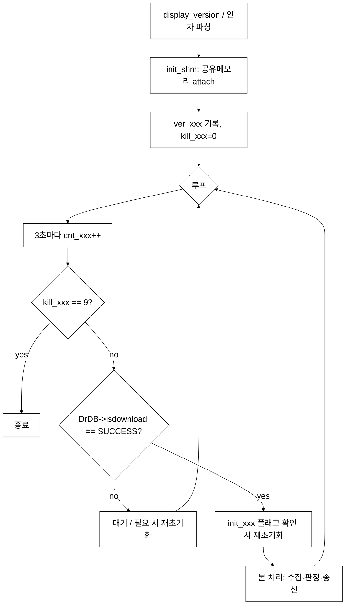
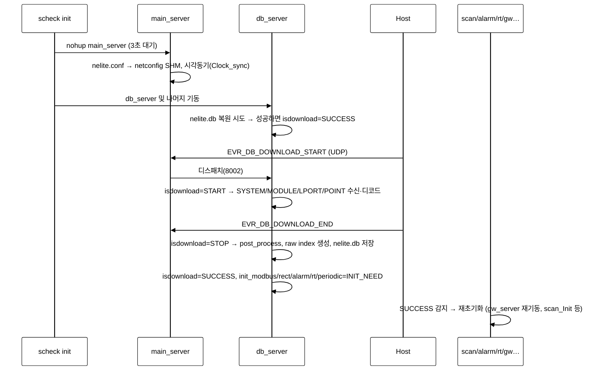
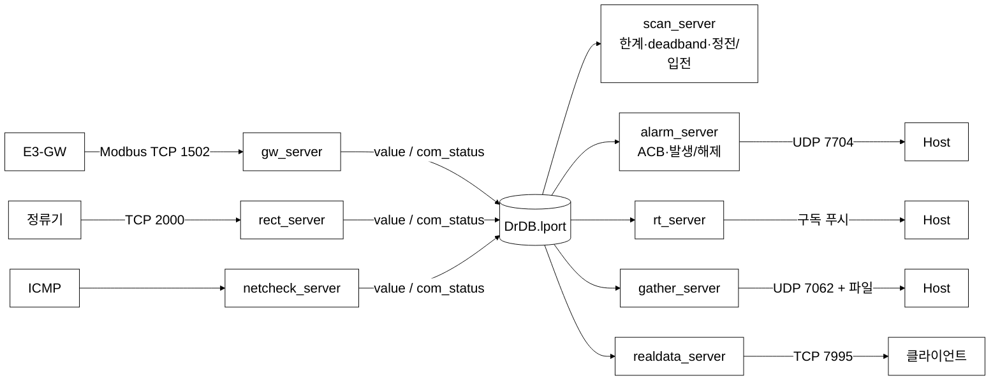
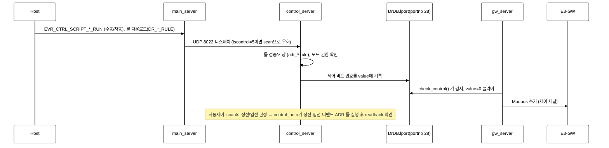
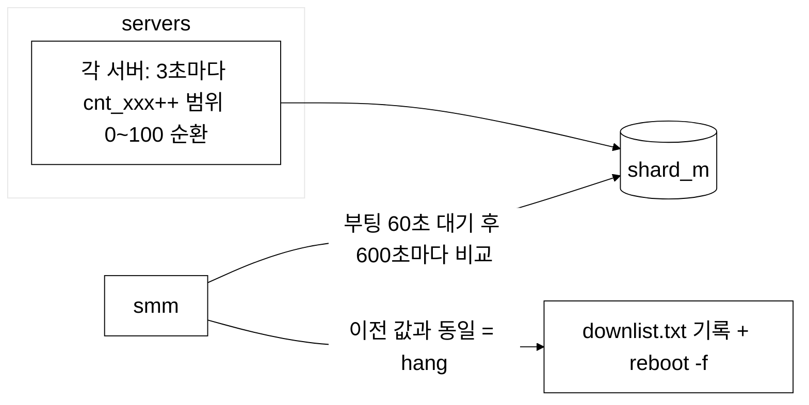

# E3-DP (e3dp.2.1) 소스 아키텍처 문서

- 대상 소스: `C:\ges\project\08_dp\e3dp\e3dp.2.1`
- 작성 방식: 소스·Makefile·헤더를 단계적으로 읽고 정리 (README 대부분이 빈 템플릿이라 **코드에서 역으로 추론**한 내용이다)
- 표기: 확인된 사실은 파일 경로를 병기했고, 코드로 확정하지 못한 부분은 "추정"으로 표시했다.

---

## 1. 한눈에 보는 요약

E3-DP는 **N-ELITE 계열 전력/설비 감시 시스템의 현장 데이터 처리 장치(DP)** 이다. 현장의 **E3-GW(Modbus TCP 게이트웨이)** 와 **정류기(RECT, 동아 프로토콜)** 에서 계측·접점 값을 수집해 판정(경보)·제어·정시수집을 수행하고, 상위(Host/모국)와 UDP/TCP로 연동한다.

| 항목 | 내용 |
|---|---|
| 언어/플랫폼 | C (gcc), 32-bit ARM(EABI5, armhf) 리눅스 – `bin/*` ELF 확인. DPTester가 `libfahw.h`(FriendlyARM)를 쓰므로 NanoPi류 보드로 추정 |
| 구조 | **멀티 프로세스 데몬 군(약 13개) + System V 공유메모리 + UDP/TCP 소켓** |
| 핵심 설계 | 설정/계측 DB(`DrDB`, `DrSI`)를 **공유메모리에 올려놓고 모든 서버가 직접 읽고 쓴다.** 서버 간 메시지는 최소한(주로 Host→서버 요청 중계) |
| 배포 경로 | `/opt/e3dp/{bin,conf,periodic,download,log}` |
| 코드 규모 | 활성 소스 약 3만 줄, 과거 백업 디렉터리(날짜 접미사)가 섞여 있어 전체 5만 줄 이상 |
| 버전 | `make/platform.tools` VER 02.01.00(2022-06-22), `dp_tar` 기본 릴리스 3.01.05 이상 (태그: `V030112` 등) |

---

## 2. 저장소 구성 (디렉터리 지도)

```
e3dp.2.1/
├─ Makefile              최상위 빌드 (lib → src 순서)
├─ make/platform.tools   공통 빌드 변수 (HOME_DIR, CFLAGS, BIN_DIR, OPT_DIR)
├─ dp_tar                릴리스 스크립트 (버전 입력 → VERSION/LAST_UPDATED 기록 → /opt/e3dp/bin tar)
├─ include/              공통 헤더 (자료구조·포트·서비스 코드)
├─ lib/                  정적 라이브러리 소스
│   ├─ com/      libcom.a      소켓/UDP/TCP/메시지 공통 (EcRecv, tcp_open, udp_open …)
│   ├─ e3/       libe3.a       E3 공통 유틸 (공유메모리 생성, 설정파일 파싱, ping, IP 토큰 …)
│   ├─ mpu/      libmpu.a      DB 디코드·RTC·OID 유틸 (ldb_oid, config_oid, rtclock …)
│   ├─ control/  libcontrol.a  제어 룰(스크립트) 저장 (control_store)
│   ├─ gi_gw/    libgesHub.a   GW 공용 (serial, shm, socket, PrnOut 로그, pid)
│   └─ pdu/      libPdu.a      ASN.1/PDU 빌드·파싱 (Makefile에서 주석 처리, 미리 빌드된 .a 사용)
├─ src/                  서버(데몬) 소스 – §4 참조
├─ cgi-bin/ , web/       로컬 웹 UI (lighttpd + CGI)
├─ bin/                  빌드 산출물 + 운영 스크립트 (ARM 바이너리 포함)
├─ DPTester/             하드웨어 검수용 도구 (GPIO/LED/ASIX/IP175)
├─ etc/devices.conf      장치 번호 → 장치명 매핑
└─ conf/ , docs/         (비어 있음)  ※ 런타임 설정은 /opt/e3dp/conf
```

> 소스 트리에는 **날짜가 붙은 백업 디렉터리**가 다수 있고 최상위 Makefile 대상이 아니다: `src/control.20221012`, `gather.240411`, `gather.org20240405`, `netcheck.240124`, `netcheck.old`, `scan.20230213`, `*_org`, `*.old`, `*_171205.c` 등. 현행 소스는 접미사 없는 디렉터리다.

### 빌드 순서와 링크 관계

`Makefile`이 `lib/{com,control,e3,gi_gw,mpu}` → `src/{main,db,alarm,config,control,gather,modbus,gw,rect,rt,scan,netcheck,smm,emon,realdata,util}` 순으로 빌드한다. 서버 공통 링크 옵션은 `-lmpu -lcom -lPdu -le3 -lgesHub`. 빌드 산출물은 `bin/`과 `/opt/e3dp/bin/`에 복사(strip)된다. `CFLAGS`에 `-fcommon -Wno-error=…`가 붙어 있어 **최신 gcc(14+)에서도 구형 K&R 스타일 코드를 억지로 통과시키는 구조**다.

> 빌드되지 않는 모듈(최상위 Makefile 미포함): `acon_agent`, `acagent_checker`, `proc_check`, `upgrade`, `wan_led`. 이들은 별도로 빌드/배포하는 것으로 보인다(`bin/`에 `acon_agent`, `acagent_checker`, `wan_led` 바이너리 존재).

---

## 3. 전체 아키텍처



### 설계 핵심 3가지

1. **공유메모리 중심(Blackboard) 구조** – 수집기(`gw_server`, `rect_server`, `netcheck_server`)가 `DrDB->lport[]`의 값/상태를 직접 갱신하고, 판정기(`scan_server`, `alarm_server`)와 전송기(`rt_server`, `gather_server`, `realdata_server`)가 같은 배열을 읽는다. 서버 간 RPC가 거의 없다.
2. **다운로드 상태기계(`DrDB->isdownload`)로 기동 동기화** – 모든 서버가 `isdownload == DR_DOWNLOAD_SUCCESS`일 때만 본 루프를 수행한다 (§6).
3. **워치독 카운터** – 각 서버는 3초 단위로 `shard_m->cnt_xxx`를 올리고, `smm`이 주기적으로 정체 여부를 보고 **`reboot -f`** 한다 (§7).

---

## 4. 모듈(서버)별 책임

### 4.1 프로세스 목록

`bin/scheck init` 이 기동하는 기본 목록(E3DP_L_LIST): `main_server`, `db_server`, `config_server`, `gather_server`, `control_server`, `modbus_server`, `rect_server`, `scan_server`, `rt_server`, `alarm_server`, `netcheck_server`, `smm` (+ `modbus_server`가 `gw_server`를 파생). 그 외 `realdata_server`, `acon_agent`, `emon` 등은 별도 기동.

| 서버 (src/) | 포트 | 역할 | 주요 파일 |
|---|---|---|---|
| **main_server** (`main`) | UDP 7999 (`DR_UDP_PORT_VTM`) | 모든 Host 요청의 **진입점**. 서비스 코드→목적 서버 매핑 테이블(`_smtable`)로 UDP 재전송. 부팅 시 `/opt/e3dp/conf/nelite.conf`를 읽어 네트워크 설정 SHM 구성, 시각 동기(Clock_sync, 6시간 주기 `TSYNC_INTERVAL`) | `main_server.c`, `main_dispatch.c`, `main_tsync.c`, `main_init.c` |
| **db_server** (`db`) | UDP 8002 (`DR_UDP_PORT_DBM`) | 구성정보(시스템/모듈/구성품/LPORT/POINT/Shelf) **다운로드 수신·디코드(ASN.1 PDU)** 후 `DrDB`/`DrSI` 채움, `nelite.db`에 저장/복원, raw index 생성, 완료 시 `init_*` 플래그 Set | `ldb_server.c`, `ldb_decode.c`, `ldb_download.c`, `ldb_handler.c`, `ldb_tsync.c` |
| **config_server** (`config`) | UDP 7032 (`DR_UDP_PORT_SCAN`) | 한계치(High/Low), 경보 마스킹, 전력량 초기값, DC 전압/전류 설정, 방전시험, 온도보상, AO 설정, 제어모드 get/set 처리 후 DB 저장 | `config_handler.c` (≈1700줄) |
| **scan_server** (`scan`) | – (SHM 구동) | LPORT 값 **판정(상/하한·deadband·필터)**, VCB/ACB/GEN(발전기) 상태로 **정전/입전 판정**, 배터리 셀 합산, 데이터 유효성 처리 | `scan_server.c`, `scan_check.c` (≈1500줄) |
| **alarm_server** (`alarm`) | UDP 7042 → Host 7704 | 경보 발생/해제 판정, **ACB(Alarm Control Block) 3000건**을 `alarm.db` 파일에 **mmap(O_SYNC)** 영속화, Host로 전송·응답 타임아웃 재전송 | `alarm_check.c`, `alarm_acb.c`, `alarm_handler.c`, `alarm_sender.c`, `mmap_addr.c` |
| **control_server** (`control`) | UDP 8022 / TCP 8021 | 제어 요청 실행(수동 CM/RM, 자동 A/AN), **정전/입전/디멘드/ADR 룰** 저장·실행, 제어 로그. 제어 출력은 LPORT(portno 28)의 `value`에 세팅 | `control_process.c`, `control_auto.c`, `control_p?_process.c`(pd/pe/pg/po/pt/pu = 디멘드/전력/발전/…) |
| **modbus_server** (`modbus`) | – | 구성(`DrSI->shelf`)을 보고 **`gw_server`를 5 GW당 1개씩 `nohup`으로 기동**. `init_modbus` 플래그로 재구성 시 전부 `kil gw_server` 후 재기동 | `modbus_server.c` |
| **gw_server** (`gw`) | → E3-GW TCP 1502 | 담당 GW 5대를 순회하며 **Modbus 읽기 요청**(AI 40·DI 40 워드, 응답 249B 검증), 제어/AO 쓰기, 응답을 `update_ai_value/update_di_value`로 **LPORT/POINT에 매핑**, 통신 실패 시 `DrSI->shelf[].status=COMM_ALARM` | `gw_server.c` (≈1600줄) |
| **rect_server** (`rect`) | → RECT TCP 2000 | 정류기 폴링(ASCII + LRC 프레임), 정류기 종류별 값 파싱→LPORT 갱신, `rect.lport` 테이블 사용, 대용량 정류기(`large_rect.c`) 처리 | `rect_server.c` (≈1550줄) |
| **netcheck_server** (`netcheck`) | – (RAW ICMP) | 모든 GW/장치에 **ping**, 결과로 `com_status`(RT/READY) 갱신 | `netcheck_server.c`, `ping.c` |
| **rt_server** (`rt`) | UDP 8052 | Host가 요청한 **실시간 포인트 구독**(`add_client`) 관리, `RT_SEND_INTERVAL`(10ms) 주기로 구독 클라이언트에 값 전송, TCP 소켓 정리 | `rt_server.c` |
| **gather_server** (`gather`) | UDP 7062 | **정시(period) 수집**(`/opt/e3dp/periodic`에 파일 보관·일수 지난 파일 삭제), PEAK/충전(DCDS)/UPS 데이터 수집·전송, kWh 체크 | `gather_server.c` (≈2000줄) |
| **realdata_server** (`realdata`) | TCP 7995 | 외부 클라이언트에 **전 포인트(ALL/DI/AI) 원시값 조회 서비스**, 헤더(wire_id·svc_type·data_len·cnt·next_yn)+RAW 데이터 | `realdata_server.c` |
| **smm** | – | **프로세스 감시자** (§7). 버전 정보 파일(`create_vcpm_file`) 및 다운 이력(`downlist.txt`) 기록 | `smm.c` |
| **emon** | – | 운영자용 **모니터 콘솔**(shm/comp/sys/smm/flag/point/lport/raw/alarm 목록 조회, 값 강제 세트) | `emon.c` |
| **upgrade** (미빌드) | – | FTP 기반 바이너리 업그레이드 (ftp_lib 포함) | `upgrade_server.c` |
| **acon_agent** (미빌드) | TCP 13120 | ACON 장비 연동 에이전트(설정 파싱→`DrScan__ao_set` 재사용) | `acon_server.c`, `acon_parse.c` |
| **acagent_checker** (미빌드) | – | acon_agent 전용 감시 (별도 Proc 카운터 `cnt_acon`) | `proc_check.c` |
| **wan_led** (미빌드) | – | WAN 링크 감지 → LED 제어 (GPIO) | `wanled_main.c` |
| **util/** | – | 현장 진단 CLI들: `comp`, `config`, `port`, `station`, `sys`, `tsync`, `udpsend`, `ppp`, `e3_test`, `modbus_test`, `vcb_test` 등 (`bin/`에 배포) | |

### 4.2 서버 공통 골격

모든 서버가 거의 같은 패턴으로 작성돼 있다 (`display_version` → `init_shm(name)` → `shard_m->ver_xxx` 기록 → 3초 단위 `cnt_xxx++` → `kill_xxx == 9`면 종료 → `isdownload` 확인 → 본 처리).



`init_shm()`은 서버마다 `src/<name>/init_shm.c`로 **복사**되어 있고(공통 라이브러리화되지 않음), 서버에 필요한 세그먼트만 attach한다.

---

## 5. 공유메모리 / 데이터 모델

### 5.1 세그먼트 (`include/nelite.h`, `src/*/init_shm.c`)

| 키 | 변수 | 내용 |
|---|---|---|
| `0xE3000001` | `netconfig` | 네트워크 설정 (wire_id, wire_type, hostname, MIH/PRIVATE IP·GW·mask, host_ip, alarm_host_ip …) – `nelite.conf` 파싱 결과 |
| `0xE3000002` | `shard_m` | **프로세스 관리**: `cnt_*`(생존 카운터), `kill_*`(종료 요청), `ver_*`(버전 문자열) |
| `0xE3000003` | `DrDB` | **모듈 DB**: comp(300) / lport(2500) / point(3000), isdownload, `init_*` 플래그 |
| `0xE3000004` | `DrSI` | **시스템 DB**: shelf[MAX_MODBUS=300] – 장비(GW·RECT·ACON 등) 단위 IP·통신상태 |
| `0xE3000005~09` | DrPCB/Peak/DCDS/UPS/ACB | 정시·피크·충전·UPS·경보블록 (현행 코드에서는 대부분 `#if 0`, ACB는 `alarm.db` mmap으로 대체) |
| `0xE3000010` | `raw_idx` | (unit, port) → point 배열 시작/끝 인덱스 (GW 응답을 포인트로 빠르게 매핑) |
| `0xE3000011~19` | 각종 FLAG | MAIN ON/OFF, VCB, MAIN_VCB(+COUNT), GEN 1~4 – 한전/발전기 상태 |

생성은 `lib/e3/e3lib.c: CreateSharedMemory(key,size)`(shmget IPC_CREAT)로, 먼저 뜨는 프로세스가 만들고 나머지는 attach한다.

### 5.2 계층 데이터 모델

```
DrSI (시스템)
 └─ shelf[]  = 장비 1대 (GW / RECT / ACON / 계측기 …)   ← compno: 1=DP 2=GW 3=RECT 4=ACON 41=7500 42=3500 …
                 ├─ shelfno(장비번호), compid(Modbus no 1~4,9), ipaddr, status(COMM_NORMAL/ALARM)

DrDB (모듈)
 ├─ comp[]  구성품 (compname 5자: VCB_, ACB_, DCDS …, compno)
 ├─ lport[] 논리포트 = 감시 단위 값  (value, high/lowlimit, deadband, alarmmask,
 │                                     com_status, status, peak, otime/rtime …)
 └─ point[] 물리 포인트 = 장비 채널과의 매핑 (shelfno, boardno, channelno, bitno, compid/compno/portno)
```

- **point → lport** 연결은 `(compid, compno, portno)` 키. `gw_server`는 `raw_idx[unit][port]` 범위만 순회해 O(전체)를 피한다.
- 제어 출력은 별도 큐 없이 **`lport.portno == 28`의 `value`에 비트 번호를 써 두면** `gw_server.check_control()`이 다음 폴링 때 Modbus 쓰기로 변환하고 값을 0으로 되돌린다 (Mailbox 방식). AO(계측설정)는 `power_reset == 0xAF` 마커를 사용한다.
- 통신 상태 값(`com_status`): `0x11 FAIL`, `0x22 ERROR`, `0x33 READY`, `0x44 NORMAL`, `0x55 LPORT_DOWN`, `0x66 POINT_DOWN`, `0x77 RT`(정상 수신), `0x88 PING`.
- 경보 상태(`alarm.h`): `0 NORMAL, 1 LOW, 2 HIGH, 3 DIGITAL, 5 NOT_EXIST, 20 INVALID, 21 BOARD_FAIL(GW 설정 없음), 22 COMM_FAIL, 23 DEVICE_FAIL(한전/발전 상태에 따른 마스킹)`.

### 5.3 파일 기반 영속 상태 (`/opt/e3dp/…`)

| 경로 | 용도 | 주체 |
|---|---|---|
| `conf/nelite.conf` | 장치 기본 설정(WIRE_ID, WIRE_TYPE, HOST_NAME, MIH_*, PRIVATE_*, HOST_IP, ALARM_HOST_IP) | main_server 읽기 |
| `conf/nelite.db` | DrDB/DrSI 스냅샷 (재부팅 후 복원) | db_server, config_server 저장 |
| `conf/alarm.db` | ACB 3000건 (mmap, 재부팅 후 경보 유지) | alarm_server, emon |
| `conf/rect.lport` | 정류기 LPORT 매핑 테이블(200건) | rect_server |
| `conf/adr_on.rule`, `adr_off.rule` | ADR 입/정전 룰 | control_server |
| `conf/control.log` | 제어 로그 | modbus/gw (`control` 인자) |
| `periodic/` | 정시 수집 파일 | gather_server |
| `download/` | 업그레이드 파일 | upgrade |
| `log/` | 일자별 로그 | acon_agent 등 |
| `bin/VERSION`, `LAST_UPDATED` | 릴리스 버전 | dp_tar |

---

## 6. 핵심 동작 흐름

### 6.1 기동/구성 다운로드



`isdownload` 값: `READY(2) → START(3) → STOP(4) → SUCCESS(5)`; `0x44`는 시스템 장애. 다운로드 중 서버들은 판정/수집을 멈추고 대기한다.

### 6.2 수집 → 판정 → 경보 → 송신 (정상 데이터 경로)



- `gw_server` 주기: `MODBUS_POLLING_INTERVAL` 20ms(GW 간), 사이클 `GW_CYCLE_INTERVAL` 20ms; 5 GW당 1 프로세스(`GW_PER_SERVER`).
- GW 통신 실패는 `invalid_perform()`이 해당 unit/port의 LPORT를 `status=22(COMM_FAIL)`, `com_status=0x33`으로 만들어 경보 서버가 통신이상으로 처리한다.
- 한전(MAIN)·발전기(GEN)·VCB·ACB 상태는 SHM FLAG로 요약되어 `DrPE_ProcessCheck`(정전/입전)·`DrPG_ProcessCheck`(발전기) 판정에 쓰이고, 경보 `DEVICE_FAIL(23)` 마스킹 근거가 된다.

### 6.3 제어 경로



### 6.4 감시(워치독) 경로



- `smm`은 **프로세스 재기동이 아니라 장치 전체 강제 재부팅**(`reboot -f`)으로 복구한다 (main/db/config/scan/gather/real/alarm/control/modbus/rect/netcheck … 각각 동일 패턴).
- 종료 요청은 `kill_xxx = 9`를 세팅하면 해당 서버가 스스로 종료한다 (`kil`, `rmshm` 등 운영 스크립트와 병행).

---

## 7. 포트·서비스 요약

| 방향 | 포트 | 프로토콜 | 비고 |
|---|---|---|---|
| Host → main | 7999 | UDP | 모든 요청 진입 (`DR_UDP_PORT_VTM`) |
| main → db | 8002 | UDP | 구성 다운로드 |
| main → config/scan | 7032 | UDP | 한계치·마스크·AO 등 |
| main → control | 8022 (TCP 8021) | UDP/TCP | 제어 |
| main → rt | 8052 | UDP | 실시간 구독 |
| alarm → Host | 7704 | UDP | `EC_ALARM_FRONT_PORT` |
| gather ↔ Host | 7062 | UDP | 정시 수집 |
| Host 응답 수신 | 7000 | UDP | `EC_REQUEST_UPORT` |
| 시각동기 | 37 / 7700 / 7800 | UDP | time 프로토콜, 자체 포트 |
| gw_server → E3-GW | 1502 | TCP | Modbus (`E3_GW_TCP_PORT`) |
| rect_server → 정류기 | 2000 | TCP | 동아 정류기 (`DONGAH_RECT_PORT`) |
| realdata_server | 7995 | TCP | 클라이언트 조회 |
| acon_agent | 13120 | TCP | ACON 연동 |

**서비스 코드 체계**(`include/service.h`): 2xx 경보, 3xx 정시/피크/충전, 4xx 실시간·설정, 9xx 시간, 20xx 제어, 15xx 전송·영상 패킷, `0x01…` 제어 명령, `0x02…` DB 동기화. `main_dispatch.c`의 `_smtable`이 이 코드를 DB/SCAN/COT/RT 서버 ID에 매핑한다.

---

## 8. 웹 UI / 부속 도구

- **웹**: `lighttpd` + CGI (`cgi-bin/` → `index.cgi, login.cgi, logout.cgi, wl.cgi`). `OPT_DIR=$(HOME_DIR)/web`로 설치. 로그인은 **KISA SHA-256**(`KISA_SHA256.c`) 해시 비교, `TI_aes_128.c`는 암호화 보조. 사용자/운영자 계정 파일(`OPERDAT`, `USERDAT`)을 읽는다. 데몬들과는 SHM이 아니라 파일/시스템 호출로 연동하는 별도 계층이다. (`web/lighttpd.conf`의 docroot는 `/home/pi/e3gw/web/` – GW 프로젝트에서 이식한 흔적)
- **운영 스크립트(`bin/`)**: `scheck [init|kill]`(서버 일괄 기동/종료/점검), `p`/`gp`/`gf`/`gt`(ps 필터), `kil`(프로세스 kill -9), `rmshm`(SHM 삭제), `setmotd`, `ver`, `LAST_UPDATED`.
- **진단 CLI**: `emon`(콘솔 모니터), `comp`, `config`, `port`, `station`, `sys`, `modbus_test`, `vcb_test`, `e3_test`, `udpsend`, `tsync`.
- **DPTester/**: 출하 검수용. GPIO(LED·리셋 핀), ASIX AX88xxx USB-Ethernet EEPROM 읽기/쓰기/MAC 설정(`rom_*`, `mac_set`), IP175 스위치 IC 리셋, WAN 링크 점검. 서버 소스와 독립.

---

## 9. 코드베이스 특성 및 유지보수 관찰

사실 기반 관찰이며 우선순위가 높은 것부터 적었다.

1. **보안**
   - `cgi-bin/login.c`는 `log_write("[%s] ID=%s, PASS=%s", …)` 로 **평문 비밀번호를 로그에 기록**한다 (login.c:252).
   - `src/upgrade/upgrade_server.c:301`에 **FTP 접속 정보(IP/ID/PW)가 하드코딩**되어 있다.
   - 내부 UDP 프로토콜(7999 등)에 인증/암호화가 없다. 망 분리에 의존하는 구조로 보인다.
2. **복원력**: 서버 hang 시 **장치 전체 재부팅**으로만 복구한다. 개별 서버 자동 재기동(supervisor)이 없다. 또한 카운터가 0~100 순환이고 smm 주기가 600초라, 정체 감지가 최대 10~20분 지연될 수 있다.
3. **동시성**: 공유메모리 접근에 **락/세마포어가 없다** (각 서버가 `DrDB->lport[]`를 직접 R/W). 구조체가 `#pragma pack(1)`이고 float 값 갱신도 비원자적이라, 필드 단위 경합이 가능하다. 현재는 "쓰기 주체가 필드별로 나뉘는 관례"로 버티는 설계다.
4. **중복 코드**: `init_shm.c`가 서버마다 복사본, `store_db()`/`set_lport_com_status()`/`get_unit_name()`도 여러 서버에 중복. 버그 수정 시 누락 위험.
5. **용량 상한이 상수에 박혀 있음**: COMP 300 / LPORT 2500 / POINT 3000 / SHELF 300 / ACB 3000 / `MAX_UNIT` 100 / GW_PER_SERVER 5. `db_server`가 다운로드 시 상한 초과를 검사하지만(ldb_server.c:307), 증설 시 SHM 구조체 크기와 `nelite.db` 호환성이 함께 깨진다.
6. **레거시 호환**: K&R 함수 선언, 암묵적 선언, `-Wno-error=…` 다수. 최신 컴파일러/ARM64 이식 시 `-fcommon`·구조체 패킹·`long` 크기(32/64bit)가 첫 장애물이 될 가능성이 높다 (프로토콜 구조체 중 `DrULong` 사용).
7. **미사용/레거시 흔적**: SRAM 주소 상수(`0xd7…`)·DLU·VME 용어는 과거 전용 HW(DREAMS) 유산이고 현재는 SHM으로 대체됨. `DrPCB/Peak/DCDS/UPS` SHM은 `#if 0`.
8. **문서 부재**: 각 `src/*/README`가 빈 템플릿이고(`기능 :` 만 존재), 변경 이력은 `수정이력.txt`에 몇 줄뿐이다. 버전은 `version.h`(서버별, 대부분 "1.0"/2016.3.7에서 갱신 안 됨)와 `dp_tar`(릴리스 V03.01.xx)로 이중 관리되어 서로 맞지 않는다.

---

## 10. 추가 분석이 필요한 부분 (이번에 확정하지 못한 것)

- `control_p{d,e,g,o,t,u}_process.c` 각각의 제어 대상(디멘드/한전/발전/…) 상세 – 파일명 접미사로 추정한 상태
- PDU(ASN.1) 메시지 스키마와 Host 측 요청 시퀀스 – `libPdu.a`가 소스 없이 바이너리로 링크됨(`lib/pdu` 소스는 있으나 빌드 제외)
- `rect_server`의 정류기 기종별 프레임 포맷, `smm_new.c`와 `smm.c`의 차이
- Host 시스템(관제 SW) 측 구현 – 이 저장소에 없음

원하면 위 항목 중 하나를 골라 시퀀스·프레임 단위까지 내려가는 상세 문서를 이어서 작성할 수 있다.
