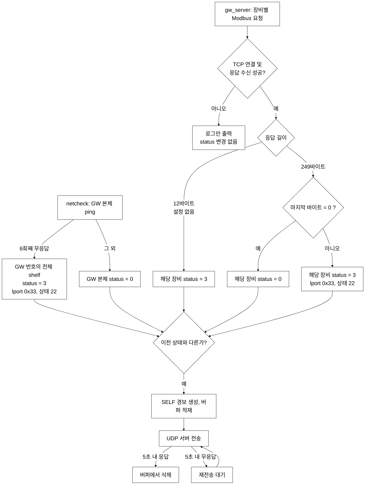
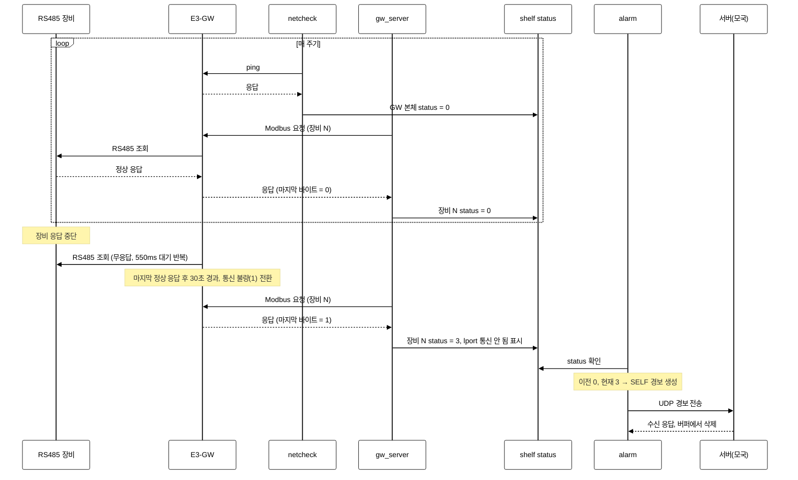

# E3-DP 통신 불량 확인 방법

## 1. 개요

| 구분 | 내용 |
|---|---|
| 목적 | E3-DP의 하위 장치 통신 불량 판단 로직 정리 및 현장 확인 절차 제시 |
| 범위 | E3-DP ↔ E3-GW ↔ RS485 장비 구간, 경보 생성 및 서버 전송 |
| 근거 | E3-DP 소스(`08_dp/e3dp/e3dp.2.1/src`), E3-GW 소스(`01_gw/src/pi/ges_hub`) 분석 |
| 작성 원칙 | 소스에서 확인된 내용만 기재. 확인하지 못한 사항은 8절 "점검 필요 사항"에 별도 기재 |
| 대상 | 현장 점검 담당자, 유지보수 개발자 |

### 용어

| 용어 | 설명 |
|---|---|
| E3-DP | 현장 데이터 수집·경보 판정 장치. 경보를 서버(모국)에 전송 |
| E3-GW | 이더넷(Modbus TCP)과 RS485 장비 간 게이트웨이 |
| shelf | DP 내부 장비 목록의 한 행. GW 본체(포트 0)와 GW에 연결된 장비(포트 1~)가 각각 한 행 |
| status | shelf의 통신 상태. 0 = 정상, 3 = 통신이상 |
| lport | 장비의 개별 측정·접점 값. com_status 0x77 = 갱신 중, 0x33 = 통신 안 됨 |

### 통신 구간

```
                ① 이더넷                          ② RS485
 E3-DP  ──(ping, Modbus TCP 1502)──  E3-GW  ──(Modbus RTU, 장비별 ID)──  RS485 장비
   │
   └─ 경보 ──(UDP)──▶ 서버(모국)
```

- DP가 직접 확인하는 구간은 ①
- ②는 E3-GW가 판단하여 응답의 마지막 1바이트로 전달 (0 = 정상, 1 = 불량)

---

## 2. 통신 불량 판단 로직

### 2.1 판단 주체

| 주체 | 확인 대상 | 대상 shelf | 불량 판정 조건 | 소스 |
|---|---|---|---|---|
| netcheck | ping | GW 본체 (`compid == 0`, `compno` 3 미만) | 무응답 6회째 실패 시 해당 GW 번호의 전체 shelf를 통신이상 처리 | `netcheck/netcheck_server.c` |
| gw_server | Modbus 응답 내용 | `compno` 11 이상인 연결 장비 각각 | 응답 마지막 바이트 ≠ 0, 또는 응답이 12바이트("설정 없음") | `gw/gw_server.c` |
| rect_server | 정류기 등 직접 요청 | rect_server 대상 shelf | 요청 실패 52회째 연속 실패 시 | `rect/rect_server.c` |
| emon | 판단 없음 | - | 상태 조회·변경 명령 제공 | `emon/emon.c` |

### 2.2 netcheck (① 구간)

- 대상: `compid == 0`인 shelf. `compno`가 `TYPE_MR_RECT`(3) 이상인 유형은 ping 제외
- ping 1회 전송, 응답 대기 300ms. 무응답 시 실패 횟수 증가, 응답 시 0으로 초기화
- 실패 횟수가 5 초과(6회째)가 되면 동일 GW 번호의 전체 shelf를 status 3으로 변경하고 해당 lport에 "통신 안 됨(0x33)", 상태 22 설정
- 그 외의 경우 해당 shelf(GW 본체)의 status를 0으로 설정. 연결 장비의 status는 변경하지 않음

### 2.3 gw_server (① + ② 구간)

장비(포트)별로 요청마다 연결 → 송신 → 수신 → 종료를 반복.

| 순서 | 동작 | 실패 시 처리 |
|---|---|---|
| 0 | GW 본체 status가 3이면 요청 생략 | 해당 주기 생략 |
| 1 | TCP 1502 연결 (대기 500ms) | 로그 출력, status 변경 없음 |
| 2 | Modbus 요청 송신 | 로그 출력, status 변경 없음 |
| 3 | 응답 대기 (500ms) | 로그 출력 없이 종료, status 변경 없음 |
| 4 | 응답 포트 번호 확인 | 불일치 시 로그 출력 후 종료, status 변경 없음 |
| 5 | 응답 길이 12바이트 여부 | 해당 장비 status 3 ("설정 없음") |
| 6 | 응답 길이 249바이트 여부 | 불일치 시 로그 출력 후 종료, status 변경 없음 |
| 7 | 마지막 바이트 확인 | 0이면 status 0. 0이 아니면 status 3 설정, 이전 status가 3이 아니었던 경우 해당 장비 lport에 "통신 안 됨(0x33)", 상태 22 설정 (제어 포인트 28번 제외) |

- 순서 1~4, 6의 실패는 status를 변경하지 않음
- 장비 status가 3이어도 조회 계속. 정상 응답 수신 시 status 0으로 복귀
- 응답 수신은 `recv` 1회로 처리

### 2.4 E3-GW의 통신 상태 판정 (마지막 바이트)

| 항목 | 내용 |
|---|---|
| 값 | 0 = 정상, 1 = 불량. DP는 0 여부만 확인 |
| 불량 전환 | 장비의 마지막 정상 응답 후 30초 경과 (ACON 4개 유형은 45초). 전환 시 해당 장비 값 200개 항목을 0으로 초기화 |
| 정상 복귀 | 마지막 정상 응답이 30초 이내이면서 정상 응답 연속 5회 이상 (가스터빈 발전기 유형은 3회). 무응답이 발생하면 연속 횟수 초기화 |
| 요청 대기 | 장비당 550ms. 무응답 시 실패 횟수 증가 후 다음 장비로 진행 |
| 미등록 ID 요청 | 12바이트 오류 응답 반환 → DP에서 "설정 없음"으로 처리 |
| 첫 조회 완료 전 요청 | 응답 없음 → DP에서 응답 대기 타임아웃으로 처리 |

- 장비 응답 중단 후 E3-GW가 불량으로 전환하기까지 30초 소요
- E3-GW 소스상 `use`가 1이 아닌 모듈은 설정 읽기 단계에서 등록하지 않음 (`rtu_config.c`)

### 2.5 lport 반영 및 서버 전달

- 통신이상 장비의 lport에 "통신 안 됨(0x33)", 상태 22 설정
  - 설정 주체: netcheck(ping 실패), gw_server(마지막 바이트 불량으로 전환 시), rect_server(정류기)
- lport가 0x77로 복귀하는 시점은 데이터 정상 수신 시 (`update_ai_value` 등)
- "통신 안 됨" lport는 값 경보 판정에서 제외 (`alarm_check.c`)
- 경보 경로: 포트 경보 생성부에서 상태 4 이상(23 제외)은 전송하지 않고 반환 (`alarm_check.c:489-493`)
- 실시간 조회 경로: rt_server가 접속 중인 클라이언트에 lport 상태(`lport.status`)를 값과 함께 전송 (`rt_server.c:698-707`)
- `alarm_check.c`, `scan_check.c`의 shelf → lport 반영 코드는 호출부가 주석 처리되었거나 함수 시작부의 `return` 이후에 있어 실행되지 않음

### 2.6 경보 생성 및 서버 전송

| 단계 | 내용 |
|---|---|
| 1 | 경보 프로세스가 shelf별 이전 상태(`pstatus`)와 현재 상태(`status`) 비교 |
| 2 | 상태가 바뀐 시점에만 경보 생성. 상태 유지 시 미생성 |
| 3 | 경보 내용: 이름 `SELF`, 장비·포트 번호, 상태 값(0 복구 / 3 발생), 발생·복구 시각 |
| 4 | 경보를 내부 버퍼(ACB)에 적재 |
| 5 | 버퍼에서 1건씩 UDP 전송. 서버 응답 수신 시 삭제, 5초 내 무응답 시 재전송 |

---

## 3. 흐름 및 시퀀스

### 3.1 전체 흐름



### 3.2 시퀀스 (정상 → 통신 이상 발생 → 서버 전송)



### 3.3 ping 정상 시 통신 단절 경고 경로

- GW 본체는 netcheck(ping), 연결 장비는 gw_server(응답 마지막 바이트)가 판정
- ping이 성공해도 gw_server가 장비 status를 3으로 설정할 수 있음
- 해당 경로: GW 응답 수신 + 마지막 바이트 1 (또는 12바이트 응답) → 장비 status 3 → SELF 경보
- 마지막 바이트 1은 E3-GW가 해당 장비로부터 30초 이상 정상 응답을 받지 못한 상태를 의미

---

## 4. 현장 확인 방법

### 4.1 확인된 현상별 판정 경로

| 확인된 현상 | 해당 판정 경로 |
|---|---|
| GW ping 무응답 | netcheck 판정 대상. 6회째 실패 시 GW 번호 전체 shelf 통신이상 |
| 로그 `Connect to … Fail` | TCP 1502 접속 실패. status 변경 없음 |
| 로그 `No Configuration in E3-GW` | E3-GW에 해당 번호의 등록 모듈 없음 (12바이트 응답). 장비 status 3 |
| 로그 `Communication Fail` | E3-GW가 해당 장비를 통신 불량(마지막 바이트 1)으로 보고. 장비 status 3 |

- 로그 메시지는 4.5 참조. 연구소 장치에서는 로그를 파일로 확인할 수 없음

### 4.2 E3-GW 설정 확인

#### 4.2.1 설정 파일 확인 (원격 ssh 접속, 읽기 전용)

웹 화면의 저장 값은 E3-GW의 설정 파일에 기록되며, E3-GW 통신 프로세스(rtu)는 같은 파일을 읽어 동작. 현장 방문 전 ssh로 파일을 확인할 수 있음.

| 파일 | 내용 | 소스 |
|---|---|---|
| `/home/pi/ges_hub/conf/module.conf` | 통신 속도·패리티 등, 모듈 수, 모듈별 번호·타입·사용 여부 | 웹 저장 `wl.c:1100`, 읽기 `rtu_config.c:222-223`, `common.h` |
| `/home/pi/ges_hub/conf/network.conf` | E3-GW의 IP(`ADDRESS`), `GATEWAY`, `NETMASK` | `wl.c:1419-1427`, `common.h` |
| `/home/pi/ges_hub/conf/ehwa_tcpip.conf` | 존재 시 `module.conf` 대신 이 파일 방식으로 읽음 | `rtu_config.c:226-272` |

확인 명령 (읽기 전용):

```
ls -l /home/pi/ges_hub/conf/
cat /home/pi/ges_hub/conf/module.conf
grep '^module-' /home/pi/ges_hub/conf/module.conf
cat /home/pi/ges_hub/conf/network.conf
```

`module.conf` 구성 (`#`로 시작하는 줄은 주석):

| 항목 | 형식 | 설명 |
|---|---|---|
| `MODBUS=` | `MODBUS=속도,패리티,…` | RS485(Modbus) 통신 설정. 연구소 장치 예: `MODBUS=9600,NONE,8,1` |
| `SERIAL=` | `SERIAL=속도,패리티,…` | 시리얼 통신 설정. 연구소 장치 예: `SERIAL=9600,NONE,8,1` |
| 모듈 수 | `#MODULE COUNT` 아래 숫자 | 등록 모듈 수. 연구소 장치 예: `4` |
| 모듈 | `module-<모듈번호>-<타입2자리>=<포인트번호> <사용여부> <zero> <span> <duration> <disp>` | 연구소 장치 예: `module-1-52=1 1 0.0 0.0 0 0` (모듈 1, 타입 52, 포인트 1~8 행이 반복) |
| `serial=` | `serial=<타입>` | 시리얼 유형 장비. 연구소 장치 예: `serial=00` |

파일에서 확인할 항목:

- `module-<모듈번호>-…`의 모듈 번호 = E3-GW 내부 모듈 ID(`EquipID`)이며, RS485 요청 프레임의 장비 ID로 사용 (`rtu_config.c`, `rtu_server.c:481`)
  - 가스터빈 발전기 유형은 다음 번호 모듈도 `EquipID = 번호 + 1`로 추가 등록
- 두 번째 값(사용 여부)이 1이 아닌 모듈은 E3-GW 설정 읽기 단계에서 등록하지 않음 (`rtu_config.c:392-421`)
- DP 서버 설정에 있는 포트 번호가 `module.conf`에 모듈 번호로 존재하는지 대조
  - 없으면 E3-GW가 12바이트 응답 → DP 로그 `No Configuration in E3-GW`
- `network.conf`의 `ADDRESS`와 DP가 사용하는 GW IP(emon `sys`의 `ip`)가 같은지 대조
- 실제 장비에 설정된 RS485 ID는 원격으로 확인 불가. 현장 확인 필요 (8절)

#### 4.2.2 웹 화면 확인

- 모듈 설정 화면은 모듈 행이 1~8번으로 고정된 구조 (`comp_point.html`, 최대 8개)
- 모듈 번호 = 행 번호. 웹에 장비 ID를 별도로 입력하는 항목 없음
- 사용 여부 "삭제"(값 2) 선택 시에도 설정 파일에는 해당 모듈 번호 그대로 사용 여부 0으로 기록 (`wl.c:1332-1337`). 번호가 이동하지 않음
- 통신 속도, 패리티, 데이터 비트, 정지 비트 항목 존재 (모듈용 `MODBUS=`, 시리얼용 `SERIAL=`)
- `MODBUS=` 값은 RS485 모듈 전체에 공통으로 적용되는 한 벌. E3-GW 시작 시 설정 파일 값으로 UART를 초기화 (`rtu_config.c:594-656`, `SC16IS752_Init`). 속도가 0이면 9600 적용
- 장비의 통신 설정을 자동으로 검출하거나 맞추는 로직은 소스에서 찾지 못함. 장비 쪽 설정은 E3-GW 설정과 동일하게 맞춰져 있어야 함

### 4.3 E3-DP 진단 콘솔(emon) 명령

실행 위치: `/opt/e3dp/bin/emon` (연구소 장치에서 확인). 명령 목록은 `emon.c`와 연구소 장치의 `help` 출력이 동일.

실행 방법 (연구소 장치에서 확인)

- 한 번 실행: `/opt/e3dp/bin/emon sys`, `/opt/e3dp/bin/emon alarm`
- 반복 출력: `/opt/e3dp/bin/emon sys -loop`
- 대화형: `/opt/e3dp/bin/emon` 실행 후 명령 입력, `exit`로 종료
- 실행 인자로 바로 처리하는 명령: `comp`, `shm`, `sys`, `smm`, `flag`, `alarm` (`emon.c`). `lport` 등 그 외 명령은 대화형에서 입력

| 명령 | 출력 내용 |
|---|---|
| `sys` | shelf 전체 목록. 한 행에 `DP`, `Unit`(GW 번호), `Modbus`(포트), `Type`, `Maxcomp`, `ip`, `st`(상태), `flag` 표시. st 0 = 정상, 3 = 통신이상 |
| `lport` | 적용된 논리 포트 목록. 항목: 장비명, 번호, 포트 번호, `t_port`, `pwr_reset`, `hpeak`, `lpeak`. 통신 상태(`com_status`, `status`)는 출력하지 않음 |
| `alarm` | 서버 전송 대기 중인 경보 버퍼(ACB) 목록. 항목: `rid`, 장비명, `번호.포트`, `val`, `st`. 통신이상 경보 예: `SELF  6. 4  ==>  val( 0.001) st( 3)` (GW 번호 6, 포트 4). 하단에 `N Alarm Message Exist.....` 표시 |

- 상태를 변경하는 명령은 점검 시 사용 금지: `alarm init`(경보 삭제), `comm`(통신 상태 수동 변경), 값 설정 명령
- `sys`의 st는 기록된 값. 소스상 타임아웃·연결 실패는 status를 바꾸지 않고 초기값이 0이므로, st 0이 정상 응답 확인을 뜻하지는 않음

### 4.4 네트워크 확인 (DP 또는 동일 망 PC)

| 목적 | 방법 |
|---|---|
| GW 응답 확인 | `ping <GW IP>` |
| GW 외 장치의 해당 IP 사용 여부 | GW 랜선 분리 후 `ping <GW IP>`. 응답이 있으면 GW가 아닌 장치가 해당 IP로 응답 중 |
| 응답 장치 MAC 확인 | `arp -a`에서 해당 IP의 MAC 확인, GW 본체 라벨의 MAC과 비교 |
| 중복 검사 | `arping -D -I <인터페이스> <IP>` |
| Modbus 포트 접속 확인 | `<GW IP>` TCP 1502 접속 시험 |
| DP 접속 상태 확인 | `netstat -tano \| grep 1502` |

도구 설치 현황 (연구소 장치 기준)

| 도구 | E3-DP | E3-GW |
|---|---|---|
| `ping`, `netstat`, `ss`, `strings` | 있음 | 있음 |
| `arp` | 있음 | 없음 |
| `arping` | 있음 | 없음 |
| `nc` | 없음 | 있음 |
| `tcpdump` | 없음 | - |
| `python3` | 있음 (3.5.2) | - |

- DP에서 TCP 1502 접속 시험은 `nc`가 없으므로 `python3`의 `socket` 사용
- 현장 장치의 설치 현황은 별도 확인 필요

### 4.5 DP·E3-GW 출력 메시지

출력 위치 (연구소 장치에서 확인)

- E3-DP: `gw_server`, `netcheck_server`, `alarm_server`의 표준 출력·표준 오류가 `/dev/null`로 연결. `/opt/e3dp/log` 디렉터리는 비어 있음
  - 운영 중 실행되는 프로세스에서는 아래 메시지를 확인할 수 없음. 확인 방법은 8절 점검 필요
- E3-GW: `rtu_server`, `modbus_server`, `hub_checker`는 부팅 시 `run.sh`가 `>/dev/null &`로 기동(`/etc/rc.local` → `run.sh`). `rtu_server`의 표준 출력은 `/dev/null`, 표준 오류는 `/dev/console`로 연결
  - 아래 E3-GW 메시지는 `printf`(표준 출력) 출력이므로 운영 중 확인할 수 없음
  - `/home/pi/ges_hub/log/rtu_log`에는 RS485 송신 패킷(`Send : [ … ]`)만 기록되어 있고, 최종 갱신은 2026-08-18
- 아래 메시지 문구는 연구소 장치에 배포된 실행 파일(`strings`)에 모두 존재 확인

**E3-DP gw_server 메시지**

| 메시지 | 의미 | status 변경 |
|---|---|---|
| `Parent E3-GW(#NN-0) Network Fail` | GW 본체가 통신이상 상태여서 요청 생략 | - |
| `Connect to <IP> (#NN-P) Fail` | TCP 연결 실패 | 없음 |
| `Receive Invalid Size` | 응답 길이가 249바이트·12바이트가 아님 | 없음 |
| `No Request Port No in E3-GW` | 응답 포트 번호 불일치 | 없음 |
| `No Configuration in E3-GW` | 12바이트 응답 (E3-GW에 해당 번호 등록 모듈 없음) | 3으로 변경 |
| `Communication Fail (#NN-P)` | 마지막 바이트 ≠ 0 | 3으로 변경 |
| `buf[rcvLen - 1] : N` | 응답 마지막 바이트 값 (0 = 정상) | - |

- `#NN-P` = GW 번호 - 포트 번호
- 응답 대기 타임아웃은 로그를 출력하지 않음. `Send … RT Request … Success` 이후 `Receive … from …`이 없으면 해당 경우

**E3-GW rtu_server 메시지**

| 메시지 | 의미 |
|---|---|
| `MODULE ID #N TIMEOUT EquipID: …, FailCnt: …` | N번 모듈 응답 대기 시간(550ms) 초과 |
| `ETC COMMUNICATION FAIL MODULE ID #N` / `ACON COMMUNICATION FAIL MODULE ID #N` | N번 모듈 통신 불량(1) 전환 |
| `COMMUNICATION RECOVERY MODULE ID #N` | N번 모듈 통신 정상(0) 복귀 |

---

## 5. 지연 시간

| 구간 | 내용 |
|---|---|
| 장비 응답 중단 → E3-GW 불량 전환 | 30초 (ACON 45초) |
| E3-GW 불량 → 정상 복귀 | 정상 응답 연속 5회 이후 |
| GW 단절 → DP 인지 | ping 6회째 실패 시점 (ping 1회당 응답 대기 최대 300ms) |
| 경보 서버 전송 재시도 | 5초 |

---

## 6. 참고 사항

- gw_server는 요청마다 TCP 연결을 새로 생성·종료
- 장치 `netstat` 확인 결과, DP(192.168.123.2) → GW(192.168.123.11, .12):1502 방향의 `TIME_WAIT` 소켓 다수 관측 (DP가 연결을 먼저 종료하는 측)
- 응답 길이가 249바이트가 아니면 `Receive Invalid Size`로 처리하고 status 변경 없음

---

## 7. 확인 방법 요약

| 순서 | 항목 | 비고 |
|---|---|---|
| 1 | emon `sys`로 통신이상 shelf의 GW 번호·포트 확인 | 4.3 |
| 2 | `emon alarm`으로 서버 전송 대기 경보 확인 | 4.3 |
| 3 | GW ping 및 IP 사용 장치 확인 | 4.4 |
| 4 | E3-GW 설정 파일(`module.conf`, `network.conf`) 확인 (ssh) | 4.2 |

---

## 8. 점검 필요 사항

소스만으로 확정하지 못한 항목. 현장 또는 장치에서 확인 필요.

| 구분 | 점검 내용 |
|---|---|
| 모듈 ID | 웹 모듈 번호(1~8)와 실제 장비에 설정된 RS485 ID의 일치 여부, 동일 ID 중복 여부 |
| 통신 설정 | E3-GW는 장비 통신 설정을 자동으로 맞추지 않음(소스 기준). RS485 모듈 공통 설정(속도·패리티·데이터 비트·정지 비트)과 각 장비 설정의 일치 여부 |
| 데이터·정지 비트 반영 | 소스상 `MODBUS=` 읽기는 두 번째 값을 정지 비트, 세 번째 값을 데이터 비트로 해석(`rtu_config.c:333-335`)하나, 웹 저장은 데이터 비트, 정지 비트 순으로 기록(`wl.c:1149`). 연구소 장치의 파일은 `MODBUS=9600,NONE,8,1`. 설정한 데이터·정지 비트가 UART에 반영되는지 장치에서 확인 필요 |
| 설정 불일치 | 사용 안 함으로 설정한 모듈 번호가 서버(DP) 설정에 포트로 남아 있는지 |
| RS485 선로 | 배선(A/B), 단자 접촉, 종단 저항(버스 양단), 병렬 연결 구성, 노이즈 |
| 장비 | 장비 전원 및 동작 상태, 장비 단독 연결 시 통신 여부(분리 시험) |
| E3-GW 표시등 | LED(통신·링크) 동작 의미는 소스에서 확인하지 못함. 장비 매뉴얼 확인 |
| emon | 연구소 장치에서는 `/opt/e3dp/bin/emon`에서 실행 확인. 현장 장치의 경로·동작은 별도 확인 |
| 출력 메시지 열람 | 연구소 장치의 DP 서버 표준 출력이 `/dev/null`로 연결되어 gw_server 메시지를 볼 수 없음. 현장 장치의 연결 대상 확인, 열람 방법(포그라운드 실행 등) 별도 검토 |
| E3-GW 메시지 | 연구소 장치의 `rtu_server` 표준 출력이 `/dev/null`로 연결되어 `MODULE ID #N TIMEOUT` 등을 볼 수 없음. 현장 장치의 연결 대상 확인, 열람 방법 별도 검토 |
| 실측 | ping 6회 실패 판정에 소요되는 실제 시간, 단절 발생부터 서버 수신까지의 실제 시간 |
