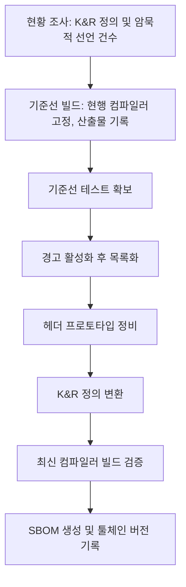

# 소스검토보고서: K&R 스타일 C 소스의 표준 방식 마이그레이션

| 항목 | 내용 |
|---|---|
| 작성자 | 김명환 |
| 작성일 | 2026-11-10 |
| 상태 | 초안 (Draft) |
| 대상 소스 | (입력 필요) |

## 1. 개요

### 1.1. 배경 및 목적

K&R 코딩 규칙(함수 매개변수를 괄호 밖에서 선언하는 구형 문법)으로 작성된 소스를 표준(ANSI/ISO C) 프로토타입(prototype, 함수 원형) 방식으로 마이그레이션(migration)하기 위해 사전 검토를 수행하였습니다. 본 문서는 그 결과를 정리한 것입니다.

```c
/* K&R 스타일 */
f(id, code)
    DrUInt id, code;
{
}

/* 표준(프로토타입) 스타일 */
void f(DrUInt id, DrUInt code)
{
}
```

### 1.2. 검토 범위

1. K&R 문법의 역사와 표준화 경과
2. 컴파일러 버전별 지원 현황
3. SBOM(Software Bill of Materials, 소프트웨어 자재명세서)과 컴파일러 버전의 관계
4. 최신 컴파일러 사용 시 발생하는 문제
5. 마이그레이션 접근안

### 1.3. 결론 요약

1. 최신 컴파일러에서 빌드가 실패하는 원인은 K&R 정의 문법 하나가 아니라 서로 다른 세 가지 구문입니다 (2.2 참조).
2. 컴파일러별 기본 동작 변경 시점은 Clang 15/16(2022/2023), GCC 14(2024), GCC 15(2025)로 나뉩니다. 참고 자료(Gemini 대화 기록)의 일부 서술은 사실과 달라 정정하였습니다 (3.3 참조).
3. SBOM 및 보안 규정이 요구하는 것은 구성요소의 식별과 문서화입니다. 검토한 범위에서 "최신 컴파일러 사용" 자체를 의무로 규정한 조항은 확인하지 못했습니다 (4 참조).
4. 마이그레이션의 근거는 "규정상 필수"가 아니라 "툴체인 업그레이드 가능성 확보와 타입 안전성 향상"으로 기술하는 것이 정확합니다.
5. K&R 정의를 프로토타입으로 변환하면 인자 승격(default argument promotion) 규칙이 달라져 동작이 바뀔 수 있습니다. 따라서 기계적 치환이 아니라 기준선 테스트를 갖춘 단계적 변환을 권고합니다 (5.4 참조).

## 2. K&R 문법의 역사

### 2.1. 표준화 경과

| 시기 | 내용 |
|---|---|
| 1978 | 『The C Programming Language』 1판에 K&R 문법이 기술되었습니다. |
| 1989/1990 | ANSI C(C89/C90)에서 프로토타입이 도입되고, K&R 정의는 obsolescent(폐기 예정)로 지정되었습니다. |
| 1999 | C99에서 암묵적 함수 선언(implicit function declaration)과 암묵적 int(implicit int)가 삭제되었습니다. |
| 2024 | C23(ISO/IEC 9899:2024)에서 식별자 목록 함수 정의(K&R 정의)와 프로토타입 없는 함수 선언이 삭제되었고, `()`는 `(void)`와 동일한 의미로 변경되었습니다. |

### 2.2. 문제가 되는 구문의 구분

| 구분 | 예 | 비고 |
|---|---|---|
| A. K&R 함수 정의 | `f(a, b) int a, b; { }` | C23에서 표준 문법에서 삭제되었습니다. |
| B. 프로토타입 없는 선언 | `int f();` | C23부터 `int f(void);`와 동일하게 해석됩니다. |
| C. 암묵적 int / 암묵적 함수 선언 | `static x;`, 선언 없는 함수 호출 | C99에서 삭제되었으며, K&R 시대 코드에 흔합니다. |

최신 컴파일러에서 실제로 먼저 실패하는 것은 B와 C인 경우가 많습니다.

### 2.3. 변환 규칙 비교

변환 전 (K&R 정의):

```c
DrInt
Dr_DGCP_RESULT_CHECK( id, code )
DrUInt	id, code;
{
```

변환 후 (표준 프로토타입 정의):

```c
DrInt
Dr_DGCP_RESULT_CHECK( DrUInt id, DrUInt code )
{
```

| 항목 | K&R 방식 | 표준 방식 | 변환 규칙 |
|---|---|---|---|
| 매개변수 이름 위치 | 괄호 안에 이름만 나열 | 괄호 안에 타입과 이름을 함께 기술 | 괄호 안으로 타입을 이동합니다. |
| 매개변수 타입 선언 | 괄호와 `{` 사이의 선언 목록 | 없음 | 선언 목록을 삭제합니다. |
| 같은 타입의 복수 매개변수 | `DrUInt id, code;` 한 줄 가능 | 매개변수마다 타입 명시 | `DrUInt id, DrUInt code`로 분리합니다. |
| 타입 선언이 없는 매개변수 | 암묵적으로 `int` | 모든 매개변수에 타입 필수 | 암묵적 `int`를 명시적 `int`로 기술합니다. |
| 반환형 | 생략 가능(암묵적 `int`) | 명시 필수 | 본 예제는 `DrInt`가 명시되어 있어 유지합니다. 생략된 경우 `int` 또는 `void`를 판단해야 합니다. |
| 매개변수 없음 | `f()` | `f(void)` | `()`를 `(void)`로 변경합니다. |
| 인자 타입 검사 | 호출 시 검사 없음 | 호출 시 개수와 타입 검사 | 헤더에 동일한 프로토타입 선언을 추가합니다. |
| 인자 전달 | `char`, `short`, `float`는 `int`, `double`로 승격 | 선언된 타입 그대로 전달 | 5.4를 참조합니다. |

본 예제에 대한 확인 사항은 다음과 같습니다.

1. 두 매개변수가 모두 `DrUInt`이므로 같은 타입을 매개변수마다 반복하여 기술하는 것이 맞습니다.
2. `DrUInt`가 `int`보다 좁은 타입(`unsigned char`, `unsigned short`)으로 typedef 되어 있으면 인자 승격 때문에 호출부 동작이 달라질 수 있으므로, typedef의 실제 정의를 확인해야 합니다.
3. 헤더에 `DrInt Dr_DGCP_RESULT_CHECK( DrUInt id, DrUInt code );` 선언이 있어야 호출부에서 타입 검사가 동작합니다. 헤더에 `DrInt Dr_DGCP_RESULT_CHECK();` 형태의 선언이 남아 있으면 함께 변경해야 합니다.

## 3. 컴파일러 지원 현황

### 3.1. 버전별 기본 동작

| 컴파일러 | 출시 | 기본 동작 변화 |
|---|---|---|
| Clang 15 | 2022 | `-Wdeprecated-non-prototype`이 신설되었습니다(경고). 프로토타입 선언 뒤에 `()` 정의가 오면 conflicting types 오류가 발생합니다. `-Wint-conversion`이 오류로 승격되었습니다. |
| Clang 16 | 2023-03 | `implicit-function-declaration`, `implicit-int`, `incompatible-function-pointer-types`가 기본 오류가 되었습니다. |
| GCC 14 | 2024 | `implicit-int`, `implicit-function-declaration`, `int-conversion`, `incompatible-pointer-types`, `return-mismatch`, `declaration-missing-parameter-type`이 기본 오류가 되었습니다. K&R 정의 자체의 제거는 전환 당시 범위에서 제외되었습니다. |
| GCC 15 | 2025 | 기본 언어 모드가 `-std=gnu17`에서 `-std=gnu23`으로 변경되었습니다. `()` 선언이 `(void)`로 해석되어 "too many arguments" 오류가 발생합니다. |
| GCC 16 | 2026 | 보고된 사례 기준으로 C23 기본값이 유지되고 있습니다. |

### 3.2. C23 표준 지원 시작 버전

cppreference 기준으로 N2432(식별자 목록 정의 삭제)는 GCC 10, Clang 15부터, N2841(프로토타입 없는 선언 삭제)은 GCC 13, Clang 15부터 지원이 시작된 것으로 표기되어 있습니다. 이는 기본값으로 적용된 시점과는 별개입니다.

### 3.3. 참고 자료(Gemini 대화 기록)와의 차이

| 참고 자료의 서술 | 검증 결과 |
|---|---|
| Clang 15부터 K&R 선언/정의를 기본 오류로 처리 | 부정확합니다. Clang 15는 경고(`-Wdeprecated-non-prototype`)이며, 오류로 바뀐 것은 Clang 16의 암묵적 선언 및 암묵적 int입니다. |
| GCC 14부터 K&R 함수 선언/호출 시 기본 오류 | 부정확합니다. GCC 14의 오류는 암묵적 선언, 암묵적 int, 포인터/정수 변환 등이며 K&R 정의 문법 자체가 아닙니다. |
| GCC 15 이후 레거시 문법 완전 거부 | 부분적으로 정확합니다. GCC 15의 기본 C23 전환으로 `()` 선언의 의미가 바뀌어 실패합니다. 식별자 목록 정의는 수집한 사례에서 `-Wold-style-definition` 경고로 확인되었으며, 실제 툴체인에서 재확인이 필요합니다. |
| C23에서 K&R 함수 선언/정의 지원 완전 제거 | 정확합니다. |
| 최신 보안 규정 및 SBOM 충족에 최신 컴파일러가 사실상 필수 | 근거를 확인하지 못했습니다 (4 참조). |

### 3.4. 미검증 항목

참고 자료의 다음 서술은 이번 검토에서 확인하지 못하였으며, 보고 전 확인이 필요합니다.

1. Ubuntu 24.04 LTS의 기본 컴파일러 버전이 GCC 14 이상이라는 서술
2. Xcode 15/16 및 Visual Studio 2022의 K&R 관련 동작
3. Linux 커널에서 K&R 코드를 일절 허용하지 않는다는 서술
4. EO 14028, EU CRA가 바이너리 보호 기법(스택 보호, CFI 등)의 적용을 명시한다는 서술
5. `-ftrivial-auto-var-init` 등 개별 옵션의 지원 시작 버전

## 4. SBOM과 컴파일러 버전

### 4.1. SBOM에 포함되는 컴파일러 관련 정보

1. 빌드 도구: 컴파일러 종류와 버전을 빌드 환경 정보로 기록합니다.
2. 런타임 구성요소: 최종 산출물에 정적 또는 동적으로 링크되는 `libgcc`, `glibc` 등은 구성요소로 식별되며 취약점(CVE) 대조 대상이 됩니다.

### 4.2. 규정과의 관계

1. EO 14028은 연방 기관이 공급업체에 SBOM을 요구하도록 하며, NTIA 최소 요소(공급자, 구성요소명, 버전, 고유 식별자, 의존 관계 등)를 따르도록 합니다.
2. EU CRA(Regulation (EU) 2024/2847)는 구성요소를 식별하고 문서화할 의무를 두며, SBOM은 그 일부입니다.
3. 두 규정 모두 SBOM에 무엇을 기록할지를 요구하는 것이며, 검토한 자료에서 특정 컴파일러 버전의 사용을 의무로 규정한 조항은 확인하지 못했습니다.
4. 구형 컴파일러 및 런타임이 SBOM에 기록되면 알려진 취약점이 검출되어 납품 심사에서 문제가 될 수 있습니다. 이는 규정 조항이 아니라 심사 운영상의 위험으로 구분하여 기술합니다.

### 4.3. 제안

"최신 컴파일러 사용"을 요건으로 두기보다 다음을 요건으로 정의할 것을 제안합니다.

1. 벤더 지원이 유지되는 컴파일러 버전을 사용합니다.
2. 컴파일러 및 런타임 버전을 고정(pinning)하고 SBOM에 기록합니다.
3. 신규 버전으로 업그레이드할 때 빌드가 깨지지 않도록 합니다.

## 5. 최신 컴파일러 사용 시 문제

### 5.1. K&R 정의와 `()` 선언

C23에서 `()` 선언은 인자 없음을 의미하므로, 인자를 넘기는 기존 호출이 오류가 됩니다. 함수 포인터 타입 선언도 영향을 받습니다.

### 5.2. 암묵적 선언과 암묵적 int

선언 없는 함수 호출과 반환형 생략은 GCC 14, Clang 16부터 기본 오류입니다. 헤더 누락이 원인인 경우가 많습니다.

### 5.3. 포인터와 정수 간 암묵 변환

K&R 시대에는 포인터와 정수를 혼용하는 코드가 흔합니다. 64비트 환경에서는 오류 외에 값이 잘릴 위험이 있습니다.

### 5.4. 프로토타입 변환 시 의미 변화

K&R 정의에서 `char`, `short`, `float` 매개변수는 호출 시 `int`, `double`로 승격되어 전달됩니다. 프로토타입으로 바꾸면 선언된 타입 그대로 전달되므로, 호출부가 프로토타입을 보지 못하는 상태에서 정의만 바꾸면 미정의 동작이 됩니다. 따라서 변환 순서는 헤더 프로토타입 정비, 호출부 검증, 정의 변환의 순서로 진행해야 합니다.

### 5.5. 임시 완화책

| 목적 | 옵션 |
|---|---|
| 구 표준 모드로 빌드 | `-std=gnu89` 또는 `-std=gnu17` |
| 특정 오류를 경고로 강등 | `-Wno-error=implicit-function-declaration`, `-Wno-error=incompatible-pointer-types` 등 |

임시 완화책은 마이그레이션 완료 전까지의 브릿지이며 최종 상태가 아닙니다.

## 6. 마이그레이션 접근안



현황 조사 예시 명령은 다음과 같습니다.

```bash
gcc -std=gnu89 -fsyntax-only \
    -Wold-style-definition -Wstrict-prototypes -Wmissing-prototypes \
    -Wimplicit-function-declaration -Wimplicit-int *.c
```

## 7. 입력 필요 사항

| 항목 | 내용 |
|---|---|
| 대상 소스 규모 (파일 수, 라인 수) | (입력 필요) |
| 현재 사용 컴파일러와 버전 | (입력 필요) |
| 타깃 플랫폼 및 비트 폭 | (입력 필요) |
| 기존 테스트 유무 | (입력 필요) |
| K&R 정의, `()` 선언, 암묵적 선언 건수 | (측정 필요) |
| 납품/심사 측 SBOM 요구 형식 | (입력 필요) |

## 8. 출처

1. Porting to GCC 14: https://gcc.gnu.org/gcc-14/porting_to.html
2. Porting to GCC 15: https://gcc.gnu.org/gcc-15/porting_to.html
3. Porting Fedora to Modern C: https://fedoraproject.org/wiki/Changes/PortingToModernC
4. Gentoo Modern C porting: https://wiki.gentoo.org/wiki/Modern_C_porting
5. Red Hat, New warnings and errors in Clang 15: https://www.redhat.com/en/blog/new-warnings-and-errors-clang-15
6. WG14 N2432: https://www.open-std.org/JTC1/SC22/wg14/www/docs/n2432.pdf
7. cppreference C23: https://cppreference.net/c/23.html
8. EO 14028 SBOM 요건 해설: https://www.endorlabs.com/learn/executive-order-14028-sbom-requirements
9. CRA SBOM 요건 해설: https://fossa.com/sbom-requirements-cra-cyber-resilience-act/
