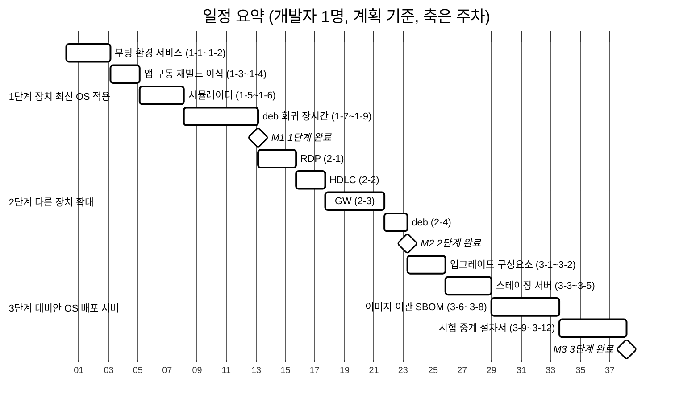
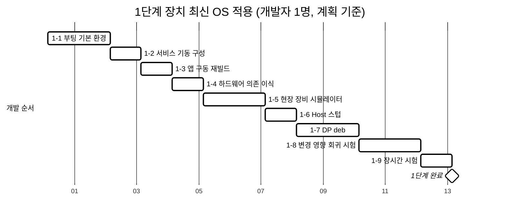
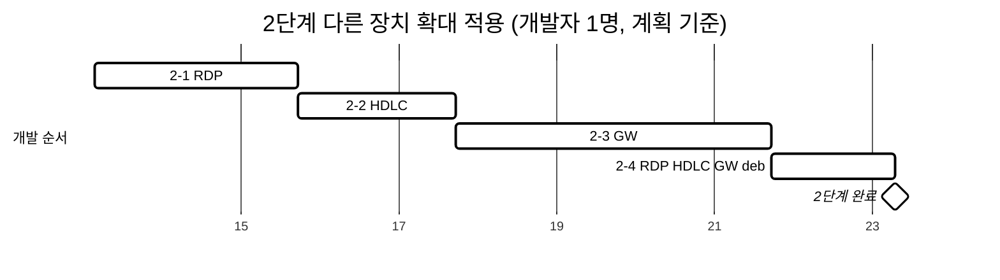
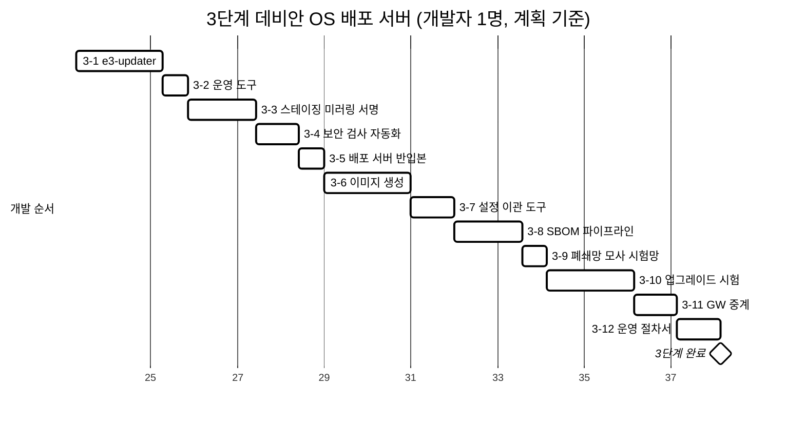

# 지속적인 OS 보안사항 적용을 위한 개발 리소스

| 항목 | 내용 |
|---|---|
| 목적 | E3 장치(DP, RDP, HDLC, GW) 신규 OS 적용과 apt 지속 패치 체계 구축의 개발 항목·시험·환경·공수 |
| 상태 | 초안 (잠정 추정, §5 확인 게이트로 보정) |
| 작성일 | 2026-10-19 |
| 작자 | 김명환 |

---

## 1. 개요

### 1.1 개발 범위
- 신규 OS 구축·포팅: Debian 13 armhf(NanoPi 3종), Raspberry Pi OS Lite(GW)
- 앱 deb 패키징
- 업그레이드 구성요소: 장치 `e3-updater`, 서버 운영 도구
- 서버·이미지: 외부 스테이징 서버, 폐쇄망 배포 서버, 설치 이미지, 설정 이관 도구
- SBOM 생성·검증
- 시뮬레이터, 시험망
- 시험, 문서

### 1.2 개발 제약
- 현장 장치·KT 폐쇄망에서 개발 불가
- 앱 소스는 개발 완료 상태. 앱 로직 신규 개발 없음
- 작업 대상: OS 환경 구성, 이식, 시뮬레이터, 시험
- 개발·검증은 사내 장비(데모세트, 개발 보드)와 시뮬레이터로 수행
- 시뮬레이터로 검증 불가한 항목은 실장비 시험 1회: 실제 장비 통신, 현장 네트워크, KT 반입

### 1.3 공수 기준
- 단위: 주(week), 풀타임, 개발자 1명, 단계 순차
- 계획: §5 확인 게이트 통과를 가정한 예상 기간(항목별 판단값)
- 범위: 최소~최대(위험 반영)
- 항목별 개발 + 단독 시험 포함
- 합계는 항목 합산
- 잠정 추정\*. 확인 게이트 결과로 항목별 보정

\* 공수·개발 기간은 AI 검토 내용을 반영한 추정

### 1.4 참고사항
- 이전 검토: AI 약 11개월 → 검토자 요구로 단계별 기간 축소 검토 → 현행 장치 기록·소스 확인 결과로 재산정
- 재산정(1명): **계획 37.5주(약 8.7개월), 범위 25.5~60주(약 5.9~13.9개월)**
- 단계
  - 1단계: 장치 최신 OS 적용 (시뮬레이터 포함)
  - 2단계: 다른 장치 확대 적용
  - 3단계: 데비안 OS 배포 서버
- 범위별 기간: §4.4

---

## 2. 현황과 OS 변경 영향

### 2.1 확인된 사실
출처: 운영 중 DP 점검 기록, 앱 소스, 인수인계 자료

| 구분 | 내용 |
|---|---|
| 메모리 | 총 494MB, 사용 32MB(앱 전체 가동). 앱 프로세스 RSS 대부분 2MB 이하. `/dev/shm` 248MB |
| 앱 바이너리 | ELF 32bit armhf. 링크 라이브러리 `libc`(`rt_server`: `libpthread`, `wan_led`: `libfahw`·`libm`) |
| 앱 소스 | DP 활성 소스 약 5.9만 줄. 최신 glibc 대응(`e3compat.h`의 `stime()` 대체), 최신 gcc 빌드 옵션 반영 |
| 하드웨어 접근 | `wan_led`(429줄)만 `libfahw`로 GPIO 13·15·19·21·22 제어. 그 외 데몬의 I2C·SPI·시리얼·GPIO 직접 사용 미확인 |
| 부팅 | 현행: FAT `boot.img`(커널 3.4.39, BSP) + 루트 `mmcblk0p2`. 신규: Debian U-Boot + 커널 6.12 + `extlinux` |
| 네트워크 | `eth0` 10.10.0.220/24(기본 경로), `eth1` USB 이더넷(AX88772B) 192.168.123.2/24. NetworkManager + networking. NAT: `rc.local`의 iptables MASQUERADE |
| 서비스 | ssh, cron, timesyncd, inetd(telnet 23), vsftpd(21), NetworkManager, pppd-dns, apt-daily.timer. `udhcpd`·`dnsmasq`·`hostapd` 설치. 웹(80) 미가동 |
| 기동 | `rc.local`: `acagent_checker`, NAT 설정. 서버 군(`scheck init`) 기동 경로 미확인 |
| 시각 | `rtc0` 존재. `acagent_checker`가 `hwclock -w` 호출 |
| 패키지 | 현행 582개, PoC 이미지 181개 |
| GW 소스 | `ges_hub`: SC16IS752(SPI UART 브리지)를 `wiringPi`/`wiringPiSPI`로 구동, GPIO LED도 `wiringPi` |
| RDP 소스 | DP와 별도 포크. 상이한 소스 파일 약 100개 |
| HDLC | 바이너리(`ges_hub`, `rs422_server`, `mbtcp_server`, `hdlc_test`, `proc_check`)와 2019년 소스 |

### 2.2 OS 변경 영향
| 영역 | 영향 | 대응 | 규모 |
|---|---|---|---|
| 메모리 | 여유 있음(32MB/494MB) | 개발 없음, 시험 중 측정 | 없음 |
| 바이너리 호환 | glibc 2.23 → 2.41. `libc`만 링크 | 무수정 구동 확인 → 소스 재빌드(deb·SBOM) | 작음 |
| 시간 구조 | `time_t` 사용 구조체 3곳(소켓 노드, PDU 내부, GW 허브). 영구 파일(`alarm.db`, `nelite.db`) 구조체 크기 변경 시 파일 재생성, 경보 이력 소실 | 재빌드 후 구조체 크기 확인 | 작음~중간 |
| 부팅·커널 | U-Boot·커널 교체. PoC 실장비 부팅 미검증. 메인라인 커널 H3 정지 사례 | 실장비 부팅, 시리얼 로그 분석 | 중간~큼 |
| 인터페이스명 | 앱이 `ifconfig eth0:1` 호출(`main_server.c`), `eth0`/`eth1` 전제. Debian 기본은 `end0`, `enx...` | `net.ifnames=0` 또는 udev 규칙, `net-tools` 설치 | 작음 |
| NAT·포워딩 | iptables MASQUERADE + ip_forward. Debian 13은 nftables 백엔드 | 서비스로 재현 | 작음 |
| GPIO | `libfahw` 없음. 6.x 커널의 sysfs GPIO 비권장 | `wan_led`를 sysfs·libgpiod로 재작성, 핀 매핑 확인 | 작음 |
| 서비스 | telnet·FTP·DHCP·ppp·NetworkManager 사용처 불명 | 현행 이미지에서 설정·사용처 확인, 유지·제거 구분 | 중간 |
| 기동 | `rc.local` + 서버 기동 경로 미확인 | systemd unit 재구성, 설정 보존, 종료 시 공유메모리 정리 | 중간 |
| 스토리지 | `alarm.db` mmap(O_SYNC) 쓰기, microSD 성능·수명 | 장시간 시험 | 작음 |
| 웹 UI | 현행 DP 웹 미가동 | 웹 패키지 포함 여부 확인 | 작음 |
| GW 하드웨어 | `wiringPi` + SPI. 저장소 제공 여부 확인 필요, SPI 활성화 필요 | 빌드 또는 대체(spidev, libgpiod), 실물 시험 | 큼 |
| 직렬(HDLC) | RS422 포트 이름·드라이버 변경 | 실물 시험 | 중간 |

---

## 3. 시험 전략 (현장 시험 최소화)

| 단계 | 시험 | 방법 | 장비 |
|---|---|---|---|
| L1 | 신구 OS 비교 | 같은 `nelite.conf`·`nelite.db`·시뮬레이터 입력으로 현행 OS와 신규 OS의 수집·판정·경보·제어 결과 비교 | 데모세트, 개발 보드 |
| L2 | 시나리오 | 정상, 임계 초과, 통신 단절·복구, 정전/입전, 제어, 재부팅 후 복원 | 시뮬레이터 |
| L3 | 장시간 | 수일 연속, 반복 재부팅, 정전 모사, `smm`, microSD 쓰기 | 개발 보드 |
| L4 | 업그레이드 | 정상, 실패, 정전 중단, 이전 반입본 복구, GW 경유 | 폐쇄망 모사 시험망 |
| L5 | 현장(최소) | 시뮬레이터로 검증 불가한 항목만: 실제 장비 통신, 현장 네트워크, KT 반입. 1~2개 국사 1회 | 실장비 |

- 시뮬레이터 입력: 데모세트·운영 장치의 Modbus·UDP 트래픽을 사전 캡처해 응답 값·시퀀스에 반영
- Host 스텁은 설정 다운로드 미구현. 설정은 현행 장치의 `nelite.conf`·`nelite.db` 사용

---

## 4. 단계별 개발 항목

불확실성: 낮음 / 중간 / 높음

### 4.1 1단계. 장치 최신 OS 적용 (시뮬레이터 포함)
| ID | 항목 | 내용 | 계획(주) | 범위(주) | 불확실성 |
|---|---|---|---|---|---|
| 1-1 | 부팅·기본 환경 | NEO 부팅, USB 이더넷, 인터페이스명 고정, 고정 IP, NAT·ip_forward, 시간·RTC | 2 | 1~3 | 높음 |
| 1-2 | 서비스·기동 구성 | 앱 기동 unit, 자동 파티션 확장, 서비스 선별(ssh, cron, 시간 동기, 필요 시 DHCP·ppp·FTP·telnet) | 1 | 0.5~2 | 중간 |
| 1-3 | 앱 구동·재빌드 | 현행 바이너리 무수정 구동, 소스 전체 재빌드, `libPdu` 소스 편입, 동작 확인 | 1 | 0.5~1.5 | 낮음 |
| 1-4 | 하드웨어 의존 이식 | `wan_led`의 `libfahw`를 sysfs·libgpiod로 대체, 핀 매핑, LED·WAN 링크 확인 | 1 | 0.5~1.5 | 중간 |
| 1-5 | 현장 장비 시뮬레이터 | GW(Modbus TCP 1502)·정류기(TCP 2000) 응답 모사. 시나리오: 정상, 임계 초과, 통신 단절, 정전/입전 | 2 | 1.5~3.5 | 중간 |
| 1-6 | Host 스텁 | 경보·정시 수집·실시간 수신, 요청·제어 송신 | 1 | 0.5~1.5 | 낮음 |
| 1-7 | DP deb | 소스 정리(`make install`, 경로 변수화, 바이너리 제거), core·tools 패키지, systemd unit, 설정 보존, 업그레이드 시 데몬 정지·공유메모리 정리·재기동 | 2 | 1.5~3 | 중간 |
| 1-8 | 변경 영향 회귀 시험 | L1·L2 | 2 | 1.5~3 | 중간 |
| 1-9 | 장시간 시험 | L3. 일부 병행하나 1주 계상 | 1 | 0.5~1.5 | 중간 |
| | **1단계 합계** | | **13** | **8~20.5** | |

### 4.2 2단계. 다른 장치 확대 적용
| ID | 항목 | 내용 | 계획(주) | 범위(주) | 불확실성 |
|---|---|---|---|---|---|
| 2-1 | RDP | 별도 포크 소스 빌드·구동, 이미지 변형, 시뮬레이터 확장, 변경 범위 시험 | 2.5 | 2~4 | 중간 |
| 2-2 | HDLC | 바이너리 구동성(의존 라이브러리), RS422 직렬 동작(실물), 이미지 변형 | 2 | 1.5~4 | 높음 |
| 2-3 | GW | Raspberry Pi OS Lite(Trixie) 이미지, `wiringPi`/SPI·SC16IS752 이식, GPIO LED, RS485 시험(시뮬레이터 + USB-RS485 어댑터) | 4 | 3~6 | 높음 |
| 2-4 | RDP·HDLC·GW deb | RDP·GW 소스 빌드 deb, HDLC 바이너리 재패키징, GW용 `wiringPi` 패키지 | 1.5 | 1~3 | 중간 |
| | **2단계 합계** | | **10** | **7.5~17** | |

### 4.3 3단계. 데비안 OS 배포 서버
| ID | 항목 | 내용 | 계획(주) | 범위(주) | 불확실성 |
|---|---|---|---|---|---|
| 3-1 | `e3-updater` | 신호 수신·인증, 비대화형 apt 실행, 기동 점검, 결과 보고 | 2 | 1.5~3 | 중간 |
| 3-2 | 운영 도구 | 서버 CLI: 대상 선택, 신호 전송, 결과 조회 | 0.5 | 0.5~1 | 낮음 |
| 3-3 | 스테이징 미러링·서명 | aptly 설정, 스케줄 미러링(Debian, GW용 저장소), 자체 키 서명 | 1.5 | 1~2.5 | 중간 |
| 3-4 | 보안 검사 자동화 | 업스트림 서명·해시 검증, 악성코드 검사, 취약점 대조, 결과 기록 | 1 | 0.5~1.5 | 낮음 |
| 3-5 | 배포 서버·반입본 | 읽기 전용 서빙, 반입본 생성·교체·이전본 보존 | 0.5 | 0.5~1 | 낮음 |
| 3-6 | 이미지 생성 | 스냅샷 기반 스크립트. NanoPi용·Raspberry Pi용 2종. 앱·`e3-updater`·저장소 설정·공개키 포함, 파티션 자동 확장 | 2 | 1.5~3 | 중간 |
| 3-7 | 설정 이관 도구 | 장치별 설정(`nelite.conf`, `nelite.db`, 네트워크 설정, 호스트명) 추출·적용 | 1 | 0.5~1.5 | 중간 |
| 3-8 | SBOM 파이프라인 | 이미지 기준 생성(cdxgen 또는 syft), 수동 항목(`libPdu.a`, KISA SHA-256 구현, `wiringPi`) 추가, KT 필수 항목 검증 | 1.5 | 1~2 | 낮음 |
| 3-9 | 폐쇄망 모사 시험망 | 스테이징 서버·배포 서버·시험 장치 격리 구성, 반입 절차 모사 | 0.5 | 0.5~1 | 낮음 |
| 3-10 | 업그레이드 시험 | L4 | 2 | 1.5~3 | 중간 |
| 3-11 | GW 중계 | DP `e3-updater`가 GW로 신호 중계, GW apt 접속은 DP 경유 | 1 | 0.5~1.5 | 중간 |
| 3-12 | 운영 절차서 | 반입, 신호 전송, 결과 확인, 카드 교체·설정 이관, 릴리스 노트 서식 | 1 | 0.5~1.5 | 낮음 |
| | **3단계 합계** | | **14.5** | **10~22.5** | |

### 4.4 범위별 기간
| 범위 | 포함 | 계획(주) | 계획(개월) | 범위(주) |
|---|---|---|---|---|
| 1단계 | 1-1~1-9 (DP 신규 OS 적용·시험) | 13 | 약 3.0 | 8~20.5 |
| 1단계 + 2단계 | OS 전환 전체 | 23 | 약 5.3 | 15.5~37.5 |
| DP 중심 전체 체계 | 1단계 + 3단계(3-11 GW 중계, 3-6의 Raspberry Pi 이미지분 제외) | 25.5 | 약 5.9 | 17~40 |
| 전체 | 1~3단계 | 37.5 | 약 8.7 | 25.5~60 |

- 검토자 목표 4~6개월(약 17~26주) 대비(계획 기준): 1단계, 1+2단계, DP 중심 전체 체계는 목표 범위 이내. 전체는 초과
- KT 협의·실장비 시험 기회 대기 시간은 제외

---

## 5. 확인 게이트 (추정 보정)

| 순서 | 확인 | 소요 | 보정 대상 |
|---|---|---|---|
| G-1 | 현행 DP 바이너리의 신규 OS 무수정 구동 | 1~2일 | 1-3, 1-8 |
| G-2 | PoC 이미지 NEO 실장비 부팅(시리얼 로그) | 1~3일 | 1-1 |
| G-3 | 현행 소스 전체 `make`(최신 Debian 보드) | 1일 | 1-3 |
| G-4 | 현행 이미지의 기동 경로·네트워크·NAT·서비스·cron·sysctl 추출 | 2~3일 | 1-2, 3-7 |
| G-5 | `alarm.db`·`nelite.db` 구조체의 `time_t`·`long` 크기 | 1일 | 1-3, 3-7 |
| G-6 | `wiringPi` 제공 여부, SPI 활성화, SC16IS752 동작(GW 실물) | 2~3일 | 2-3 |
| G-7 | HDLC 바이너리 의존 라이브러리, 직렬 포트 동작 | 1~2일 | 2-2 |
| G-8 | RDP·DP 소스 차이 중 빌드·동작 영향 범위 | 1~2일 | 2-1 |

- G-1~G-5: 1단계 착수 전. G-6~G-8: 2단계 착수 전
- 결과에 따라 해당 항목 계획·범위 갱신

---

## 6. 일정

- 기준: 개발자 1명, 단계 순차, 항목별 계획값\*
- 축: 주차(1주차 = 개발 시작 주). 차트 날짜는 주차 표시용 기준일이며 실제 일정 아님
- 일 단위 반올림으로 §4 계획 합계와 소폭 차이

\* 개발 기간은 AI 검토 내용을 반영한 추정

### 6.1 일정 요약 (주차별 마일스톤 차트)

- 축 숫자: 주차(2주 간격). ◆: 단계 완료 마일스톤(아래 표)

| 마일스톤 | 시점 | 내용 |
|---|---|---|
| M1 1단계 완료 | 13주차 | DP 신규 OS 적용, 시뮬레이터, 회귀·장시간 시험 |
| M2 2단계 완료 | 24주차 | RDP·HDLC·GW 적용, deb |
| M3 3단계 완료 (전체) | 38주차 | 스테이징·배포 서버, 업그레이드, 이미지, SBOM, 시험, 절차서 |

### 6.2 1단계 간트: 장치 최신 OS 적용 (시뮬레이터 포함)

### 6.3 2단계 간트: 다른 장치 확대 적용

### 6.4 3단계 간트: 데비안 OS 배포 서버

- 3-11 선행: 2-3(GW)
- 3-10 선행: 1-7(DP deb), 3-9(시험망)

---

## 7. 시뮬레이터

| 시뮬레이터 | 모사 대상 | 통신(소스 확인) | 사용 시험 | 재사용 |
|---|---|---|---|---|
| 현장 장비 (DP 쪽) | E3-GW, 정류기 | GW: Modbus TCP 1502(AI 40·DI 40 워드, 응답 249B). 정류기: TCP 2000(ASCII, LRC) | L1~L3 | 진단 CLI(`modbus_test`, `mb_test`, `vcb_test`), 사전 캡처 트래픽 |
| Host 스텁 | 상위 관제 | UDP: 요청 7999, 경보 7704, 응답 7000, 정시 수집 7062, 실시간 8052. TCP 조회 7995. 메시지: ASN.1 PDU(`libPdu`) | 경보·정시 수집·제어 | 진단 CLI(`udpsend`, `e3_test` 등), `lib/pdu` 소스 |
| 현장 장비 (GW 쪽) | RS485 Modbus RTU 장비(냉각기 등) | 시리얼 RTU 9600 8N1 | GW 수집 시험 | 인수인계 칠러 시뮬레이터(Python, pyserial, 슬레이브 ID 1~4, GUI) |
| 폐쇄망 모사 시험망 | KT 시스템 망, 반입 절차 | HTTP/HTTPS | L4 | VM, 격리 스위치 |

- `libPdu`는 64bit PC에서 ASN.1 정수 크기 검사(`intsize != sizeof(long)`)로 실패. PC에서 PDU 생성 시 ASN 정수 처리 32bit 고정 수정 또는 armhf 환경(보드, QEMU) 실행
- 칠러 시뮬레이터는 시리얼 포트 직접 사용. PC 사용 시 USB-RS485 어댑터와 루프백 필요

---

## 8. 개발·시험 환경

| 구분 | 항목 | 용도 |
|---|---|---|
| 하드웨어 | 데모세트(DP, RDP, GW) | 현행 OS 기준 동작, 트래픽 캡처 |
| 하드웨어 | NanoPi NEO 개발 보드 3대 이상 | 개발, 업그레이드 시험, 신구 비교 |
| 하드웨어 | RDP·HDLC 구성 보드 각 1대 | 차이 확인, 부팅 시험 |
| 하드웨어 | Raspberry Pi 2대 이상(GW 모델 확인 후), GW 하드웨어(SC16IS752 보드) | GW 포팅, 업그레이드 시험 |
| 하드웨어 | microSD 10장 이상 | 신규·기존 이미지 분리 보관 |
| 하드웨어 | USB-TTL(3.3V) 케이블, 5V/2A 전원, 이더넷 스위치 | 시리얼 로그, 전원, 시험 네트워크 |
| 하드웨어 | USB-RS485/RS422 어댑터 | GW·HDLC 시리얼 시험 |
| 개발 PC | Windows 11 + WSL2 Ubuntu, qemu-user-static, debootstrap | armhf 빌드, 이미지 생성 |
| 서버 | 스테이징 서버 1대(외부망). 디스크는 미러 용량 산정 후 결정 | 미러링, 서명, 검사, 이미지·SBOM 생성 |
| 서버 | 배포 서버 시험기 1대(VM 가능) | 반입·서빙·업그레이드 시험 |
| 소프트웨어 | aptly, nginx 등 정적 웹서버, GnuPG | 저장소, 서빙, 서명 |
| 소프트웨어 | cdxgen 또는 syft, ClamAV, grype 또는 trivy | SBOM, 악성코드·취약점 검사 |
| 소프트웨어 | Python(pymodbus 등), 시리얼 터미널, tcpdump | 시뮬레이터, 로그·트래픽 |
| 자료 | 소스: `e3dp.2.1`, `pics.2.1`(RDP), `ges_hub`(GW), `e3_hdlc` | 포팅, 패키징 |
| 자료 | 인수인계 이미지(DP·RDP·HDLC·GW) | 현행 설정 추출, 신구 비교 |
| 자료 | 장비 Modbus 맵, 국사별 수용 포인트 문서 | 장비 시뮬레이터 |
| 자료 | KT SBOM 가이드, 제출 SBOM 4종 | SBOM 검증 기준 |

- 양산 장비·기존 운영 카드는 시험에 사용하지 않음

---

## 9. 개발 외 필요 사항

| 항목 | 내용 |
|---|---|
| KT 협의 | 배포 서버 위치, 장치 → 서버 포트, 반입 매체·경로, 요청 대응 기간. 대기 시간이 길어 1단계부터 병행 |
| 실장비 시험 | L5: 시뮬레이터로 검증 불가한 항목. 시험 기회 1회 이상 |
| 운영자 확인 | 현행 서비스(telnet, FTP, DHCP, ppp) 사용처. 유지·제거 판단 근거 |
| 사내 승인 | 외부망 스테이징 서버 구성, 보안 검사 도구 사용 |
| 서명 키 관리 | 키 보관·백업 책임자 지정 |
| 인력 | 개발자 1명 풀타임 |

---

## 10. 용어

| 용어 | 설명 |
|---|---|
| SBOM | 소프트웨어 자재명세서. 컴포넌트(이름, 버전, 의존 관계) 목록 |
| Host | E3 장치가 연동하는 상위 관제 시스템 |
| `libPdu` | Host와 주고받는 ASN.1 메시지 생성·해석 정적 라이브러리 |
| `libfahw` | NanoPi 제조사(FriendlyELEC)의 GPIO 등 하드웨어 접근 라이브러리 |
| `wiringPi` | Raspberry Pi GPIO·SPI 접근 라이브러리 |
| SC16IS752 | SPI 연결 2채널 UART 브리지 칩. GW RS485 포트에 사용 |
| `nelite.conf` / `nelite.db` / `alarm.db` | 장치별 설정 / 설정·계측 DB 스냅샷 / 경보 이력 |
| `smm` | E3 앱 프로세스 감시 프로그램. 데몬 정체 시 장치 강제 재부팅 |
| aptly | apt 저장소 미러링·스냅샷·서명 도구 |
| 스테이징 서버 | 외부망에서 미러링·서명·보안 검사·시험 후 반입본을 만드는 서버 |
| 반입본 | 스테이징 서버가 만든 검사 완료 서버 이미지 또는 저장소 볼륨 |
| `e3-updater` (가칭) | 업그레이드 신호를 받아 apt를 실행하는 신규 공통 구성요소 |
| 폐쇄망 | 외부 인터넷이 차단된 KT 시스템 망 |
