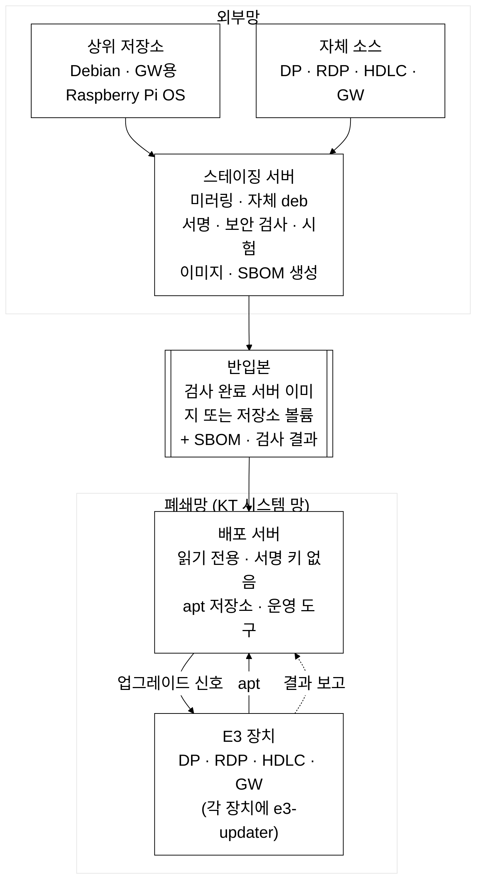
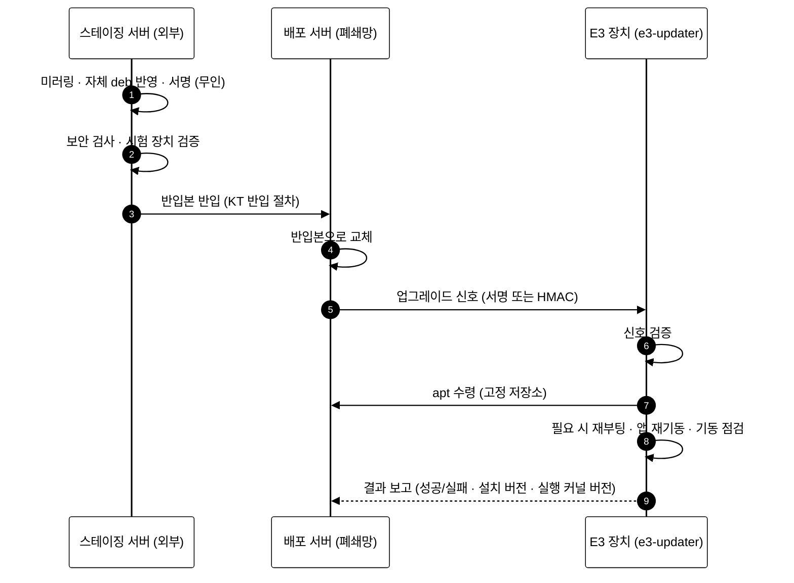

# 지속적인 OS 보안사항 적용을 위한 시스템 구상도

| 항목 | 내용 |
|---|---|
| 목적 | E3 장치에 최신 OS·보안 패치를 지속 적용하고 SBOM을 제출하는 시스템의 구성 정의 |
| 상태 | 구상 단계 |
| 작성일 | 2026-10-19 |
| 작성자 | 김명환 |

---

## 1. 요약

- 문제: 당사 E3 장치(DP, RDP, HDLC, GW)의 OS가 지원 종료(EOL)이고 배포가 수동. KT가 요구하는 SBOM 제출과 지속 패치를 처리할 수 없음
- 구성
  - 전 장치를 Debian 13 계열 OS로 전환. 현장은 microSD를 1회 교체
  - 외부망 스테이징 서버가 Debian 저장소를 자동 미러링하고 서명·보안 검사·시험 후 반입본 생성
  - 반입본을 폐쇄망(KT 시스템 망) 배포 서버에 반입. 장치는 이 서버에서 표준 apt로 업그레이드
  - 이미지(제품 설치 구성)마다 SBOM 자동 생성
- 범위: E3 장치 4종. 실행 프로그램(앱) 보안과 부트로더는 대상 아님

### 구성 원칙
1. **서명과 보안 검사는 외부 스테이징 서버에서만 수행**
2. **폐쇄망 배포 서버는 읽기 전용이며 서명 키가 없음**
3. **업그레이드는 신호 → `e3-updater` → 표준 apt**

---

## 2. 대상 장치

E3(N-ELITE 계열): KT 국사 전원·설비 감시 시스템. 현장 장치 수십 대.

| 제품 | 역할(확인 범위) | 보드 | 현재 OS | 목표 OS |
|---|---|---|---|---|
| E3-DP | 현장 데이터 처리. 장비 값 수집, 경보 판정, 제어, 상위 관제(Host) 연동 | NanoPi NEO (H3, armhf 32bit, RAM 512MB) | Ubuntu 16.04.2 | Debian 13 armhf |
| E3-RDP (RPMS) | DP 계열 현장 장치 | NanoPi (H3) | Ubuntu 16.04.2 | Debian 13 armhf |
| E3-HDLC | 현장 장치. 소스 미확정 | NanoPi (H3) | Ubuntu 16.04.6 | Debian 13 armhf |
| E3-GW | Modbus TCP 게이트웨이. DP 사설망 뒤에 위치 | Raspberry Pi (armv7 커널) | Raspbian 8 | Raspberry Pi OS Lite (Debian 13 기반, 32bit) |

- 현재 배포: 장치에서 소스 컴파일 후 `/opt/*/bin` tar 복사, 또는 약 8GB 이미지 기록
- KT SBOM 요건: 제품 단위 제출, CycloneDX 또는 SPDX JSON, 전 컴포넌트 purl과 직접·전이 의존성 필수, 취약점 조치 후 재제출

---

## 3. 전체 구성도

- 전제: 배포 서버는 KT 시스템 망 안에 설치하고 장치 → 서버 HTTP/HTTPS 통신을 허용
- 반입 매체·경로는 KT 반입 절차를 따름

---

## 4. 갱신 흐름

- 일상 갱신(미러링, 서명, 검사, SBOM 생성)은 스케줄로 무인 수행
- 담당자 작업: 검사 결과 확인, 반입 승인, 신호 전송, 결과 확인
- GW: DP의 `e3-updater`가 신호를 중계하고 apt 접속도 DP를 경유
- 이상 시 장치는 보고만 하고 복구는 수동(이전 버전 deb 설치 또는 카드 교체). 서버는 이전 반입본으로 교체 가능

---

## 5. 구성 요소

| 구성요소 | 위치 | 내용 |
|---|---|---|
| 스테이징 서버 | 외부망 | aptly로 Debian(GW용 포함) 저장소 자동 미러링, 자체 deb 반영, 자체 키 서명, 보안 검사(업스트림 서명·해시·악성코드·취약점 대조), 시험 장치 검증, 이미지·SBOM 생성, 반입본 작성 |
| 반입본 | 반입 단위 | 검사 완료된 서버 이미지 또는 저장소 볼륨. SBOM·검사 결과 포함. 이전 반입본 보존 |
| 배포 서버 | 폐쇄망 | 반입본을 읽기 전용으로 서빙. 운영 도구로 신호 전송·결과 조회. 갱신은 반입본 교체 |
| `e3-updater` (가칭) | 전 장치 | 신호 인증, 표준 apt 실행, 기동 점검, 결과 보고. 앱 데몬과 분리, 앱 코드 미수정 |
| 장치 패키지 | 장치 | 제품 메타 패키지(`e3dp`, `e3rdp`, `e3hdlc`, `e3gw`) = 공통(`e3-base`, `e3-updater`) + 제품 앱 패키지. `nelite.conf`·`nelite.db`·`alarm.db`는 업그레이드에서 덮어쓰지 않음. HDLC는 소스 확정 전 바이너리 재패키징 |
| 이미지·SBOM | 스테이징 서버 | 보드 계열별 설치 이미지(NanoPi, Raspberry Pi). 이미지와 SBOM을 같은 스냅샷에서 생성. SBOM은 제품 설치 구성 기준 CycloneDX, 수동 항목(`libPdu.a`, KISA SHA-256 구현) 포함, KT 필수 항목 자동 검증 |
| 현장 전환 | 현장 | microSD를 새 이미지로 장치당 1회 교체. `nelite.conf` 이관 도구 사용, `nelite.db`는 Host 설정 재다운로드로 복원, `alarm.db`는 이관 안 함. 이전 카드로 원복 가능 |

---

## 6. 구축 단계

| 단계 | 내용 |
|---|---|
| 1 | 기반 정리: 소스 정리, `libPdu` 소스 확정, DP/RDP 소스 차이 확인, GW 모델 확인, KT 협의(서버 위치, 장치 → 서버 포트, 반입 경로, 요청 대응 기간) |
| 2 | DP PoC: deb 빌드 → 스테이징 저장소 → NEO 설치·업그레이드 → `e3-updater` → SBOM 생성 |
| 3 | 이미지 생성, 설정 이관 도구, 카드 교체 절차 |
| 4 | 스테이징 서버 자동화, 배포 서버 구성, 운영 절차서 |
| 5 | RDP, HDLC, GW 확장. 후속: 업그레이드 자동 모드, 취약점 영향 판단 문서(VEX), 장치별 설치 목록 조회 |

---

## 7. 용어

| 용어 | 설명 |
|---|---|
| SBOM | 소프트웨어 자재명세서. 구성 컴포넌트(이름, 버전, 의존 관계) 목록 |
| apt / deb | Debian 패키지 관리 도구 / 패키지 파일 형식 |
| aptly | 저장소 미러링·스냅샷·서명을 지원하는 apt 저장소 관리 도구 |
| 스냅샷 | 특정 시점의 저장소 내용을 고정한 것 |
| 스테이징 서버 | 외부망에서 미러링·서명·보안 검사·시험을 수행하고 반입본을 만드는 서버 |
| 반입본 | 스테이징 서버가 만든 검사 완료 서버 이미지 또는 저장소 볼륨 |
| 폐쇄망 | 외부 인터넷이 차단된 KT 시스템 망 |
| Host | E3 장치가 연동하는 상위 관제 시스템 |
| `e3-updater` (가칭) | 업그레이드 신호를 받아 apt를 실행하는 신규 공통 구성요소 |
| `nelite.conf` / `nelite.db` / `alarm.db` | 장치별 설정 / 설정·계측 DB 스냅샷 / 경보 이력 |
