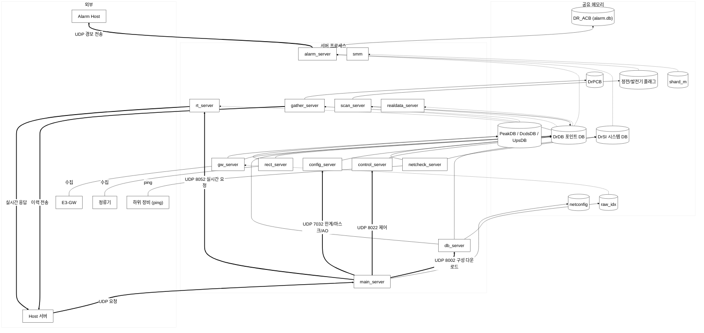

# E3-DP 메모리 분석 계획 보고서

| 항목 | 내용 |
|---|---|
| 작성일 | 26.11.04 |
| 작성자 | 김명환 |
| 분석 대상 | `e3dp.2.1` 소스 기준 SysV 공유 메모리 19개 + 파일 공유 메모리 1개 |
| 리소스 투입 | 주 20%: 주 5근무일 기준 1투입일/주 |
| 예상 공수 | 기본 15투입일 + 예비 3투입일 = 총 18투입일 |
| 현재 현황 | 이번 주 전체 구조 파악·분석 계획 수립 진행 중. 첫 상세 분석은 `netconfig` |

본 보고서는 공유 메모리의 세그먼트별 구성과 프로그램 연결 관계를 바탕으로, **내부 변수의 정의·입출력·사용법을 추적하는 분석 계획**을 정리한다. 기존 구조 분석을 재사용하되, 필드별 소스 근거와 동작 조건을 보강한다. 운영 장비 실측·배포본 대조·재현 시험·코드 수정은 별도 범위이다.

64비트 기준 논리 크기는 SysV **443,013 B**, 파일 공유 메모리 **156,006 B**, 총 **599,019 B**이다. 대표 공유 변수는 20개이며, 연계 프로그램은 중복 제거 시 18종이다. 세부 분석은 대표 포인터뿐 아니라 구조체 내부의 명명된 멤버까지 포함하고, 같은 구조의 배열 원소는 대표 경로와 인덱스 규칙으로 묶는다.

## 1. E3-DP 공유 메모리 흐름도

화살표 종류:
- 굵은 화살표(`==>`) = **UDP 요청/응답 메시지** (서버 간 명령 전달)
- 실선 화살표(`-->`) = 공유 메모리 **쓰기(W)**
- 점선 화살표(`-.->`) = 공유 메모리 **읽기(R)**
- 라벨이 붙은 가는 선(`---`) = 외부 장비와의 입출력

## 2. 세그먼트별 attach 매트릭스

 **● = SysV attach, M = 파일 mmap, ⚠ = 참조 코드는 있으나 attach 없음, 빈칸 = 해당 연결 없음** 연결 여부는 실제 읽기·쓰기 여부나 운영 장비의 실행 상태를 뜻하지 않는다.

| 프로세스 | netconfig | shard_m | DrDB | DrSI | DrPCB | PeakDB | DcdsDB | UpsDB | raw_idx | 플래그 11~18 | 플래그 19 (GEN4) | DR_ACB | Proc |
|---|:-:|:-:|:-:|:-:|:-:|:-:|:-:|:-:|:-:|:-:|:-:|:-:|:-:|
| main | ● | ● | ● | ● | | | | | | ● | | | |
| db | ● | ● | ● | ● | ● | ● | | | ● | ● | | | |
| config | ● | ● | ● | ● | | | | | | | | | |
| scan | ● | ● | ● | ● | | | | | | ● | ● | | |
| gw | ● | ● | ● | ● | | ● | | ⚠ | ● | ● | ● | | |
| modbus | ● | ● | ● | ● | | | | | | ● | | | |
| rect | ● | ● | ● | ● | | | ⚠ | | | ● | | | |
| netcheck | ● | ● | ● | ● | | | | | | ● | | | |
| control | ● | ● | ● | ● | | ● | ● | | | ● | | | |
| alarm | ● | ● | ● | ● | ● | ● | ● | ● | | ● | | M | |
| gather | ● | ● | ● | | ● | ● | ● | ● | | | | | |
| rt | ● | ● | ● | ● | | | | | | ● | | | |
| realdata | | ● | ● | | | | | | | | | | |
| emon | ● | ● | ● | ● | | | | | | ● | | M | |
| acon_agent | ● | ● | ● | ● | | | | | | | | | ● |
| upgrade | ● | | ● | ● | | | | | | | | | |
| smm |  | ● |  |  |  |  |  |  |  |  |  |  |  |
| acagent_checker |  |  |  |  |  |  |  |  |  |  |  |  | ● |

## 3. 간트차트 (리소스 투입 20%)

**W1~W18은 상대 주차**이다. 매주 연속 5일을 투입한다는 의미는 아니다. 작성일은 일정 시작일로 사용하지 않는다.

■ = 계획 작업, 진행 = 현재 수행 중, 예비 = 필요 시 

| 작업 | W1 | W2 | W3 | W4 | W5 | W6 | W7 | W8 | W9 | W10 | W11 | W12 | W13 | W14 | W15 | W16 | W17 | W18 |
|---|---|---|---|---|---|---|---|---|---|---|---|---|---|---|---|---|---|---|
| 전체 구조·분석 계획 | 진행 |  |  |  |  |  |  |  |  |  |  |  |  |  |  |  |  |  |
| netconfig |  | ■ |  |  |  |  |  |  |  |  |  |  |  |  |  |  |  |  |
| shard_m / Proc |  |  | ■ |  |  |  |  |  |  |  |  |  |  |  |  |  |  |  |
| DrDB |  |  |  | ■ | ■ | ■ | ■ | ■ |  |  |  |  |  |  |  |  |  |  |
| DrSI / raw_idx |  |  |  |  |  |  |  |  | ■ |  |  |  |  |  |  |  |  |  |
| DrPCB / PeakDB |  |  |  |  |  |  |  |  |  | ■ |  |  |  |  |  |  |  |  |
| DcdsDB / UpsDB |  |  |  |  |  |  |  |  |  |  | ■ |  |  |  |  |  |  |  |
| 정전·발전기 플래그 |  |  |  |  |  |  |  |  |  |  |  | ■ |  |  |  |  |  |  |
| DR_ACB / alarm.db |  |  |  |  |  |  |  |  |  |  |  |  | ■ |  |  |  |  |  |
| 통합 흐름 검토 |  |  |  |  |  |  |  |  |  |  |  |  |  | ■ |  |  |  |  |
| 최종 검토·문서 반영 |  |  |  |  |  |  |  |  |  |  |  |  |  |  | ■ |  |  |  |
| 예비 공수 |  |  |  |  |  |  |  |  |  |  |  |  |  |  |  | 예비 | 예비 | 예비 |

기본 분석은 약 15주, 예비 포함 약 18주이다. 주별 리소스가 달라지면 **누적 투입일을 기준으로 갱신**한다. 현재 실제 투입시간이 미입력되어 있으므로 확정 완료일이나 잔여 공수를 제시하지 않는다.

| 평균 투입률 | 주당 투입일 | 기본 15일 | 예비 포함 18일 |
|---|---:|---:|---:|
| 10% | 0.5일 | 30주 | 36주 |
| 20% | 1일 | 15주 | 18주 |
| 40% | 2일 | 7.5주 | 9주 |
| 100% | 5일 | 3주 | 3.6주 |

## 4. 작업계획 (누적 투입일)

1투입일은 담당자 1명의 순수 분석시간 **8시간**으로 가정한다. D1~D18은 누적 투입일에 따른 작업 구간이다. 실제 투입과 완료 범위는 별도로 기록한다.

| 누적 투입일 | 대상 | 작업 계획 | 완료 산출물 |
|---|---|---|---|
| D1 | 전체 구조·분석 계획 (이번 주 진행 중) | 소스 버전/빌드 조건 고정, 20개 영역·연계 프로그램 목록 대조, 변수 추적 양식과 미확인 목록 작성 | 분석 보고서 |
| D2 | `netconfig` (첫 상세 분석) | 설정 파일 적재부터 각 소비 프로그램까지 멤버별 추적, 변경 반영 시점 확인 | 분석 보고서 |
| D3 | `shard_m`, `Proc` | 카운터·종료·버전 필드, 감시·재기동 경로와 주기, 예약 슬롯 분석 | 분석 보고서 |
| D4 | `DrDB` 헤더 | 구성 개수, 다운로드·제어·재초기화 플래그, 초기화 범위와 상태 전이 추적 | 분석 보고서 |
| D5 | `DrDB.comp[]`, `point[]` | 구성 다운로드·복원, 물리/논리 연결 및 인덱스 사용 조건 추적 | 분석 보고서 |
| D6 | `DrDB.lport[]` 정의·설정 | 식별자, 포트 유형, 한계값·마스크·설정 변경 경로 추적 | 분석 보고서 |
| D7 | `DrDB.lport[]` 값·통신·제어 | 현재값, 통신상태, 제어 요청의 생산·소비 경로와 다중 쓰기 추적 | 분석 보고서 |
| D8 | `DrDB.lport[]` 경보·피크·시간 | 경보 상태·이전값·피크·시각 필드, 미사용 필드까지 대조 | 분석 보고서 |
| D9 | `DrSI`, `raw_idx` | 장비 구성·통신상태, 인덱스 생성·조회, 배열 범위와 재구성 시점 추적 | 분석 보고서 |
| D10 | `DrPCB`, `PeakDB` | 이력 기록·조회·전송·응답 후 삭제, 버퍼 인덱스·경계 동작 추적 | 분석 보고서 |
| D11 | `DcdsDB`, `UpsDB` | 이력 생성·소비, attach 누락과 호출 조건, 버퍼 상태 필드 추적 | 분석 보고서 |
| D12 | 정전·발전기 플래그 9개 | 개별 값 의미, 판정 조건, 지연 카운트, 참조 프로그램 구분 | 분석 보고서 |
| D13 | `DR_ACB` / `alarm.db` | 파일 생성·매핑, 블록 멤버, 적재·전송·해제, 재기동 초기화, 32/64비트 차이 추적 | 분석 보고서 |
| D14 | 프로그램 간 통합 흐름 | 기동, 구성 다운로드, 계측·경보, 제어, 이력 전송, 재기동 흐름 교차 확인 | 분석 보고서 |
| D15 | 최종 검토·문서 반영 | 선언 대비 추적 누락 점검, 통계·R/W 표 정합성 확인, 미확인 항목과 결론 정리 | 분석 보고서 |
| D16~D18 | 예비 공수 | 남은 간접 접근·빌드 분기·미확인 의미 재조사, 검토 보완 | 분석 보고서 |

### 분석 방법과 첫 작업

각 영역에서 **정의 → 생성·연결 → 초기화 → 쓰기(W) → 읽기(R) → 사용 조건·수명 → 예외**를 추적한다.

D1은 전체 구조·영역별 규모·연결 관계와 분석 계획을 정리한다. 첫 상세 분석 D2는 다음을 수행한다.

1. `NetworkConfigRec` 전체 멤버의 타입·길이·의미·크기와 키를 정리한다.
2. 생성·attach 경로와 실패 처리, 초기화 시점을 확인한다.
3. `nelite.conf` 설정 항목이 `main_server`를 통해 기록되는 경로를 추적한다.
4. 멤버별 읽기 프로그램·함수와 출력 용도, attach만 하는 경우를 구분한다.
5. 설정 누락·변경·재기동 시 동작과 다른 공유 영역으로 전달되는 값을 확인한다.

### 점검 및 실적 관리

D2에서 첫 분석의 실제 공수와 양식을 점검하고, D3·D8에서 남은 예상 공수를 갱신한다. D13에서 전체 20개 영역의 누락을 점검하고 D15에서 통합 검토한다. 핵심 동작이 미확인인 영역은 완료로 처리하지 않으며, 소스만으로 확정할 수 없는 사항은 후속 검증 대상으로 구분한다.

- 실제 누적 투입일 = 누적 분석시간 ÷ 8시간
- 갱신 총 예상 공수 = 실제 누적 투입일 + 남은 기본 작업 예상일 + 남은 예비일
- 참고 잔여 주수 = 남은 예상 투입일 ÷ 향후 주당 평균 투입일

이번 주는 진행 중이며 실투입시간은 미등록이다. D1이 계획대로 1일에 완료되면 기본 14일 + 예비 3일, 총 17투입일이 남는다. 예비 공수는 실제 사용 사유를 기록하며 기본 작업 초과분과 중복 합산하지 않는다.

## 5. 산출물 (각 분석문서)

### 상세 분석문서 작성 계획

아래 파일명은 **향후 작성할 산출물의 제안명**이다. 현재 분석 완료 또는 파일 생성 상태를 뜻하지 않는다. 연관 영역은 한 문서에 묶되 각 세그먼트·변수를 구분한다.

| 작성 시점 | 예정 문서명 | 주요 내용 | 상태 |
|---|---|---|---|
| D2 | `netconfig_네트워크관련_분석.md`, `netconfig_네트워크외_분석.md` | netconfig: 설정 변수 사전, 파일 입력→공유 변수→소비 프로그램, 초기화·변경 반영 | 예정 |
| D3 | `프로세스관리_분석.md` | shard_m, Proc: 생존 카운터·종료·버전·감시 및 재기동 | 예정 |
| D4~D8 | `DrDB_분석.md` | 헤더·comp[]·point[]·lport[]의 멤버 사전, 설정·계측·통신·제어·경보 R/W | 예정 |
| D9 | `시스템DB_원시인덱스_분석.md` | DrSI, raw_idx: 장비 구성·상태, 인덱스 생성·조회·배열 범위 | 예정 |
| D10 | `정시_피크버퍼_분석.md` | DrPCB, PeakDB: 적재·조회·전송·삭제·경계 처리 | 예정 |
| D11 | `DC_UPS버퍼_분석.md` | DcdsDB, UpsDB: 이력 흐름, attach 누락·호출 조건 | 예정 |
| D12 | `정전_발전기플래그_분석.md` | 9개 플래그: 값 의미·판정 조건·지연·상태 전이 | 예정 |
| D13 | `경보파일메모리_분석.md` | DR_ACB: 파일 생성·매핑·경보 블록·전송·초기화·ABI 차이 | 예정 |
| D14 | `공유메모리_통합흐름_분석.md` | 기동·다운로드·수집·경보·제어·이력·재기동 시나리오 | 예정 |
| D15 | `공유메모리_분석결과_보고서.md` | 분석 범위·완료 현황·주요 발견·미확인 항목·후속 검증 | 예정 |

각 분석문서는 영역 개요, 멤버별 변수 사전, 초기화·입출력 추적표, 호출 흐름·사용 조건, 수명·재기동 동작, 소스 근거, 미확인 항목을 포함한다. 변수 추적표에는 **영역 / 멤버 경로 / 타입·용량 / 의미·단위 / 초기화 / W 원천·함수 / R 함수·용도 / 조건·주기 / 소스 위치·버전 / 확인 상태**를 기록한다.

### 노션을 통한 진행 내용 공유

- 공유 공간: [E3-DP 노션](https://app.notion.com/p/E3-DP-40d566c0ec1a8085ba64ffb107083b8d)
  - https://app.notion.com/p/E3-DP-40d566c0ec1a8085ba64ffb107083b8d
- 이용 방식: 회사 메일로 노션 계정을 가입하고 **무료 이용을 전제로** 문서를 공유한다.
- 접근 요청: 가입한 계정의 회사 메일 주소(ID)를 **김명환에게 전달하여 관련 문서 공유를 요청**한다.
- 공유 내용: 분석 진행 상황, 변수 추적 결과, 주요 발견, 미확인 사항과 후속 작업을 수시로 갱신한다. 문서별 상태는 예정·진행 중·검토 중·완료로 표시한다.
- 관리 방식: 원본 Markdown 분석문서와 노션 공유본에 갱신일·분석 대상 소스 버전을 남겨 서로 대조할 수 있게 한다.

### AI 계획 검토 의견

보고서는 **구조와 연결 관계 → 리소스·일정 → 구체적 작업 → 산출물·공유 방법** 순서로 구성하는 것이 적절하다. 일정의 기준은 투입일로 유지하고 주차 간트차트는 리소스 20%일 때의 참고 배치로 사용한다. 첫 `netconfig` 분석에서 문서 수준과 실제 소요 공수를 확인한 뒤 나머지 계획을 조정한다.
