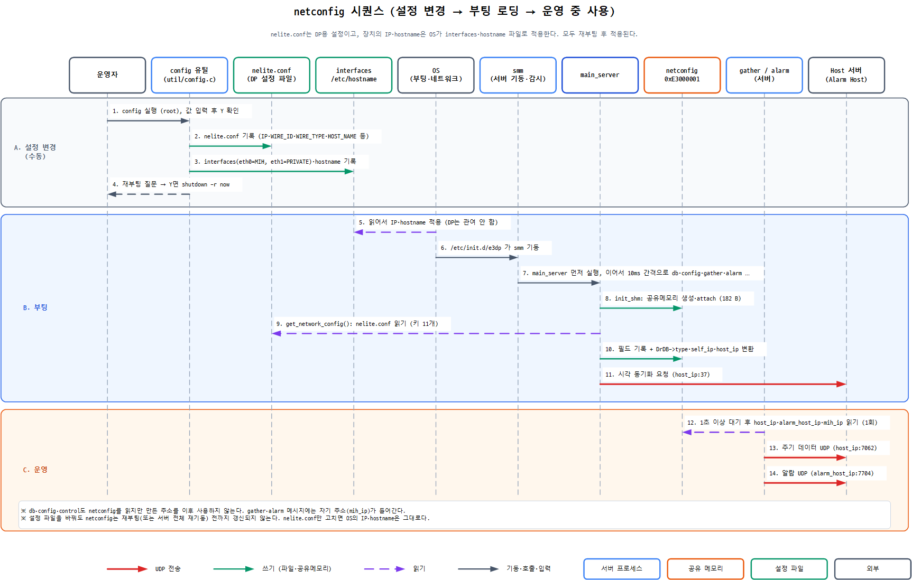

# netconfig 네트워크 관련 분석

> 대상: `e3dp.2.1` 소스, 경로는 `e3dp.2.1/` 기준. 소스 줄을 직접 확인했고, 기준 장치(10.10.0.220)는 읽기 전용으로 대조했다.
> `netconfig`는 DP가 부팅할 때 `nelite.conf`를 읽어 만드는 공유메모리(182바이트, 키 `0xE3000001`)이다.
> **이 문서의 범위:** IP·게이트웨이·넷마스크·hostname처럼 `config` 유틸이 OS 네트워크 파일(`interfaces`, `hostname`)에 함께 기록하고 재부팅으로 적용되는 항목, 그리고 이 값이 호스트 UDP 통신 주소로 쓰이는 흐름이다. 동작을 가르는 `wire_type`, 진단용 `wire_id`, 웹 전용 키는 `netconfig_네트워크외_분석.md`에서 다룬다.

---

## 1. 핵심 요약

1. **설정은 파일 3개**이다: `nelite.conf`(DP용), `/etc/network/interfaces`(OS의 IP), `/etc/hostname`(OS의 이름).
2. **설정 변경은 `config` 유틸로 한다.** 세 파일을 같은 값으로 만들고, 재부팅하면 적용된다. 수동으로 고치면 OS 파일도 같이 고쳐야 한다.
3. **부팅하면 `nelite.conf`가 메모리(netconfig)로 로딩**된다.
4. **로딩된 값은 호스트(상위 서버)와의 UDP 통신 주소**로 쓰인다: 주기 데이터 전송, 알람 전송, 시각 동기화 요청.

---

## 2. 전체 흐름



```
[설정 변경]  config 유틸 (수동 실행)
    └─ 쓰는 파일 3개
        ├─ /opt/e3dp/conf/nelite.conf       ← DP가 읽음
        ├─ /etc/network/interfaces          ← OS가 읽음 (IP·마스크·게이트웨이)
        └─ /etc/hostname                    ← OS가 읽음 (호스트 이름)
                         │
                    재부팅  ▼
[부팅]
    ├─ OS            : interfaces, hostname 적용 → 장치의 실제 IP·이름이 정해짐
    └─ DP (smm → main_server)
         └─ nelite.conf 읽기 → 공유메모리 netconfig 채움
                         │
                         ▼
[운영]  다른 서버들이 netconfig의 IP로 호스트와 UDP 통신
```

- IP와 hostname을 장치에 적용하는 것은 **OS**이다. DP는 읽어서 통신 주소를 만들 뿐, OS 설정을 바꾸지 않는다.
- 호스트(서버)가 IP 설정을 내려보내는 경로는 없다. 호스트가 DP로 내려보내는 것은 DB 구성, 상·하한, 경보 마스크, 제어 명령이다.

---

## 3. 설정을 바꾸려면

| 방법 | OS의 IP·hostname | DP(netconfig) |
|---|---|---|
| **`config` 유틸 (권장)** | `interfaces`, `hostname`을 함께 기록 → 재부팅 후 적용 | 재부팅 후 적용 |
| `nelite.conf`만 수정 | **적용 안 됨** | DP 전체 재기동(또는 재부팅) 후 적용 |

`nelite.conf`만 고치면 OS와 DP의 값이 어긋난다. 수동으로 고칠 때는 아래 짝을 같은 값으로 맞춘다.

| nelite.conf | OS 파일 |
|---|---|
| `MIH_IP`, `MIH_GATEWAY`, `MIH_NETMASK` | `interfaces`의 eth0 `address`, `gateway`, `netmask` |
| `PRIVATE_IP`, `PRIVATE_GATEWAY`, `PRIVATE_NETMASK` | `interfaces`의 eth1 `address`, `gateway`, `netmask` |
| `HOST_NAME` | `/etc/hostname` |

`HOST_IP`, `ALARM_HOST_IP`, `WIRE_ID`, `WIRE_TYPE`은 OS 파일과 짝이 없는 DP 전용 값이다.

**`config` 유틸 사용법** (`src/util/config.c`, root로 실행)
- 항목마다 현재 값이 `[ ]`로 표시되고, Enter는 유지, 새 값 입력은 교체이다. 전체 값 확인(Y) 후 세 파일을 쓰고, 재부팅 여부를 묻는다.
- `config init`은 입력 없이 소스에 박힌 기본값(예: MIH_IP 10.0.10.10)으로 기록한다. 현재 값을 읽지 않으므로 주의한다.
- 재부팅하지 않으면 파일만 바뀌고 아무것도 적용되지 않는다.

---

## 4. 메모리에 로딩된 값은 어디에 쓰이나

| 프로세스 | 쓰는 값 | 용도 (무엇을 어디로) | 위치 |
|---|---|---|---|
| **gather_server** | `host_ip`, `mih_ip` | **주기 데이터**(`EC_SVC_PERIODIC_GATHER`)를 호스트로 UDP 전송. 목적지 `host_ip`:7062, 메시지에 자기 주소(`mih_ip`) 포함 | `gather_server.c:348-349, 419, 896, 1575` |
| **alarm_server** | `alarm_host_ip`, `mih_ip` | **알람**(`EC_SVC_ALARM_GATHER`)을 알람 호스트로 UDP 전송. 목적지 `alarm_host_ip`:7704, 메시지에 자기 주소(`mih_ip`) 포함. 응답이 없으면 `alarm_host_ip`를 로그로 출력 | `alarm_sender.c:50-51, 121`, `alarm_handler.c:268-276, 321` |
| **main_server** | `host_ip`, `mih_ip`, `wire_type` | **시각 동기화 요청**을 호스트 37번 포트로 전송. `wire_type`은 `DrDB->type`으로 복사 | `main_tsync.c:65-66, 293`, `main_server.c:381` |
| db / config / control | `host_ip`, `mih_ip` | 읽어서 주소 구조체를 만들지만 **이후 사용하지 않음** | `ldb_server.c:413`, `config_server.c:241`, `control_init.c:158` |
| emon | 전체 | 진단 화면 출력 | `emon.c:298` |
| gw, modbus, netcheck, rect, rt, scan, acon_agent | 없음 | 메모리에 붙기만 하고 값은 읽지 않음 | 각 `init_shm.c` |

- 모든 통신 상대는 `nelite.conf`의 `HOST_IP`(알람은 `ALARM_HOST_IP`)이다. 기준 장치 값은 둘 다 10.10.0.144이다.
- 호스트가 메시지 안의 자기 주소(`mih_ip`)로 응답한다면 OS의 실제 IP와 `mih_ip`가 다를 때 응답이 맞지 않는다. 호스트 쪽은 이 저장소에 없어 확인하지 못했다.

---

## 5. 필드 트리

`[O]` 서버 로직이 사용, `[D]` 진단 출력만, `[-]` DP는 읽지 않음(OS 설정 생성에는 쓰임), `[X]` 미사용.

```
netconfig (182 B) 중 네트워크 항목 9개
├─ hostname       [D] 장치 이름 (OS의 /etc/hostname과는 별개 복사본)
├─ mih_ip         [O] 자기 장치 IP → 통신 시 자기 주소 (Self_IP)
├─ mih_netmask    [-] OS의 eth0 netmask 생성에 쓰임
├─ mih_gateway    [-] OS의 eth0 gateway 생성에 쓰임
├─ private_ip     [D] OS의 eth1 address 생성에 쓰임
├─ private_netmask[-] OS의 eth1 netmask 생성에 쓰임
├─ private_gateway[-] OS의 eth1 gateway 생성에 쓰임
├─ host_ip        [O] 호스트(통신 상대) IP → 통신 시 상대 주소 (Host_IP)
└─ alarm_host_ip  [O] 알람 전송 대상 IP
```

- 나머지 4개 필드(`wire_id`, `wire_type`, `e3gw_subnet`, `rect_subnet`)는 `netconfig_네트워크외_분석.md`의 필드 트리에서 다룬다.
- 구조체 정의: `include/nelite.h:162-186`. 같은 표기가 필드 주석에도 들어 있다.
- 값을 채우는 곳: `main_server.c`의 `get_network_config()` (`:215-403`). 다른 프로세스는 읽기만 한다.

---

## 6. 알아둘 점

- **서버는 기동 시 1회만 읽는다.** `nelite.conf`를 고친 뒤에는 main_server만이 아니라 서버 전체를 다시 띄워야 한다(`/etc/init.d/e3dp restart` 또는 재부팅).
- **hostname은 DP 동작에 영향이 없다.** `netconfig->hostname`을 읽는 곳은 진단 화면(`emon.c:307`)뿐이고, main이 기동 시 값을 출력한다(`main_server.c:267`). 장치의 실제 이름은 OS의 `/etc/hostname`이며, `config` 유틸이 `nelite.conf`와 함께 기록하지만 둘은 독립된 복사본이라 한쪽만 고치면 어긋난다.
- **키가 없어도 기동은 멈추지 않는다.** 해당 필드가 빈 값으로 남는다(`main_server.c:232`의 NULL 검사가 항상 거짓).
- **값 길이를 검사하지 않는다.** `hostname` 29자, IP 15자는 종료 문자(NUL)까지 들어가는 한계이다. 이를 넘으면 종료 문자가 없어지고, 한 글자 더 넘으면 다음 필드를 덮어쓴다.
- **`HOST_IP` 줄은 `ALARM_HOST_IP` 줄보다 앞에 있어야 한다.** 값을 `grep` 부분 일치로 찾기 때문이다. `config` 유틸이 만드는 파일은 이 순서이다.
- **수동 편집에는 입력 검증이 없다.** `config` 유틸은 WIRE_TYPE(1·2)과 IP 형식을 검증한다.
- **`config` 유틸의 `nelite.db` 삭제는 현재 디렉터리가 `/`일 때만 동작한다.** 상대 경로 `bin/rm`을 쓰기 때문이다(`config.c:125`). `nelite.db`는 호스트가 내려준 DB의 로컬 사본이며, 이 삭제 여부가 `wire_type`의 최종 값에도 영향을 준다(`netconfig_네트워크외_분석.md` 4.1절).
- **웹 설정 화면(`wl.cgi`)이 쓰는 파일은 DP가 읽는 파일과 경로가 다르다.** `cgi-bin/wl.c`는 `/home/pi/e3gw/conf/nelite.conf`(`cgi-bin/common.h:141`)에 저장하고, DP는 `/opt/e3dp/conf/nelite.conf`(`include/nelite.h:77`)를 읽는다. 기준 장치(10.10.0.220, 설치 버전 03.01.14)에는 웹 서버와 `wl.cgi`가 배포되어 있지 않다(`/opt/e3dp`에 cgi·web 없음, lighttpd 미기동, `/home/pi/e3gw` 없음). 기준 장치는 현장과 거의 비슷한 환경이므로 웹 설정 화면은 E3-DP에서 쓰이지 않는 것으로 본다. 현장 장치 자체는 확인하지 않았다. 자세한 내용은 `netconfig_네트워크외_분석.md` 6절.
- **netconfig를 거치지 않는 Host IP 경로가 하나 있다.** `control_client.c`가 `DrGetHostIP()`로 `/opt/conf/nelite.config`를 읽는데, 기준 장치에는 이 파일이 없다(`control_auto.c:1060`에서 호출). 실행 여부는 확인하지 않았다.
- **기동 순서는 대기 시간에만 의존한다.** 읽는 서버가 모두 `sleep(1)` 이상 기다린 뒤 읽는다. 동기화 장치는 없다.
- **기준 장치 확인 결과:** `nelite.conf`, 공유메모리 내용, `interfaces`, `hostname`, 실제 IP가 모두 일치했다. 공유메모리에 붙은 프로세스 수(14)도 소스 분석과 같았다.
- **신 환경(Debian)에서 `/etc/network/interfaces` 방식이 IP를 적용하는지는 확인하지 않았다.**

