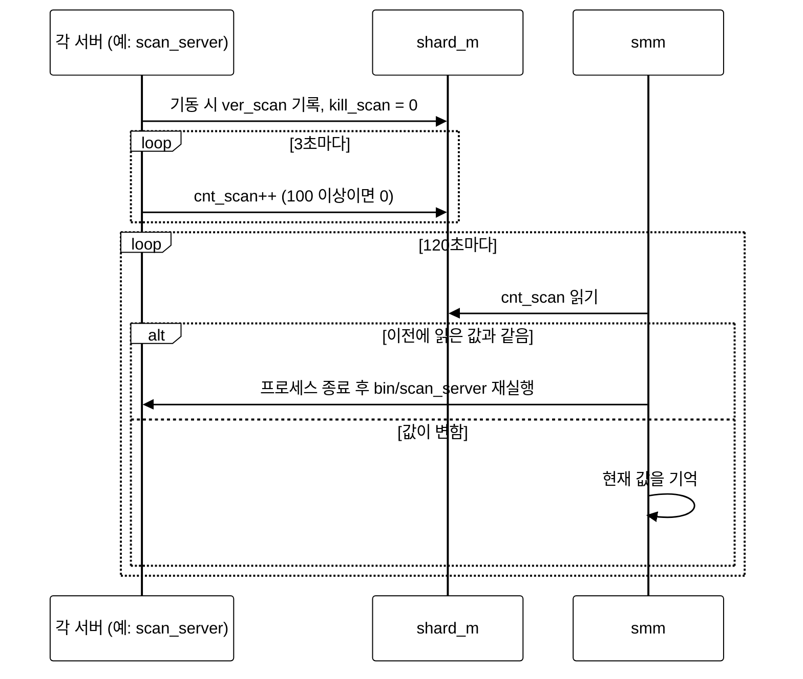
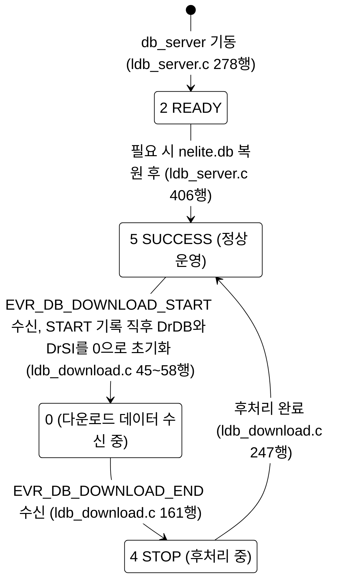
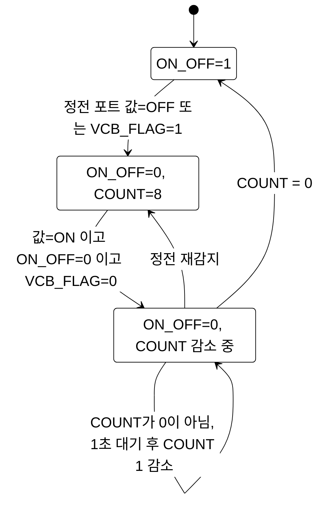
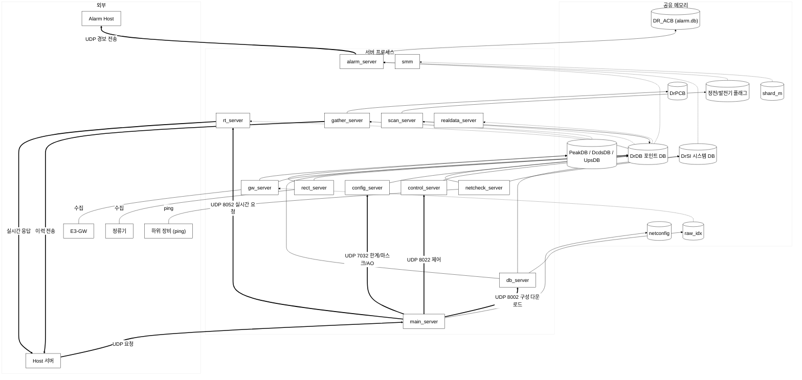

# E3-DP 공유 메모리 구조

> 대상: `e3dp.2.1` 소스 (`include/nelite.h`, `include/drmodule.h`, `include/scan/*.h`, `include/alarm/alarm.h`, `src/*/init_shm.c` 등)
> 이 문서만으로 E3-DP의 공유 메모리 구성, 각 영역의 의미, 읽고 쓰는 프로세스를 이해할 수 있도록 작성했다.
> 표기: **R** = 읽기, **W** = 쓰기(값 변경).

**검증 기준 (이 문서의 모든 내용은 아래 방법으로 확인한 사실이다)**

| 항목 | 확인 방법 |
|------|-----------|
| 구조체 크기 | 소스 트리의 실제 헤더를 gcc 13.3(x86_64, 64비트)으로 컴파일해 `sizeof` 출력. 32비트 값은 컴파일 환경이 없어 필드 합으로 계산한 것이며 해당 부분에 "계산값"이라 표시했다. |
| 서버별 attach 목록 | 각 서버 소스를 `gcc -E`(전처리)한 결과에서 `CreateSharedMemory`/`createShardMemory` 호출을 추출. `#if 0`, 주석 처리된 호출은 제외된다. |
| "attach 없이 사용" 여부 | 서버 디렉터리의 `Makefile` OBJS에 있는 소스를 전처리해 공유 메모리 변수의 사용 여부를 전수 조사 |
| 읽기/쓰기 주체, 값의 의미 | 해당 소스 줄을 직접 확인. 근거 파일을 본문에 적었다. |
| 범위 | **소스 트리 기준** 이다. 장비에 배포된 바이너리와 일치하는지는 확인하지 않았다. |

---

## 0. 메모리 분석 통계

### 0.1 전체 규모

아래 수치는 **3절의 영역별 크기와 5.2절의 활성 attach/mmap 목록을 집계한 소스 기준 통계** 이다. 장비에서 측정한 현재 사용량이 아니라, 각 영역을 한 번씩 합산한 설계 용량이다.

| 항목 | SysV 공유 메모리 | 파일 기반 공유 메모리 (`MAP_SHARED`) | 전체 |
|---|---:|---:|---:|
| 영역 수 | 19개 세그먼트 | 1개 파일 매핑 (`alarm.db`) | 20개 |
| 대표 공유 변수 수 | 19개 | 1개 (`DR_ACB`) | 20개 |
| 논리 크기 — 64비트 기준 | 443,013 B (432.63 KiB) | 156,006 B (152.35 KiB) | 599,019 B (584.98 KiB) |
| 연계 프로그램 종류 수 — 중복 제거 | 18개 | 2개 (`alarm_server`, `emon`) | 18개 |

**집계 기준**

- **변수 수** 는 영역을 가리키는 대표 전역 변수명 수이다. `DrDB` 내부의 구조체 멤버 수, 배열 원소 수, 프로세스별 포인터 사본 수는 포함하지 않는다. 내부 데이터 용량은 0.3절에 별도로 적었다.
- **연계 프로그램 수** 는 5.2절의 16개 프로그램에 `smm`, `acagent_checker`를 더한 범위에서, 활성 `attach` 또는 `mmap` 호출이 있는 프로그램 종류를 센 값이다. `emon` 같은 점검 프로그램과 `upgrade_server`도 포함하며, 일반 유틸리티와 웹 CGI는 제외한다. 운영 장비의 실행 중 서비스 수나 `shm_nattch` 측정값과는 다르다.
- 같은 프로그램이 여러 영역에 연결되어도 전체 프로그램 수에서는 **한 번만** 센다. 파일 매핑의 2개 프로그램은 SysV 연계 18개에 이미 포함되므로 합계는 18개이다.
- attach만 하고 데이터를 사용하지 않는 프로그램도 연결 수에 포함한다. 반대로 `rect_server`의 `DcdsDB`, `gw_server`의 `UpsDB`는 참조 코드가 있어도 attach가 없어 연결 수에서 제외한다 (4.4절, 5.2절).
- **KiB = 1,024 B** . 크기는 프로세스 수를 곱하지 않는다. 공유 영역 자체의 크기이며 프로세스별 RSS를 더한 값이 아니다. 일반 설정·백업·이력 파일은 파일 공유 메모리 통계에서 제외한다.

### 0.2 영역별 크기·변수 수·연계 프로그램 수

| 구분 | 대표 변수 | 영역 수 | 변수 수 | 논리 크기(B) | 연계 프로그램 수 | 연결 근거 |
|---|---|---:|---:|---:|---:|---|
| SysV | `netconfig` | 1 | 1 | 182 | 15 | 5.2절 |
| SysV | `shard_m` | 1 | 1 | 872 | 16 | 5.2절의 15개 + `smm` |
| SysV | `DrDB` | 1 | 1 | 332,237 | 16 | 5.2절 |
| SysV | `DrSI` | 1 | 1 | 12,005 | 14 | 5.2절 |
| SysV | `DrPCB` | 1 | 1 | 61,204 | 3 | db, alarm, gather |
| SysV | `PeakDB` | 1 | 1 | 8,722 | 5 | db, gw, control, alarm, gather |
| SysV | `DcdsDB` | 1 | 1 | 14,504 | 3 | control, alarm, gather |
| SysV | `UpsDB` | 1 | 1 | 8,704 | 2 | alarm, gather |
| SysV | `raw_idx` | 1 | 1 | 4,400 | 2 | db, gw |
| SysV | 정전·발전기 플래그 11~18 | 8 | 8 | 8 (각 1 B) | 각 11 | 5.2절의 플래그 11~18 열 |
| SysV | `MAIN_GEN_FLAG4` (플래그 19) | 1 | 1 | 1 | 2 | scan, gw |
| SysV | `Proc` | 1 | 1 | 174 | 2 | acon_agent, acagent_checker |
| **SysV 소계** | | **19** | **19** | **443,013** | **18 (중복 제거)** | |
| 파일 mmap | `DR_ACB` | 1 | 1 | 156,006 | 2 | alarm, emon |
| **전체** | | **20** | **20** | **599,019** | **18 (중복 제거)** | |

> `smm`의 `shard_m` 연결은 `src/smm/smm_new.c`의 `createShardMemory()` 호출, `Proc` 연결은 `src/acon_agent/acon_server.c`와 `src/acagent_checker/proc_check.c`의 호출로 확인한다. 표의 서버 약칭은 5.2절과 같다.

### 0.3 데이터 수용량과 해석 시 참고할 통계

| 대상 | 최대 수용량 / 구성 | 의미 |
|---|---|---|
| `DrDB` | 구성품 300개, 논리포트 2,500개, 물리 포인트 3,000개 | 배열의 고정 용량. 현재 사용 개수는 `usedcomps`, `lport_count`, `point_count` 등과 별도 확인 필요 |
| `DrSI` | 하위 장비(shelf) 300개 | 실제 사용량은 `shelf_count` 등으로 확인 |
| `raw_idx` | `begin`/`end` 각각 100 × 11 | 인덱스 원소 총 2,200개 |
| `DrPCB` / `PeakDB` / `DcdsDB` / `UpsDB` | 각각 1,700 / 300 / 500 / 300건 | 이력 버퍼 총 2,800건. 경보 버퍼와 별도 |
| `DR_ACB` | 경보 블록 3,000건 | 파일 기반 공유 메모리의 고정 용량 |
| `shard_m` | 관리 슬롯 15개 | 생존 감시 대상은 12개이며, 슬롯 수와 연계 프로그램 수는 다른 지표 (4.1절) |

- **용량 집중도** : `DrDB`가 SysV 논리 크기의 약 **75.00%** 를 차지한다. 구조 변경의 용량 영향을 볼 때 가장 먼저 확인할 영역이다.
- **페이지 단위 규모** : 페이지 크기를 4,096 B로 가정해 각 SysV 영역을 따로 올림하면 총 **507,904 B (496 KiB)** 이다. 1 B 플래그 9개도 각각 한 페이지이므로 합계 36 KiB가 된다. 이는 페이지 반올림 계산이며 실제 상주 메모리(RSS), 커널 관리 비용, 파일 페이지 캐시를 포함한 실측값은 아니다.
- **플랫폼 차이** : `DR_ACB`는 32비트에서 **144,006 B (계산값)** 로 줄어든다. 다른 영역을 3절 크기로 유지해 합산하면 전체 논리 크기는 **587,019 B (573.26 KiB)** 이다. 실제 배포 ABI의 크기는 별도로 확인해야 한다.
- **운영 시 보완할 값** : SysV 영역별 실제 생성 여부·크기·attach 수, 실행 중 프로그램 목록, 배열 사용 개수와 버퍼 적재량을 함께 수집하면 설계 용량과 현재 사용량을 비교할 수 있다. 현재 문서의 숫자는 사용률이나 실행 중 서비스 수를 뜻하지 않는다.

---

## 1. 한눈에 보기

E3-DP는 기능별로 나뉜 **독립 프로세스(서버) 여러 개** 가 동시에 동작한다. 서버 간 통신 수단은 두 가지이다.

- **공유 메모리** : 설비의 현재값·경보상태·통신상태·설정값 같은 **데이터** 를 모든 서버가 같은 메모리에 붙어(attach) 직접 읽고 쓴다.
- **UDP 소켓** : Host가 보낸 **요청/명령** 은 `main_server`가 받아 서비스 종류별 서버로 전달한다 (6절).

핵심 영역은 다음과 같다.

- **DrDB (포인트 DB)** : 설비의 모든 계측/감시 포인트(논리포트)의 현재값·경보상태·통신상태를 담은 가장 큰 영역(332,237 B ≈ 324 KB). 거의 모든 서버가 접근한다.
- **DrSI (시스템 DB)** : E3-GW 등 하위 장비(shelf)의 통신상태·IP 정보.
- **shard_m (프로세스 관리)** : 각 서버의 생존 신호(카운터)와 종료 요청 플래그. 감시 프로세스 `smm`이 사용한다.
- 그 외 영역: 네트워크 설정, 정시/피크/DC/UPS 이력 버퍼, 원시 인덱스 테이블, 정전·발전기 판정용 1바이트 플래그.
- 경보 버퍼(ACB)만 예외적으로 **SysV 공유 메모리가 아니라 파일(`alarm.db`)을 `mmap`**  한다.
- **락(세마포어/뮤텍스/flock)은 소스 전체(`src`, `lib`)에 없다.** 같은 필드를 여러 서버가 쓰는 경우가 있다 (예: `lport.value`, `lport.status`, `lport.com_status` — 5.3절).

---

## 2. 트리 구조

계층과 항목별 설명(키, 크기)을 함께 보여주기 위해 이 절은 텍스트 트리로 쓴다. 프로세스 간 흐름, 상태 변화, 순서는 이후 절에서 mermaid 도표로 보여준다.

```
E3-DP 공유 메모리
│
├─ [A] 시스템 · 설정 계열
│   ├─ NetworkConfigRec  (netconfig)   key 0xE3000001   182 B
│   │     wire_id, wire_type, hostname, MIH/Private/Host/경보호스트 IP, 넷마스크, 게이트웨이, e3gw·rect 서브넷
│   │
│   ├─ shard_memory      (shard_m)     key 0xE3000002   872 B
│   │   ├─ cnt_xxx[15]    서버별 생존 카운터 (서버가 주기적으로 증가)
│   │   ├─ kill_xxx[15]   서버별 종료 요청 플래그 (9이면 서버가 종료)
│   │   └─ ver_xxx[15][50] 서버별 버전 문자열
│   │
│   └─ ProcRec           (Proc)        key 0xE000002    174 B   ※ 다른 키와 자릿수가 다름(0xE3… 아님)
│         acon_agent 전용 생존 카운터 / 종료 플래그 / 버전 (cnt_acon, kill_acon, ver_acon + 예약)
│
├─ [B] 실시간 DB 계열 (핵심)
│   ├─ DrModuleRec       (DrDB)        key 0xE3000003   332,237 B  ← 포인트 DB
│   │   ├─ 헤더 32 B: stationid, type, self_ip/host_ip, periodinterval, isdownload, period_flag,
│   │   │             iscontrol, control_user/mode/pre_mode, usedcomps, total_ports, total_points,
│   │   │             point_count, lport_count, comp_count
│   │   ├─ comp[300]     구성품(Component) 정보              29 B × 300
│   │   ├─ lport[2500]   논리포트(Logical Port) – 값/상태/한계/경보   103 B × 2500
│   │   ├─ point[3000]   물리 포인트(GW 포트·채널 매핑)         22 B × 3000
│   │   └─ init_modbus/rect/alarm/rt/periodic   서버별 "구성 재적용 요청" 플래그 (5 B)
│   │
│   ├─ DrSystemRec       (DrSI)        key 0xE3000004   12,005 B   ← 시스템(장비) DB
│   │   ├─ shelf_count, slot_count, usedshelfs  (5 B)
│   │   └─ shelf[300]    하위 장비 1대 = 1 shelf             40 B × 300
│   │
│   └─ RawIndexRec       (raw_idx)     key 0xE3000010   4,400 B    ← 원시 인덱스
│         begin/end[MAX_UNIT=100][MAX_PORT+1=11] : (GW 단위, 포트) → DrDB->point[] 범위
│
├─ [C] 이력(History) 버퍼 계열
│   ├─ Dr_PCBRec         (DrPCB)       key 0xE3000005   61,204 B   정시(Period) 데이터 1700건
│   ├─ stPeakDBRec       (PeakDB)      key 0xE3000006   8,722 B    피크 이력 300건 + 전력값 4개
│   ├─ stDcdsDBRec       (DcdsDB)      key 0xE3000007   14,504 B   DCDS 이력 500건
│   └─ stUpsDBRec        (UpsDB)       key 0xE3000008   8,704 B    UPS 이력 300건
│
├─ [D] 정전/발전기 판정 플래그 (각 1 바이트 세그먼트, scan_server가 갱신)
│   ├─ MAIN_ON_OFF_FLAG        key 0xE3000011   입전 확정(1) / 정전 또는 복구 대기(0)
│   ├─ VCB_FLAG                key 0xE3000012   VCB OFF 또는 전압이상(UV) 시 1
│   ├─ MAIN_VCB_FLAG           key 0xE3000013   (서버 로직에서는 미사용, emon이 출력만 함)
│   ├─ MAIN_VCB_FLAG_COUNT     key 0xE3000014   입전 복귀 판정 지연 카운트다운(8 → 0)
│   ├─ MAIN_GEN_FLAG           key 0xE3000015   발전기 1~4 중 하나라도 가동 중이면 1
│   ├─ MAIN_GEN_FLAG1          key 0xE3000016   발전기 #1 가동 여부
│   ├─ MAIN_GEN_FLAG2          key 0xE3000017   발전기 #2 가동 여부
│   ├─ MAIN_GEN_FLAG3          key 0xE3000018   발전기 #3 가동 여부
│   └─ MAIN_GEN_FLAG4          key 0xE3000019   발전기 #4 가동 여부
│
└─ [E] 경보 버퍼 (공유 메모리 아님: 파일 mmap)
    └─ DrAlarmRec_ACBRec (DR_ACB)   /opt/e3dp/conf/alarm.db  (MAP_SHARED)
        ├─ flag, req_id
        └─ ACB[3000]    경보 메시지 블록
```

> 참고: `cgi-bin/common.c`는 웹 CGI용 세그먼트(`SYSTEM_KT_TELECOP_WEB_SHM_KEY = 0x1000000`, 변수 `WCFG`)를 `shmget(IPC_CREAT)`로 직접 만들어 쓴다. `src/`의 서버들은 이 키를 사용하지 않으므로 이 문서의 범위에서 제외한다.
> `lib/gi_gw/shm.c`의 `createShardMemory()`는 `lib/e3/e3lib.c`의 `CreateSharedMemory()`와 같은 동작(`shmget(0666|IPC_CREAT)` + `shmat`)을 하는 함수로, `smm`과 `acagent_checker`가 사용한다.

---

## 3. 세그먼트 목록 (키·변수·크기·용도)

키는 `include/nelite.h`(그리고 `include/proc_watchdog.h`)에 정의된다. 모든 세그먼트는 권한 `0666`, `IPC_CREAT`로 만들어지며 **먼저 기동한 프로세스가 생성** 하고 나머지는 같은 키로 붙는다.
크기는 `#pragma pack(1)`/`PACKED` 기준 바이트 수(gcc 컴파일 확인값)이다. 커널은 세그먼트를 페이지(4 KB) 단위로 할당한다.

| # | 키 | 전역 변수 | 구조체 | 크기(B) | 용도 |
|---|----|-----------|--------|--------:|------|
| 1 | `0xE3000001` | `netconfig` | `NetworkConfigRec` | 182 | 장비 네트워크·식별 설정 (`main_server`가 `nelite.conf`에서 로드) |
| 2 | `0xE3000002` | `shard_m` | `struct shard_memory` | 872 | 서버 생존 신호·종료 요청·버전 |
| 3 | `0xE3000003` | `DrDB` | `DrModuleRec` | 332,237 | 구성품/논리포트/포인트 DB (현재값·경보 포함) |
| 4 | `0xE3000004` | `DrSI` | `DrSystemRec` | 12,005 | 하위 장비(shelf) 정보·통신상태 |
| 5 | `0xE3000005` | `DrPCB` | `Dr_PCBRec` | 61,204 | 정시 데이터 버퍼 (1700건 × 36 B + 4 B) |
| 6 | `0xE3000006` | `PeakDB` | `stPeakDBRec` | 8,722 | 피크 데이터 (300건 × 29 B + 헤더 22 B) |
| 7 | `0xE3000007` | `DcdsDB` | `stDcdsDBRec` | 14,504 | DCDS 데이터 (500건 × 29 B + 헤더 4 B) |
| 8 | `0xE3000008` | `UpsDB` | `stUpsDBRec` | 8,704 | UPS 데이터 (300건 × 29 B + 헤더 4 B) |
| 9 | (파일) | `DR_ACB` | `DrAlarmRec_ACBRec` | 156,006 (64비트) / 144,006 (32비트, 계산값) | 경보 블록 3000건. `alarm.db` 파일 mmap. 키 `SHM_DR_ACB_KEY = 0xE3000009`는 정의만 있고 attach 호출은 주석 처리됨 |
| 10 | `0xE3000010` | `raw_idx` | `RawIndexRec` | 4,400 | (GW 단위, 포트)별 `DrDB->point[]` 시작/끝 인덱스 |
| 11 | `0xE3000011` | `MAIN_ON_OFF_FLAG` | `char` | 1 | 입전 확정(1) / 정전·복구 대기(0) |
| 12 | `0xE3000012` | `VCB_FLAG` | `char` | 1 | VCB OFF 또는 전압이상(UV) 시 1 |
| 13 | `0xE3000013` | `MAIN_VCB_FLAG` | `char` | 1 | 서버 로직 미사용(emon 출력만) |
| 14 | `0xE3000014` | `MAIN_VCB_FLAG_COUNT` | `char` | 1 | 입전 복귀 디바운스 카운트 |
| 15 | `0xE3000015` | `MAIN_GEN_FLAG` | `char` | 1 | 발전기 가동 종합 |
| 16 | `0xE3000016` | `MAIN_GEN_FLAG1` | `char` | 1 | 발전기 #1 |
| 17 | `0xE3000017` | `MAIN_GEN_FLAG2` | `char` | 1 | 발전기 #2 |
| 18 | `0xE3000018` | `MAIN_GEN_FLAG3` | `char` | 1 | 발전기 #3 |
| 19 | `0xE3000019` | `MAIN_GEN_FLAG4` | `char` | 1 | 발전기 #4 |
| 20 | `0xE000002` | `Proc` | `ProcRec` | 174 | acon_agent 전용 생존 신호 (`acagent_checker`가 생성 후 0으로 초기화) |

`shard_memory`가 870 B(= 120 + 750)가 아니라 872 B인 이유: 이 구조체는 `PACKED` 속성이 없고, 모든 attach 소스에서 `drmodule.h`가 `nelite.h`(`#pragma pack(1)`)보다 먼저 포함되어 패킹되지 않는다. 마지막 `char[50]` 배열 뒤에 2 B 패딩이 붙는다. 서버 소스 16개와 util 소스 6개를 컴파일해 `sizeof(struct shard_memory)`가 모두 872임을 확인했다 (`shard_m`을 attach하지 않는 `upgrade_server.c`만 870으로 계산된다).
ACB 크기가 플랫폼에 따라 다른 이유: `DrAlarmBLOCK.pop_time`이 `DrULong`(= `unsigned long`)이라 32비트에서 4 B, 64비트에서 8 B이다 (블록 48 B ↔ 52 B).

---

## 4. 주요 구조체 설명

### 4.1 `shard_memory` (프로세스 관리, `shard_m`)

서버 15슬롯에 대해 같은 모양의 필드 3벌을 가진다.
슬롯: main, db, config, scan, gather, real, alarm, alarm_h, control, modbus, rect, netcheck, realdata, reserv2, reserv3.
(`real` = rt_server의 슬롯. `alarm_h`, `reserv2`, `reserv3`는 어느 서버도 쓰지 않는다. `gw_server`는 슬롯이 없다.)

| 필드군 | 의미 |
|--------|------|
| `cnt_<서버>` (int) | 서버가 **자기 주 루프에서 증가** 시키는 생존 카운터. 100 이상이면 0으로 되돌린다. |
| `kill_<서버>` (int) | 서버는 루프에서 이 값이 **9인지 검사** 해 9이면 종료한다. 서버는 기동 시 0으로 초기화한다. |
| `ver_<서버>` (char[50]) | 서버가 기동 시 `strcpy(…, VERSION)`으로 자기 버전 기록 |

동작 규칙(생존 감시 프로토콜):

1. 각 서버: `times()` 기준 3초(`PROC_WAIT_TIME`)가 지날 때마다 `cnt_<자기>++` (≥100이면 0). 모든 서버가 같은 3초 패턴을 쓴다.
2. `smm`: 120초(`CHECK_WAIT`)마다 이전에 읽어 둔 값과 비교해 **같으면** 해당 서버를 `/proc` 검색으로 종료(`ProcessKilled`)한 뒤 `/opt/e3dp/bin/<서버> > /dev/null &`로 다시 실행한다 (`ExcuteServer`). 감시 대상은 main, db, config, scan, gather, rt, alarm, control, modbus, rect, netcheck, realdata 12개이다. (`alarm_h` 감시는 주석 처리되어 있고, `gw_modbus_server`·`rtu_server` 재기동 코드는 `#if 0`으로 막혀 있다.)
3. **`kill_<서버>`에 9를 쓰는 코드는 이 소스 트리(`src`, `lib`, `tests`)에 없다.** 서버 쪽 검사만 구현되어 있고, `smm`의 재기동은 `kill` 플래그가 아니라 프로세스 종료(`ProcessKilled`)로 이루어진다.



`acon_agent`는 별도 구조체 `ProcRec`(`Proc`)를 쓴다. `cnt_acon`은 65000까지 증가한 뒤 0으로 돌아가며, `acagent_checker`가 **20초** 마다 비교해 같으면 `acon_agent`를 다시 실행한다.

### 4.2 `DrModuleRec` (포인트 DB, `DrDB`)

**헤더(32 B)** — 국소/장비 단위 정보와 상태 플래그

| 필드 | 의미 | 쓰는 곳 |
|------|------|---------|
| `stationid[4]` | 국소 코드 | db_server (`memcpy`: `ldb_decode.c:204, 232`, `ldb_server.c:516`) |
| `type` | 장비 유형 (`DR_LOCAL_TYPE`=1, `DR_REMOTE_TYPE`=2, `DR_COMM_TYPE`=3) | main_server (`DrDB->type = netconfig->wire_type`, `main_server.c:523`), db_server |
| `self_ip[4]`, `host_ip[4]` | 자기 IP, 상위(Host) IP | main_server (`netconfig`에서 변환, `main_server.c:530-531`) |
| `periodinterval` | 정시 수집 주기 | db_server |
| `period_flag` | 정시 처리 표식 | gather_server |
| `isdownload` | 구성 다운로드 상태 (아래) | db_server |
| `iscontrol`, `control_user`, `control_mode`, `control_pre_mode` | 제어 수행 중 여부·권한·모드 | control_server, config_server, db_server (`control_pre_mode`는 control_server만) |
| `usedcomps`, `total_ports`, `total_points`, `point_count`, `lport_count`, `comp_count` | 각 배열의 사용 개수 | db_server |

**`isdownload` 값** (`include/drcommon.h`): 2 `DR_DOWNLOAD_READY`, 3 `DR_DOWNLOAD_START`, 4 `DR_DOWNLOAD_STOP`, 5 `DR_DOWNLOAD_SUCCESS`. 이 밖에 **0** 이 나타난다 (아래 전이 참조). 1은 `DR_SYSTEM_CONFIRM`으로 정의되어 있고 `ldb_server.c:169`에서 비교만 한다.

`db_server` 코드에서 확인한 전이:



- `DrDbmDownLoadStart`는 `isdownload`에 `DR_DOWNLOAD_START(3)`를 쓴 **직후** `DrDB`(`periodinterval`부터 `sizeof(DrModuleRec)` 바이트)와 `DrSI` 전체를 0으로 채운다. `isdownload`도 이 범위에 포함되므로 Host가 구성 데이터를 보내는 동안 값은 **0** 이다. `START(3)` 값은 순간적으로만 존재한다.
- `DrDbmDownLoadEnd`가 `STOP(4)`으로 바꾸고 구성 정리(후처리)를 한 뒤 `SUCCESS(5)`로 바꾼다. 즉 `STOP`은 실패가 아니라 "수신은 끝났고 후처리 중"인 구간이다.
- **다른 서버들은 이 전이를 폴링으로 감지** 한다. `gw_server`는 `이전=SUCCESS 이고 현재=0`이면 "Download Started"로 보고(`gw_server.c:130`), `이전=STOP 이고 현재=SUCCESS`이면 "다운로드 완료"로 보고 재초기화한다: `gw_server`(`create_gw_list`), `scan_server`(`Dr_Scan_Init`), `alarm_server`(3초 대기 후 ACB 초기화), `netcheck_server`.
- `SUCCESS`가 아닌 동안 `control_server` 등은 처리를 멈추고 대기한다 (예: `control_server.c:247`, 500 ms 단위).

**`comp[300]`** — 구성품(설비) 정보: 시설/구성품 코드(`facilname`, `compname`), 번호(`compno`), 사용 논리포트 수(`usedlports`) 등.

**`lport[2500]`** — 논리포트 = 구성품이 가진 하나의 계측/상태 항목. 서버들이 가장 많이 읽고 쓰는 부분이다.

| 필드 | 의미 | 쓰는 서버 |
|------|------|-----------|
| `compid`, `compno`, `compname`, `portno`, `type` | 어느 구성품의 몇 번 포트인지, 아날로그/디지털 구분 | db_server (다운로드) |
| `value` (float) | **현재 계측값/상태값** | gw_server, rect_server (수집), control_server (제어값), scan_server (정전/입전 가상포인트), gather_server (VCB_ 1번 포트 19에 `PeakDB->now_data`를 기록, `gather_server.c:1103`), modbus_server·gw_server (초기화), db_server (다운로드 시 초기값), emon (수동 설정) |
| `status` | **경보 상태** (아래 표) | scan_server (README: 상·하한 경보 상태 갱신), alarm_server (디지털 포트에서 `value & alarmmask`가 직전 값 `pvalue`와 달라지면 `DIGITAL`/`NORMAL`로 기록, `alarm_check.c:299-333`), gw_server·netcheck_server (통신이상=22), rect_server, db_server (다운로드 시 22), emon |
| `com_status` | **통신 상태** (아래 표) | gw_server, rect_server, netcheck_server, scan_server, gather_server (0x77), db_server |
| `highlimit`, `lowlimit`, `alarmmask` | 상·하한, 경보 억제(마스크) | config_server (db_server는 다운로드 시 초기 설정) |
| `deadband` | 불감대 | db_server만 씀 |
| `dband` | (정의만 있음) | config_server가 쓰지만 읽는 서버가 없다 |
| `peakvalue` | 피크값 | alarm_server, emon |
| `pvalue` | 디지털 포트의 직전 `value & alarmmask` (`alarm_check.c:299, 332`) | alarm_server |
| `pstatus` | 이전 상태 | alarm_server (db_server가 다운로드 시 0으로 초기화) |
| `hpeak`, `lpeak` | 최고/최저값 | alarm_server, gather_server |
| `otime1/2`, `rtime1/2` | 경보 발생/복구 시각 | alarm_server |
| `occ_time` | 발생 시각 (2019-09-16 DSK 추가) | scan_server |
| `tree_port` | 계통 구분: 한전=`DR_HANGEN`(1), 발전=`DR_BALGEN`(2), 한전&발전=`DR_COMMON`(3), 발전&발전=`DR_DUAL_BALGEN`(4) (`scan_check.c` 주석) | db_server (설정). 읽기: scan_server·alarm_server·emon |
| `tree` | (정의만 있음) | **어느 서버도 읽거나 쓰지 않는다** |
| `rackno`, `shelfno`, `slotno`, `channelno` | 물리 위치 (구조체 주석: Shelf/Slot/Com_port/Raw_Channel 번호) | db_server |
| `rtvalue` | (정의만 있음) | **값을 쓰는 코드가 `src`, `lib`, `include`, `cgi-bin` 어디에도 없다.** 읽는 곳: `gw_server.c:736`, `rect_server.c:620`, `large_rect.c:195` (4.4절) |
| `high_flag`, `low_flag`, `power_reset` | **AO(계측설정제어) 명령 전달용** 으로 재사용 (아래 설명) | 기록: config_server, acon_agent, rect_server(주소 사전 설정). 클리어: gw_server, rect_server, modbus_server (`modbus_server.c:228`) |

`status` 값 (`include/alarm/alarm.h`): 0 정상, 1 하한, 2 상한, 3 디지털 경보, 5 없음(`NOT_EXIST`), 20 Invalid, 21 GW에 설정정보 없음, 22 통신이상, 23 한전·발전 상태에 따른 마스킹.

`com_status` 값 (`src/emon/emon.c`의 정의 이름): 0x11 FAIL, 0x22 ERROR, 0x33 READY, 0x44 NORMAL, 0x55 LPORT_DOWN, 0x66 POINT_DOWN, **0x77 RT** (실시간 값 수신 중), 0x88 PING.
코드에서 쓰는 값: `gw_server`는 값을 정상 수신하면 `0x77`을, GW 통신이 끊겨 해당 포트를 무효 처리할 때(`invalid_perform`) `status=22`와 `com_status=0x33`을 기록한다. `db_server`는 다운로드 시 모든 논리포트를 `com_status=0x33`, `pcom_status=0x33`, `status=22`, `pstatus=0`, `flag=0`으로 초기화한다 (`ldb_download.c:538-566`). 즉 다운로드 직후 각 포트는 "통신이상(22)"에서 시작하고, 이후 해당 서버가 값을 갱신한다. `gather_server`는 VCB_ 1번 포트 19에 `0x77`을 기록한다.
`set_lport_com_status()`(`alarm_check.c:744`)는 `com_status`와 `status=22`를 쓰는 함수이지만 호출부(`alarm_check.c:95`)가 주석 처리되어 `alarm_server`에서는 실행되지 않는다.

**AO 명령 전달 방식** (소스 주석: "DrDB->lport의 사용하지 않는 high_flag, low_flag를 이용해서 Address와 설정값 저장", `config_handler.c:1389`, `acon_parse.c:61`):

1. `config_server`(또는 `acon_agent`)가 대상 논리포트에 기록한다: `power_reset = 0xAF`, `high_flag` = 주소 정보, `low_flag` = 설정값.
   `high_flag`는 `point[j].channelno×1000 + point[j].shelfno×10 + point[j].boardno`로 인코딩한다 (`config_handler.c:1423`); `compid`가 302(`DR_COMPONENT_DCDS_CODE`, 직류제어부)일 때는 `mr_addr`를 그대로 넣는다.
2. `gw_server`의 `check_ao_set()`이 `power_reset == 0xAF`인 논리포트를 찾아 `high_flag`를 풀어(주소 = `high_flag/1000`) 해당 GW 포트로 값을 보내고, `power_reset`, `high_flag`, `low_flag`를 모두 0으로 되돌린다 (`gw_server.c:841-865`).
3. 정류기는 `rect_server`가 `high_flag`를 레지스터 주소로, `low_flag`를 값으로 읽어 전송하고 0으로 되돌린다 (`rect_server.c:1227-1312`). `rect_server`는 시작 시 정류기 종류별로 `high_flag`에 레지스터 주소(예: 0x010F, 0x0114…)를 미리 채워 둔다 (`rect_server.c:218-304`).
4. `config_server`는 `power_reset`에 0x33, 0x34~0x37도 기록한다 (`config_handler.c:1062`, `1132-1135`; 주석: DC 전압/시간 설정 46.0V·46.5V, 30분·60분). 이 값을 읽는 쪽은 확인하지 않았다.

**`point[3000]`** — 물리 포인트: 논리포트가 어느 GW(`shelfno`)의 어느 포트(`portno`)·비트(`bitno`)·채널에서 오는지의 매핑. 다운로드 시 `db_server`가 채우고, 이후 읽기 위주이다.

**`init_modbus / init_rect / init_alarm / init_rt / init_periodic`** — "구성이 바뀌었으니 다시 읽어라" 요청 플래그.
- `db_server`가 다운로드 완료(`ldb_server.c:410`)와 `ldb_handler.c:215`에서 5개 모두 `INIT_NEED(1)`로 세팅한다.
- `modbus_server`는 기동 시 `init_modbus`를 `INIT_NEED`로 두고(`modbus_server.c:91`), 값이 `INIT_NEED`이면 구성을 다시 읽은 뒤 `INIT_NOT_NEED(0)`로 내린다 (`modbus_server.c:145-154`).
- `rect_server`도 기동 시 `init_rect`를 `INIT_NEED`로 두지만(`rect_server.c:97`), 이 값을 확인하고 내리는 코드(`rect_server.c:138-152`)는 `#if 0`으로 막혀 있다.
- **`init_rect`, `init_alarm`, `init_rt`, `init_periodic`은 활성 코드에서 값을 읽는 서버가 없다** (`emon`이 값을 출력할 뿐이다). 실제로 읽어서 동작하는 것은 `init_modbus` 하나이다.

### 4.3 `DrSystemRec` (시스템 DB, `DrSI`)

`shelf[]` 한 항목이 하위 장비(E3-GW 또는 정류기 등) 하나이다 (구조체 주석 기준).

| 필드 | 의미 | 쓰는 서버 |
|------|------|-----------|
| `rackno` | DP 번호 | db_server |
| `shelfno` | GW 장비 번호(Unit) | db_server |
| `compno` | 장비 종류 (`drcommon.h`의 `TYPE_*`): 1 `E3_DP`, 2 `E3_GW`, 3 `MR_RECT`/`LARGE_RECT`, 4 `AY_ACON`, 41 `A7500`, 42 `A3500`, 43 `ACON`, 44 `INV`, 45 `UPS`, 46 `E3_IO8`, 47 `E3_AI8`, 48 `E3_DC2`, 49 `A3300`, 50 `A3550` | db_server |
| `usedslots` | 장비 IP의 마지막 자리 | db_server만 씀. README는 `modbus_server`가 GW IP를 하위 포트에 적용한다고 하지만 해당 코드는 `/*** db_server to move 2016.12.15 DSK … ***/`로 주석 처리되어 있다 (`modbus_server.c:245-264`) |
| `compid` | Modbus 번호 (구조체 주석: "MODBUS NO[1 ~ 4, 9]") | db_server |
| `ipaddr[20]` | IP 문자열 | db_server (`memcpy`: `ldb_decode.c:744, 899`) |
| `status`, `pstatus` | 현재/이전 통신 상태 (`COMM_NORMAL`=0, `COMM_ALARM`=3, `COMM_NO_CONFIG`=99) | `status`: gw_server, netcheck_server, rect_server, db_server, emon; `pstatus`: alarm_server (db_server가 초기화) |
| `com_fail_cnt` | 통신 실패 횟수 | netcheck_server, rect_server (db_server가 초기화) |
| `flag` | 통신 체크용 카운터 | netcheck_server (db_server가 초기화). 읽는 곳: emon |
| `otime1/2`, `rtime1/2` | 통신 이상 발생/복구 시각 | alarm_server |

### 4.4 이력 버퍼 (DrPCB / PeakDB / DcdsDB / UpsDB)

| 영역 | 항목 | 기록하는 서버 | 소비하는 서버 |
|------|------|----------------|----------------|
| `DrPCB` | 사용여부, 요청ID(`rid`), 전송여부, 시각, 구성품/포트, 값, 최소/최대 (정시 데이터) | gather_server | gather_server (20건씩 파일 저장 후 Host 전송 — README) |
| `PeakDB` | 헤더: `pre_data`/`now_data`/`old_data`/`calc_data`(전력값 4개) + 피크 항목 300개 | gw_server (`now_data`, `calc_data`; `gw_server.c:888, 897`), gather_server (`now_data`, `calc_data`, `ID`, 피크 항목) | gather_server |
| `DcdsDB` | 항목 500개 (사용여부, 구성품, 값, 최대/최소, 시각, 요청ID) | **rect_server** (`createDCDS_Data`), gather_server (초기화·ID 갱신) | gather_server |
| `UpsDB` | 항목 300개 (동일 형식) | **gw_server** (`createUPS_Data`), gather_server (초기화·ID 갱신) | gather_server |

항목은 `Used`(사용 중)와 `Rid`(Host 요청 ID)로 "전송 대기 → Host 응답의 rid가 일치하면 처리" 흐름을 관리한다 (`gather_server.c:1706-1929`).

> **attach 없이 사용하는 코드** : `rect_server`는 `DcdsDB`를, `gw_server`는 `UpsDB`를 각각 14곳에서 사용하지만, **두 서버 모두 해당 세그먼트를 attach하지 않는다** (`rect/init_shm.c`의 `DcdsDB` attach는 `#if 0`, `gw/init_shm.c`의 `UpsDB` attach는 주석). 포인터는 전역 변수로 어디에서도 대입되지 않으므로 NULL이고, 해당 함수가 실행되면 NULL 포인터를 참조한다. 호출 조건은 다음과 같다.
> - `createDCDS_Data()`: 호출은 `rect_server.c:624`와 `large_rect.c:199`. 조건은 `!((int)value && i > 0)` 이고 `(int)value != ((int)lport[i].rtvalue & 0x04)`. `rtvalue`를 쓰는 코드가 소스 어디에도 없어 DrDB가 0으로 초기화된 이후 항상 0이므로, 이 조건은 **`value != 0` 이고 `i == 0`(lport 첫 번째 항목)** 일 때만 참이다.
> - `createUPS_Data()`: 호출은 `gw_server.c:739`. 조건은 UPS 구성품(`DR_COMPONENT_UPS__CODE`) 포트 25에서 `ivalue = (int)value & 0x01`이 0이고 `ivalue != ((int)rtvalue & 0x01)`. `rtvalue`가 항상 0이면 `0 != 0`이 되어 **참이 될 수 없다.**
> 따라서 이 소스 기준으로 `createUPS_Data()`는 호출 조건이 참이 될 수 없고, `createDCDS_Data()`는 `(int)value != 0` 이고 `i == 0`일 때만 호출된다. `gather_server`는 `DcdsDB`/`UpsDB`를 attach하여 `Used`가 1인 항목을 읽어 전송하며, 시작 시 모든 항목의 `Used`를 0으로 초기화한다 (`gather_server.c:482-510`).

### 4.5 `RawIndexRec` (`raw_idx`)

`raw_idx->begin[unit][port]` ~ `end[unit][port]`가 해당 GW 포트에 속하는 `DrDB->point[]` 인덱스 범위이다.
`db_server`가 다운로드 시 계산하고(`ldb_handler.c:457-481`), `gw_server`가 수신 데이터를 포인트에 매핑할 때 이 범위만 순회한다 (`gw_server.c:545, 597`).

### 4.6 정전/발전기 플래그 (1바이트 세그먼트 9개)

`scan_server`(`scan_check.c`)가 DrDB 값(VCB·ACB 상태, 발전기 제어반 상태)을 보고 판정해서 쓴다. 다른 서버는 쓰지 않는다.

- `VCB_FLAG` : VCB OFF(VCB 포트 21의 bit0) 또는 ATS 1차 전압이상(UV) 시 1, 정상이면 0.
- `MAIN_VCB_FLAG_COUNT` : 정전이 감지되면 8로 설정, 입전 조건(VCB ON)이 확인될 때마다 1초 대기 후 1씩 감소 — 순간 입·정전 깜빡임을 걸러내는 디바운스.
- `MAIN_ON_OFF_FLAG` : 정전 중이거나 복구 대기 중이면 0, `MAIN_VCB_FLAG_COUNT`가 0이 되어 입전이 확정되면 1.
- `MAIN_GEN_FLAG1~4` : 발전기 제어반 포트 값에서 "RUN"이면 1 (`DrPG_ProcessCheck_NEW`, `scan_check.c:1426`; 구성품 번호 1~4가 각각 FLAG1~4). 구성품별 판정: DGCP 포트 21은 bit 0x04이면 STOP, 0x08이면 IDLE, 0x10이면 RUN, 그 외 STOP. GENG 포트 20은 `com_status != 0x77`이면 STOP, bit 0x02이면 STOP, bit 0x04이면 RUN, 그 외 STOP. 플래그는 RUN일 때만 1이다.
- `MAIN_GEN_FLAG` : 1~4 중 하나라도 1이면 1.

정전/입전 판정의 상태 변화 (국소(Local) 장비, `Dr_Filter_driver`):



원격(Remote) 장비는 `RRCP` 구성품 1번 포트 20의 값을 기준으로 같은 방식(`COUNT`=8, 감소, `ON_OFF` 세팅)으로 판정한다.

**누가 이 플래그를 읽는가** : 다른 서버에서 읽는 것은 `alarm_server`의 `MAIN_GEN_FLAG`뿐이다 (`alarm_check.c:694`). `alarm_server`는 경보를 올리기 전에 계통별로 다음을 검사해 해당하면 경보를 생략한다 (`alarm_check.c:374-465`).
- `tree_port=한전`: 정전(`Dr_VCB_CHECK`가 OFF)이면 생략
- `tree_port=발전`: 발전기가 RUN이 아니면 생략
- `tree_port=공통`: 발전기 STOP이고 정전이면 생략

`Dr_VCB_CHECK()` 자체는 이 공유 플래그가 아니라 DrDB의 VCB(국소) 또는 RRCP(원격) 포트 값을 직접 읽는다 (`alarm_check.c:621-679`).

### 4.7 경보 버퍼 `DR_ACB` (`alarm.db` mmap)

- `alarm_server`가 기동 시 `/opt/e3dp/conf/alarm.db`를 열고(없거나 크기가 `sizeof(DrAlarmRec_ACBRec)`와 다르면 새로 만들어 채움), `mmap(PROT_READ|PROT_WRITE, MAP_SHARED)`한다 (`alarm/init_shm.c`).
- 경보 발생 시 ACB 한 칸(`used=1`)에 기록 → Host로 전송 → 응답(`req_id`) 수신 시 해당 칸 삭제 (README).
- **`DrAlarmACBInitialize()`가 ACB 전체를 0으로 지운다.** 호출 위치:
  - `alarm/init_shm.c:113` — `open_alarm_db()`가 mmap 직후 **매번** 호출하므로, `alarm_server`는 기동할 때마다 ACB를 비운다.
  - `alarm_server.c:167` — 구성 다운로드 완료 감지(STOP→SUCCESS) 후 3초 대기하고 호출
  - `alarm_server.c:105` — 실행 인자 `init`으로 기동한 경우
  - README는 "재기동 시 미전송 메시지 재전송을 위해 `alarm.db`에도 저장"이라고 설명하지만, 위 코드 때문에 **재기동 시 기존 ACB 내용은 유지되지 않는다.**
- `emon`도 같은 파일을 `PROT_READ|PROT_WRITE`, `MAP_SHARED`로 mmap한다. `emon`은 파일을 새로 만든 경우에만 초기화하며, 명령 `alarm init`(`emon.c:114, 268`)으로 ACB를 비울 수 있다.

---

## 5. 공유 메모리를 다루는 프로세스와 소스

### 5.1 프로세스 목록 (역할·소스)

"빌드" 열은 루트 `Makefile`의 빌드 대상 포함 여부이다.

| 프로세스(실행파일) | 소스 디렉터리 / 주요 파일 | 역할 (근거) | 빌드 |
|---|---|---|:-:|
| `main_server` | `src/main/` `main_server.c`, `main_dispatch.c` | 기동 시 `nelite.conf`를 읽어 `netconfig`·`DrDB` 헤더에 반영(README). Host 요청을 서비스 테이블(`_smtable`)로 분류해 UDP로 db/config/control/rt 서버에 전달(`main_dispatch.c`). 시각 동기화 | ● |
| `db_server` | `src/db/` `ldb_server.c`, `ldb_handler.c`, `ldb_download.c`, `ldb_decode.c` | 다운로드된 구성정보를 `DrDB`/`DrSI`에 적재하고 `nelite.db`에 저장·복원(README). `raw_idx` 생성. UDP 8002 | ● |
| `config_server` | `src/config/` `config_server.c`, `config_handler.c` | 상·하한치 변경, 경보 억제, AO 처리(README). UDP 7032 (`DR_UDP_PORT_SCAN`을 `EcUDPOpen`으로 바인딩, `config_server.c:110`; 소스 주석의 "8002"는 상수 값과 다르다) | ● |
| `scan_server` | `src/scan/` `scan_server.c`, `scan_check.c` | 상·하한 경보 상태 갱신, 한전/발전 계통별 Invalid 처리, 정전/입전 가상포인트(README) | ● |
| `gw_server` | `src/gw/` `gw_server.c` | E3-GW에서 실시간 계측·감시값을 읽어 공유 메모리에 갱신, GW 포트 통신상태 처리, 제어·AO 명령 전송(README) | ● |
| `modbus_server` | `src/modbus/` `modbus_server.c` | E3-GW 5대당 `gw_server` 1개를 기동. 다운로드 시 모든 `gw_server`를 중지·재기동. (README에는 "GW IP 끝자리를 `DrSI`에 적용"도 있으나 그 코드는 주석 처리되어 `db_server`로 옮겨졌다, 4.3절) | ● |
| `rect_server` | `src/rect/` `rect_server.c`, `large_rect.c` | 정류기에서 실시간 계측·감시값을 읽어 공유 메모리에 갱신, AO 명령 전송(README) | ● |
| `netcheck_server` | `src/netcheck/` `netcheck_server.c`, `ping.c` | 하위 장비 `ping` 점검 결과로 `DrSI` 통신상태를 갱신하고 해당 장비 논리포트를 통신이상 처리 | ● |
| `control_server` | `src/control/` `control_server.c`, `control_handler.c`, `control_*_process.c` | 제어명령 처리: 제어포인트 논리포트의 `value`만 설정하고 실제 전송은 `gw_server`가 수행(README). ADR 제어룰 저장·처리. UDP 8022 | ● |
| `alarm_server` | `src/alarm/` `alarm_server.c`, `alarm_check.c`, `alarm_acb.c`, `alarm_sender.c`, `mmap_addr.c` | 시스템·시설 상태 변화 시 경보 메시지 생성·저장, Host(Alarm Host)로 전송(README) | ● |
| `gather_server` | `src/gather/` `gather_server.c` | 정시·피크 이력을 `/opt/e3dp/periodic`에 20건씩 파일로 저장하고 Host 전송 후 응답을 받으면 삭제(README). DC·UPS 이력도 처리. VCB_ 1번 포트 19의 `value`에 `PeakDB->now_data`를 기록(`gather_server.c:1103`) | ● |
| `rt_server` | `src/rt/` `rt_server.c` | Client의 RT Request를 List에 저장하고 처음 한 번, 이후 Value/Status가 변할 때마다 Response 전송(README). UDP 8052 | ● |
| `realdata_server` | `src/realdata/` `realdata_server.c` | TCP 7995 서버(최대 30 클라이언트). 요청 시 `DrDB`의 아날로그/디지털 논리포트(`value`, `lpeak`, `hpeak`, `pstatus`)를 구성품코드·번호·포트 인덱스와 함께 응답 | ● |
| `smm` | `src/smm/` `smm_new.c` | 서버 생존 감시·재기동 (4.1절) | ● |
| `emon` | `src/emon/` `emon.c`, `init_shm.c`, `mmap_addr.c` | 점검 CLI. 명령(`disp_help`): shm/sys/smm/flag/comp/lport/raw/point/alarm 출력, `alarm init`, 값 설정(`Comp_Code Comp_No Lport_ID Bit Value`), 통신상태 설정(`comm Unit Modbus Status`), 셸 명령(`!`) | ● |
| `acon_agent` | `src/acon_agent/` `acon_server.c`, `acon_parse.c`, `acon_handler.c` | TCP 9785 서버(최대 30 클라이언트). ACON 구성품 논리포트 값을 응답하고, 설정 요청은 `high_flag`/`low_flag`/`power_reset=0xAF`로 기록(`acon_parse.c`) | ● |
| `acagent_checker` | `src/acagent_checker/` `proc_check.c` | `Proc` 세그먼트를 만들고 `acon_agent`를 실행, 20초마다 `cnt_acon` 변화를 보고 정지 시 재실행. 로그 파일 정리, 일 1회 NTP 시각 설정 | ● |
| `upgrade_server` | `src/upgrade/` `upgrade_server.c`, `upgrade_handler.c`, `ftp_lib.c` | FTP로 받은 파일로 `bin`을 `bin.old`로 바꾸고, `DrSI`의 GW(`compno==2`) 목록을 순회하며 GW에 송신 후 "system Reboot" 응답을 확인. 매일 12:10:30에 다운로드 폴더 정리 | ✕ |
| 유틸리티 | `src/util/` `alm_tst.c`, `e3_test.c`, `sys.c`, `comp.c`, `acon_ctrl/`, `vcb_test/` (`util/Makefile`의 타깃: port, config, station, comp, sys) | `DrDB`/`DrSI`를 사용하는 보조 프로그램 | (`util`) |

공통 attach 함수: `lib/e3/e3lib.c`의 `CreateSharedMemory(key, size)` — `shmget(IPC_CREAT|0666)` + `shmat`을 수행하고, 실패하면 `NULL`을 반환한다. 서버 코드는 반환값의 `NULL` 검사를 하지 않는다. 해제 함수 `DeleteSharedMemory`(`shmdt`)가 있다.

### 5.2 세그먼트별 attach 매트릭스

`gcc -E` 전처리 결과 기준으로 **실제 활성 상태인 attach 호출** 만 표시한다 (`●`).
`⚠` = 코드에서 사용하지만 attach하지 않는 세그먼트 (4.4절).

| 프로세스 | netconfig | shard_m | DrDB | DrSI | DrPCB | PeakDB | DcdsDB | UpsDB | raw_idx | 플래그 11~18 | 플래그 19 (GEN4) | DR_ACB |
|---|:-:|:-:|:-:|:-:|:-:|:-:|:-:|:-:|:-:|:-:|:-:|:-:|
| main | ● | ● | ● | ● | | | | | | ● | | |
| db | ● | ● | ● | ● | ● | ● | | | ● | ● | | |
| config | ● | ● | ● | ● | | | | | | | | |
| scan | ● | ● | ● | ● | | | | | | ● | ● | |
| gw | ● | ● | ● | ● | | ● | | ⚠ | ● | ● | ● | |
| modbus | ● | ● | ● | ● | | | | | | ● | | |
| rect | ● | ● | ● | ● | | | ⚠ | | | ● | | |
| netcheck | ● | ● | ● | ● | | | | | | ● | | |
| control | ● | ● | ● | ● | | ● | ● | | | ● | | |
| alarm | ● | ● | ● | ● | ● | ● | ● | ● | | ● | | ● |
| gather | ● | ● | ● | | ● | ● | ● | ● | | | | |
| rt | ● | ● | ● | ● | | | | | | ● | | |
| realdata | | ● | ● | | | | | | | | | |
| emon | ● | ● | ● | ● | | | | | | ● | | ● |
| acon_agent | ● | ● | ● | ● | | | | | | | | |
| upgrade | ● | | ● | ● | | | | | | | | |

- `플래그 11~18`은 `MAIN_ON_OFF_FLAG`, `VCB_FLAG`, `MAIN_VCB_FLAG`, `MAIN_VCB_FLAG_COUNT`, `MAIN_GEN_FLAG`, `MAIN_GEN_FLAG1~3` 8개이다. 플래그 19(`MAIN_GEN_FLAG4`)는 `scan`과 `gw`만 attach한다.
- `acon_agent`, `acagent_checker`는 추가로 `Proc` 세그먼트를 사용한다. `DR_ACB`는 `mmap`이며 `alarm_server`, `emon`이 연다.
- **attach와 실제 사용은 다르다.** 위 서버 소스를 전처리해 확인한 "attach만 하고 활성 코드에서 사용하지 않는" 세그먼트:
  - 정전/발전기 플래그: `scan_server`가 전부 사용하고, `alarm_server`는 `MAIN_GEN_FLAG`만 읽고, `emon`은 출력한다. `main`, `db`, `gw`, `modbus`, `rect`, `netcheck`, `control`, `rt`는 플래그를 attach만 한다.
  - 이력 세그먼트: `db`(DcdsDB, DrPCB, PeakDB), `control`(DcdsDB, PeakDB), `alarm`(DcdsDB, DrPCB, PeakDB, UpsDB)는 attach만 한다.
  - 그 밖: `main`·`control`·`rt`의 `DrSI`, `scan`·`gw`·`modbus`·`rect`·`netcheck`·`rt`의 `netconfig`, `gw`의 `shard_m`, `acon_agent`의 `DrSI`·`netconfig`·`shard_m`, `upgrade`의 `DrDB`.

### 5.3 필드별 쓰는 쪽 / 읽는 쪽

집계 방법: 각 서버의 `Makefile` OBJS 소스를 전처리(`gcc -E`)한 뒤, `필드 = …`, `++`, `--`, `+=` 같은 대입·증감은 **쓰기** , 그 외 참조(비교, 인자 전달 등)는 **읽기** 로 분류했다. 함수(`memcpy` 등)로 채우는 배열 필드는 해당 소스 줄로 따로 확인했다. 서버 이름은 디렉터리명(`db` = db_server)이다.

**공유 메모리 전체**

| 대상 | 쓰기 (W) | 읽기 (R) |
|---|---|---|
| `netconfig` | **main** (`main_server.c`) | alarm, config, control, db, emon, gather, upgrade |
| `shard_m` | 각 서버가 **자기 슬롯만** (`cnt_`, `kill_=0`, `ver_`) | 각 서버가 자기 `kill_`, **smm** 이 전체 `cnt_`, emon |
| `raw_idx` | **db** | **gw** |
| `DrPCB` | **gather** | **gather** |
| `PeakDB` (`now_data`, `calc_data`) | gather, gw | gather (`now_data`은 gw도) |
| `PeakDB` (`ID`, 피크 항목) | gather | gather |
| `DcdsDB` 항목 | rect ⚠(attach 없음) | gather, rect |
| `DcdsDB` (`ID`, `Rid`, `Used` 해제) | gather | gather |
| `UpsDB` 항목 | gw ⚠(attach 없음) | gather, gw |
| `UpsDB` (`ID`, `Rid`, `Used` 해제) | gather | gather |
| 플래그 11~19 | **scan** (유일) | scan, alarm(`MAIN_GEN_FLAG`만), emon |
| `DR_ACB` | alarm (emon은 `alarm init`/신규 파일 시) | alarm, emon |
| `Proc` | acon_agent (`cnt_acon`), acagent_checker (생성 시 0 초기화) | acagent_checker |

**`DrDB` 헤더**

| 필드 | 쓰기 (W) | 읽기 (R) |
|---|---|---|
| `stationid` | db | db, config, control, alarm, gather, rt, realdata, emon, acon_agent |
| `type` | main, db | db, config, scan, control, alarm, gather, emon |
| `self_ip` | main | db, config, emon |
| `host_ip` | main | emon |
| `periodinterval` | db | db, config, gather, emon |
| `period_flag` | gather | gather, emon |
| `isdownload` | db | scan, gw, modbus, rect, netcheck, control, alarm, gather, rt, realdata, emon |
| `iscontrol` | db, config, control | main, config, control, emon |
| `control_user`, `control_mode` | db, config, control | config, control, emon |
| `control_pre_mode` | control | control, emon |
| `usedcomps`, `total_ports`, `total_points`, `point_count`, `lport_count`, `comp_count` | db | config, scan, gw, modbus, rect, netcheck, control, alarm, gather, rt, realdata, emon, acon_agent 등 (필드마다 다름) |
| `init_modbus` | db, modbus | modbus, emon |
| `init_rect` | db, rect | emon |
| `init_alarm`, `init_rt`, `init_periodic` | db | emon |

**`DrDB->lport[]`**

| 필드 | 쓰기 (W) | 읽기 (R) |
|---|---|---|
| `compid`, `compno`, `compname`, `portno`, `type`, `rackno`, `shelfno`, `slotno`, `channelno`, `tree_port` | db | 대부분의 서버 (필드마다 다름) |
| `value` | db, scan, gw, modbus, rect, control, gather, emon | scan, gw, rect, control, alarm, gather, rt, realdata, emon, acon_agent |
| `status` | db, scan, gw, rect, netcheck, alarm, emon | scan, gw, rect, control, alarm, gather, rt, emon |
| `com_status` | db, scan, gw, rect, netcheck, gather | scan, alarm, gather, emon |
| `pstatus` | db, alarm | alarm, realdata |
| `pvalue` | alarm | alarm |
| `peakvalue` | alarm, emon | alarm |
| `hpeak`, `lpeak` | alarm, gather | gw, rect, alarm, gather, realdata, emon |
| `highlimit`, `lowlimit` | db, config | db, config, scan, alarm, emon (`highlimit`은 control도) |
| `alarmmask` | db, config | db, config, scan, control, alarm, rt, emon |
| `deadband` | db | db, config, scan |
| `dband` | config | (없음) |
| `otime1/2`, `rtime1/2` | alarm | alarm |
| `occ_time` | scan | scan |
| `alarmval` | scan | (없음) |
| `flag` | db, config | config |
| `high_flag`, `low_flag`, `power_reset` | config, acon_agent, gw, modbus, rect | config, gw, rect, acon_agent (`power_reset`은 emon도) |
| `rtvalue` | **(없음)** | gw, rect |
| `tree` | (없음) | (없음) |

**`DrDB->comp[]`, `DrDB->point[]`**

| 필드 | 쓰기 (W) | 읽기 (R) |
|---|---|---|
| `comp[]` (`compid`, `compno`, `bucket`, `facilid`, `maxcompno`, `par1/2_id/no`, `s_portno`, `usedlports`) | db | config, db, scan, alarm, control, emon (필드마다 다름) |
| `point[]` (`shelfno`, `portno`, `channelno`, `boardno`, `bitno`) | db | db, config, scan, gw, rect, netcheck, alarm, control, emon, acon_agent (필드마다 다름) |

**`DrSI`**

| 필드 | 쓰기 (W) | 읽기 (R) |
|---|---|---|
| `shelf_count` | db | alarm, config, db, emon, gw, modbus, netcheck, rect, scan, upgrade |
| `shelf[]` 구성 (`rackno`, `shelfno`, `compno`, `maxcomp`, `compid`, `usedslots`, `ipaddr`) | db | db, config, scan, gw, modbus, rect, netcheck, alarm, emon, upgrade (필드마다 다름) |
| `shelf[].status` | db, gw, rect, netcheck, emon | scan, gw, rect, netcheck, alarm, emon |
| `shelf[].pstatus`, `otime1/2`, `rtime1/2` | alarm (`pstatus`는 db도) | alarm |
| `shelf[].com_fail_cnt` | db, rect, netcheck | rect, netcheck |
| `shelf[].flag` | db, netcheck | emon |

"(없음)"은 이 소스 트리의 서버 소스에서 해당 접근이 발견되지 않았다는 뜻이다.

---

## 6. 데이터 흐름

화살표 종류:
- 굵은 화살표(`==>`) = **UDP 요청/응답 메시지** (서버 간 명령 전달)
- 실선 화살표(`-->`) = 공유 메모리 **쓰기(W)**
- 점선 화살표(`-.->`) = 공유 메모리 **읽기(R)**
- 라벨이 붙은 가는 선(`---`) = 외부 장비와의 입출력



도표에서 `HIST`로 가는 쓰기 중 `gw_server`의 `UpsDB`와 `rect_server`의 `DcdsDB`는 소스에 있지만 두 서버가 해당 세그먼트를 attach하지 않는다. 실행 조건은 4.4절에 있다. 또한 도표는 한눈에 보도록 단순화했다: 모든 서버가 `shard_m`에 자기 생존 카운터를 쓰는 것(4.1절), `alarm_server`가 `DrDB`의 피크·발생/복구 시각·디지털 포트 상태를 갱신하는 것, `gather_server`가 `DrDB`의 피크값과 VCB_ 1번 포트 19를 갱신하는 것, `config_server`·`acon_agent`가 AO 명령을 `DrDB`에 쓰고 `gw_server`·`rect_server`가 읽어 처리하는 것은 생략했다. 전체 목록은 5.3절 표를 본다.

`main_server`의 서비스 분배 규칙 (`main_dispatch.c`의 `_smtable` 및 `switch`):

| 서비스 종류 | 전달 대상 | UDP 포트 |
|---|---|---|
| 구성 다운로드·저장 (`EVR_DB_*`) | db_server | 8002 (`DR_UDP_PORT_DBM`) |
| 상·하한 변경, 경보 억제, AO 값, kWh 초기화 등 (`EC_SVC_UPDATE_*`, `EC_SVC_ALARM_MASK`, `EC_SVC_AO_VALUE_SET` …) 및 제어모드(`EVR_CTRL_MODE_*`) | config_server | 7032 (`DR_UDP_PORT_SCAN`) |
| 제어 스크립트·룰 (`EVR_CTRL_SCRIPT_*`, `DR_*_RULE`, `EVR_CTRL_DB_STORE`) | control_server | 8022 (`DR_UDP_PORT_ECM`) |
| 실시간 요청 설정/해제 (`EC_SVC_REALTIME_SET/RESET`) | rt_server | 8052 (`DR_UDP_PORT_RT`) |

(`EVR_DB_SYSTEM_UPDATE`는 전달하지 않고 `main_server`가 직접 시각 동기화(`Clock_sync`)로 처리한다. 제어 스크립트 중 `iscontrol != 5`일 때는 서비스 번호가 1234로 바뀌어 7032로 전달된다.)

한 번의 계측 사이클 예: `gw_server`가 GW에서 값을 읽어 `lport.value`와 `com_status=0x77`로 기록 → `scan_server`가 상·하한을 비교해 `lport.status` 갱신(README) → `alarm_server`가 상태 변화를 감지해 ACB에 경보를 적재하고 Host로 전송 → 응답을 받으면 ACB 삭제(README).

---

## 7. 기타 알아둘 점

1. **기동 순서와 생성 주체** : 세그먼트는 "먼저 attach하는 프로세스가 만든다". 새로 만들어진 세그먼트는 0으로 초기화된다. 구성은 `db_server`가 메모리가 비어 있으면(`usedcomps`, `total_ports`, `total_points`, `shelf_count` 중 하나가 0 이하) `nelite.db`를 복원(`restore_db`)하여 채운다. 여러 서버가 `isdownload`를 확인하며 (5.3절) `control_server`는 `SUCCESS`가 아니면 대기한다 (4.2절).
2. **세그먼트 수명** : SysV 공유 메모리는 프로세스가 모두 종료되어도 **커널에 남는다** (`ipcs -m`로 확인, `ipcrm`으로 삭제). `shmget`에 기존 세그먼트보다 큰 크기를 요청하면 `EINVAL`로 실패하므로, 구조체 크기를 바꾼 빌드로 교체할 때는 기존 세그먼트를 정리해야 한다.
3. **레이아웃 공유의 전제** : 모든 서버가 같은 헤더와 같은 패킹으로 빌드되어야 한다. 이 소스에서는 서버 소스 16개와 util 소스 6개를 컴파일해 각 구조체 크기가 모두 동일함을 확인했다 (3절; `shard_memory`가 870으로 계산되는 `upgrade_server.c`는 해당 세그먼트를 사용하지 않는다). `DR_ACB`는 `DrULong` 때문에 32/64비트 전환 시 크기가 바뀌고, `alarm.db`는 크기가 달라지면 새로 만들어진다.
4. **동기화 없음** : 락이 없으므로 같은 필드를 둘 이상의 서버가 쓰면 경합이 생길 수 있다. 여러 서버가 쓰는 필드는 5.3절에 정리했다 (`value` 8개, `status` 7개, `com_status` 6개 서버). 정전 판정 플래그는 `scan_server`만 쓴다.
5. **서버 기동 시 초기화되는 값** : `shard_m`의 자기 슬롯(`kill_xxx=0`, `ver_xxx`), `modbus_server`·`rect_server`의 `init_xxx=INIT_NEED`, `alarm_server`의 ACB 전체(4.7절), `modbus_server`/`gw_server`의 일부 `lport.value`(IDLE/0).
6. **코드 점검 시 확인된 사항**
   - `rect_server`의 `DcdsDB` 사용, `gw_server`의 `UpsDB` 사용은 attach가 없다. 단, `rtvalue`를 쓰는 코드가 없어 호출 조건이 거의/전혀 충족되지 않는다 (4.4절).
   - README와 코드가 다른 곳: `alarm` README는 "재기동 시 미전송 메시지 재전송"이라 하지만 기동 때마다 ACB를 비운다 (4.7절). `modbus` README는 "GW IP 끝자리를 `DrSI`에 적용"이라 하지만 그 코드는 주석 처리되어 `db_server`로 옮겨졌다 (4.3절).
   - `modbus_server.c`에 `usedslots` 적용 코드가 주석으로 남아 있고, `rect_server.c`의 `init_rect` 확인 코드는 `#if 0`이다 (4.2절). `lport.tree`, `lport.dband`, `lport.alarmval`은 쓰기만 하거나 어디서도 읽히지 않는다 (5.3절).
   - `src/control/control_auto.c`의 `DrAutoControlHandler`는 지역변수 `MAIN_GEN_FLAG`를 SRAM 절대 주소 `0xd7000026`(DREAMS 시절 SRAM 맵)으로 두고 읽는다 (`control_auto.c:75, 96`). 호출부(`control_server.c`의 `DrAutoControlHandler`)는 주석 처리되어 현재 실행되지 않는다. `scan_check.c`·`alarm_check.c`에도 같은 주소 패턴이 있으나 주석 처리되어 있다.
   - `include/drcommon.h`의 `SRAM_*_BASE_ADDRESS`(0xd7000000 대)는 구 SRAM 맵의 정의이며 현재 공유 메모리와 무관하다.
   - `MAIN_VCB_FLAG`(0xE3000013)는 attach만 되고 서버 로직에서 쓰이지 않는다. `SHM_DR_ACB_KEY`(0xE3000009)는 정의만 있고 attach는 주석 처리되어 있다. `SHM_ALARM_FILE_KEY`는 주석 안에서만 언급되며 정의가 없다.
   - `emon/common.h`에는 오래된 키 `SHM_KEY_NUM 9527`이 남아 있으나 현재 키는 `nelite.h`의 `SM_KEY_NUM 0xE3000002`이다. `config_server`, `scan_server`, `control_server`에 남은 `shmget(SM_KEY_NUM, SM_MEM_SIZE=1024, …)` 블록은 모두 `#if 0`/주석 처리되어 있다.
   - `Proc` 키 `PROC_SHMKEY`는 `0xE000002`(`0xE3…`가 아님)이며 `acon_agent`, `acagent_checker`가 같은 상수를 사용한다.
   - `init_alarm`, `init_rt`, `init_periodic` 플래그는 읽는 서버가 없다 (4.2절).
   - `kill_<서버> = 9`를 쓰는 코드는 없다 (4.1절).
   - 다운로드 시작 시 `DrDB`를 `periodinterval`(구조체 오프셋 13)부터 `sizeof(DrModuleRec)` 바이트만큼 0으로 채우므로 구조체 끝을 13 B 넘어 쓴다 (`ldb_download.c:48-52`; `#else` 쪽 코드는 `- 13`을 빼서 쓴다). 세그먼트는 페이지 단위로 할당되므로 즉시 오류로 드러나지는 않는다.

---

## 8. 용어

| 용어 | 설명 |
|------|------|
| DP | Data Processor(E3-DP). 이 소프트웨어가 도는 데이터 처리 장치 |
| GW | E3-GW. DP 하위의 현장 게이트웨이 (`nelite.h`의 `E3_GW_TCP_PORT` = 1502) |
| shelf | `DrSI`에서 하위 장비 1대를 부르는 이름 |
| 구성품 (Component) | 설비 단위(예: ACB, VCB, 발전기 제어반). 코드 `compname` 5자 |
| 논리포트 (Logical Port, lport) | 구성품이 가진 하나의 계측/상태 항목 |
| 포인트 (point) | 논리포트가 연결된 물리 입력(GW 포트·채널·비트) |
| ACB | 이 문서에서는 **Alarm Control Block** (경보 버퍼). 설비의 ACB와 별개 용어 |
| VCB / 입전·정전 | 진공차단기 / 한전 전원이 들어옴·끊김 (`DR_MAIN_PE_ON`=0, `DR_MAIN_PE_OFF`=1 — `Dr_VCB_CHECK`가 반환하는 포트 값 기준) |
| AO | 계측 설정 제어 (README: "AO(계측설정제어)") |
| ADR | 제어 룰 (`adr_off.rule`, `adr_on.rule`을 control_server가 저장·처리 — README) |
| 정시 / 피크 / DCDS / UPS | 주기 이력 / 전력 피크 이력 / DCDS 이력 / UPS 이력 (소스의 `DrPCB`, `PeakDB`, `DcdsDB`, `UpsDB`) |
